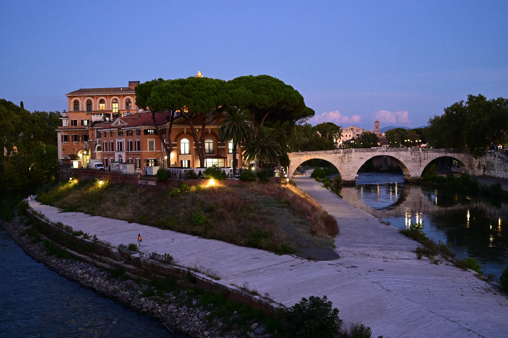
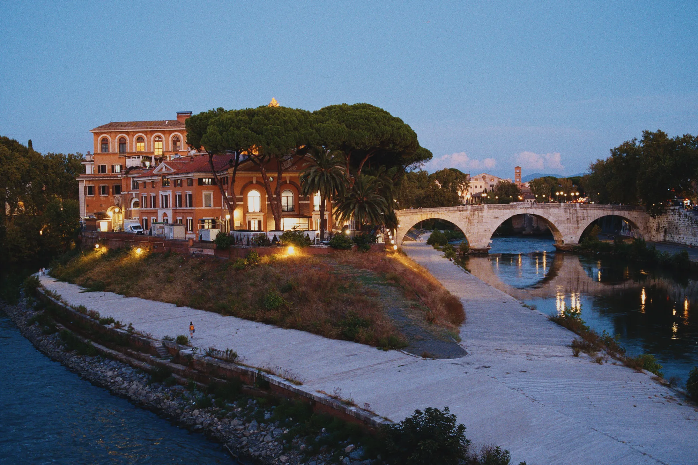
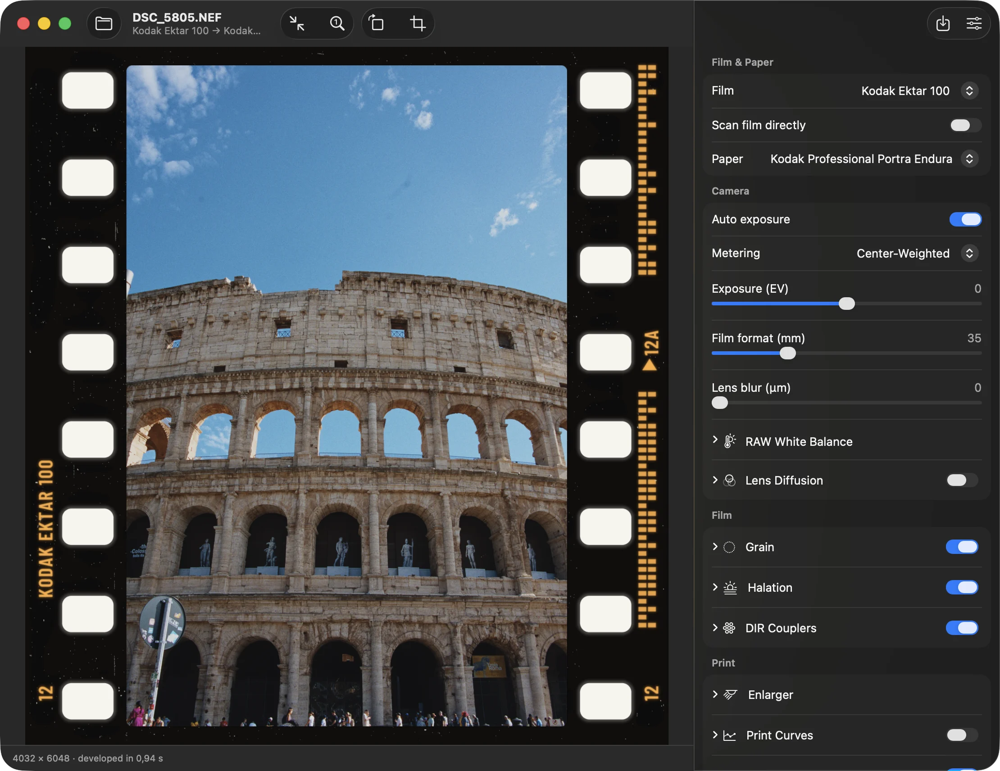
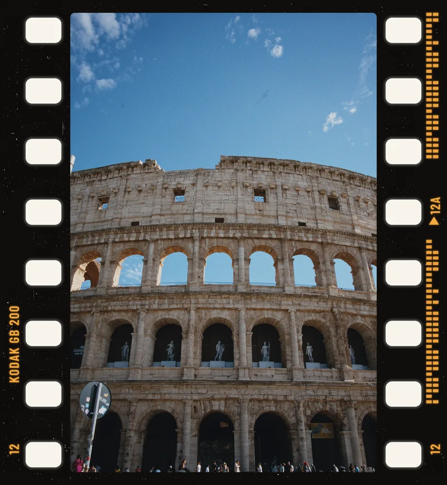

# Negs

**Your photos, developed on film.**

Negs is a free Mac app that runs your pictures through a physical simulation of film: the dyes, the print paper, the glow around highlights, the grain. They come out looking shot on film, not filtered to look like it.

Negs is built on two open-source projects: Andrea Volpato's [spektrafilm](https://github.com/andreavolpato/spektrafilm), the spectral film simulation behind every stock, and turbasvin's [spektrafilm-rs](https://github.com/turbasvin/spektrafilm-rs), the Rust port that runs it on the GPU. Negs improves on both, with a GPU preview that matches the reference render, Apple's RAW decoder, faster exports and lab-style borders, and wraps it all in a native macOS app.

**[Download for Mac](https://github.com/noahhaasis/negs/releases)** · macOS 14 or later · Apple silicon

| RAW · Apple default | Negs · Kodak Ektar 100 |
|---|---|
|  |  |

## A darkroom in a window

Pick a film, pick a paper, drag a slider, and watch the picture change as you move.

- Opens RAW files from most cameras, including Nikon HE★ and 60 MP medium format, plus JPEG, TIFF and PNG
- Crop, straighten, and add borders with each stock's real edge print
- Undo, keyboard shortcuts, pinch to zoom: it behaves like a Mac app
- Exports PNG, TIFF or JPEG and keeps your camera's EXIF
- 60 fps live preview while you drag a slider, and what you see in the preview is what you export

## Chemistry, not a filter

Negs doesn't guess what film looks like. It follows the light through the whole chain (film, enlarger, paper, scanner) using the published data for each stock.

- **Colour from the spectrum.** Your photo is turned back into light, exposed onto the film's three dye layers, printed onto paper and scanned. Colours shift the way they did on the real stock, because the same thing happens to them.
- **Halation.** Bright lights bleed a warm red glow, the way light bounces back through real film. Street lamps, sun on chrome, candle flames.
- **Grain that lives in the image.** Grain is simulated in each dye layer from how dense the film is at that spot. It sits inside the picture instead of being laid on top.
- **The developer's bite.** Development chemistry sharpens edges and deepens colour where tones meet, giving the crispness film has and digital lacks.
- **Paper matters.** The print paper changes the look as much as the film does, just like in a real lab.
- **Print it, or scan it.** Print the negative onto paper for the classic lab look, or skip the paper and scan the film directly.

### Why not a LUT?

A LUT looks at each pixel on its own and swaps its colour. Real film doesn't work like that: light spreads through the emulsion, highlights glow, grain follows exposure and neighbouring tones pull on each other. Negs simulates all of it, so the look holds up where LUTs fall apart: skin, neon, deep shadows, bright skies.

## Borders

Finish with a clean white border, a thin keyline, a black film edge, or the full 35mm frame, sprocket holes and all, printed with the stock's own edge markings.

## Your film shelf

| | |
|---|---|
| **Colour negative** | Portra 160, Portra 400, Portra 800 (+1, +2), Ektar 100, Gold 200, Ultramax 400, Fujicolor C200, Pro 400H, Superia X-TRA 400 |
| **Slide** | Ektachrome 100, Kodachrome 64, Velvia 100, Provia 100F |
| **Motion picture** | Vision3 50D, Vision3 250D, Vision3 200T, Vision3 500T, Verita 200D |
| **Black & white** | Tri-X 400 *(experimental)*, Double-X 5222 *(experimental)* |
| **Papers & print film** | Portra Endura, Endura Premier, Supra Endura, Ultra Endura, Ektacolor Edge, Crystal Archive II, Ilford Multigrade RC, Vision 2383, Vision 2393 |

Kodak, Fujifilm and Ilford stock names are trademarks of their owners. Negs is not affiliated with them.

## Install

1. **Download** the `.dmg` from the [latest release](https://github.com/noahhaasis/negs/releases).
2. **Drag to Applications.** Open the `.dmg` and drag **Negs** into the **Applications** folder.
3. **Open it once.** Double-click Negs. macOS says it can't verify the app and won't open it. Click **Done** (not *Move to Trash*).
4. **Allow it in Settings.** Go to **System Settings → Privacy & Security**, scroll down and click **Open Anyway** next to the message about Negs. Enter your password, then click **Open**.

Why the extra step? Negs isn't notarized by Apple, which needs a paid developer account, so macOS asks you to allow it yourself the first time.

Negs updates itself: use **Negs → Check for Updates…**, or turn automatic checks on or off in Settings.

### Handy shortcuts

| | |
|---|---|
| Open a photo | ⌘O |
| Export | ⇧⌘E |
| Save the preview | ⌘S |
| Rotate | ⌘R |
| Fit / actual size | ⌘0 / ⌘1 |
| Show or hide adjustments | ⌥⌘I |
| Show the original while held | \ |

Pinch to zoom, scroll or drag to pan, double-click to fit.

## Questions

**Is Negs free?**
Yes. It's free to download and open source under the GPL-3.0 (see [License](#license)).

**macOS says Negs can't be opened. Is it safe?**
macOS shows that warning for every app that isn't notarized by Apple. Negs isn't, because notarizing needs a paid developer account. All of the source code is in this repository for anyone to check. Follow the [install steps](#install): you only need to allow it once.

**Which files can I open?**
RAW files from most cameras (through Apple's own RAW support), plus JPEG, TIFF and PNG.

**Does it run on Intel Macs?**
No. Negs needs a Mac with Apple silicon (M1 or later).

**Is this a preset pack?**
No. Presets and LUTs remap colours. Negs simulates the film, the paper and the light, which is why halation, grain and edge effects come out right.

**Windows or Linux?**
Not yet, but they will follow.

**Found a bug or have an idea?**
[Open an issue](https://github.com/noahhaasis/negs/issues).

## Credits

The film model at the heart of Negs comes from two open-source projects. Negs builds a fast, native Mac app on top of them.

- **[spektrafilm](https://github.com/andreavolpato/spektrafilm)** by Andrea Volpato: the spectral simulation of film and print. The physics and the stock data come from here.
- **[spektrafilm-rs](https://github.com/turbasvin/spektrafilm-rs)** by turbasvin: the Rust port of spektrafilm that Negs started from.

The spectral-upsampling tables are by [Johannes Hanatos](https://github.com/hanatos), author of [vkdt](https://github.com/hanatos/vkdt). Parts of the maths are ported from numpy, scipy, scikit-image and colour-science. RAW files Apple can't read are decoded with [rawler](https://github.com/dnglab/dnglab), and updates are delivered with [Sparkle](https://sparkle-project.org).

## License

Negs is free software under the **GNU General Public License, version 3** ([full text](LICENSE)), the same license as spektrafilm and spektrafilm-rs, which it builds on.

That means you can use Negs for anything, including commercial work. The photos you make with it are yours, and the license puts no conditions on them. You may also share and modify the app. If you distribute it, modified or not, you must pass on the same freedoms: release it under the GPL-3.0 and make the source code available.

- Copyright © Andrea Volpato (spektrafilm)
- Copyright © turbasvin (spektrafilm-rs)
- Copyright © 2026 Noah Haasis (Negs: the Mac app and the changes to the engine)

Third-party components keep their own licenses. Sparkle, the update framework bundled in the Mac app, is under the MIT license.

## For developers

Building from source, the command-line tools, accuracy against the original Python project, and how the code is laid out: see [docs/development.md](docs/development.md).
