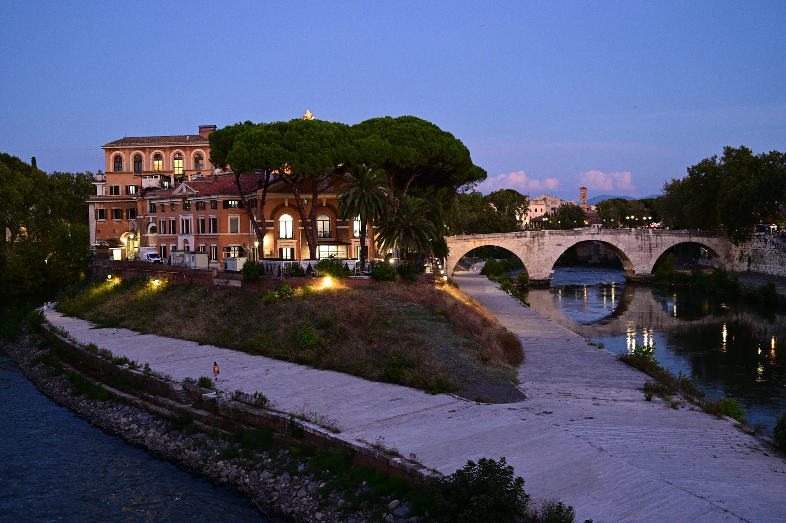
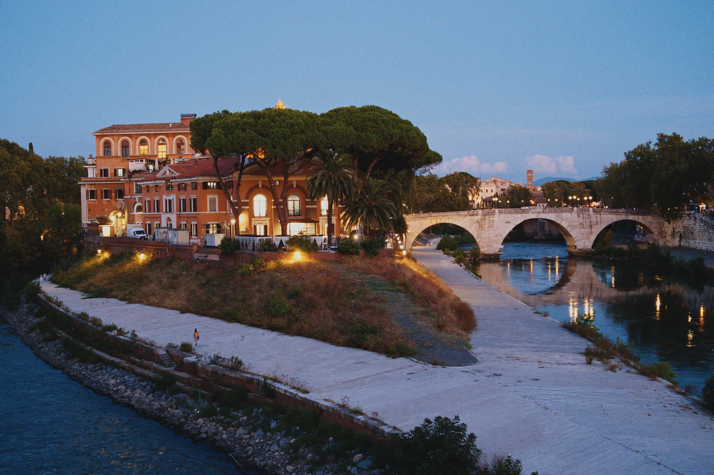
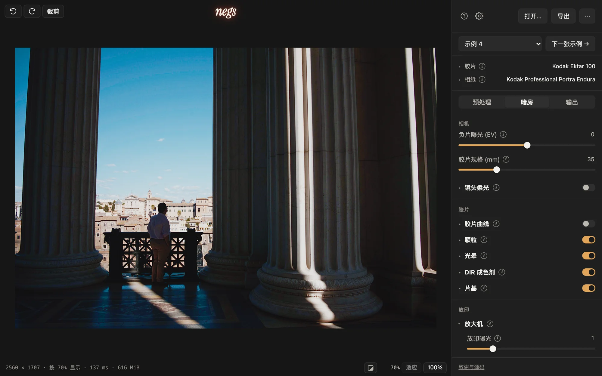
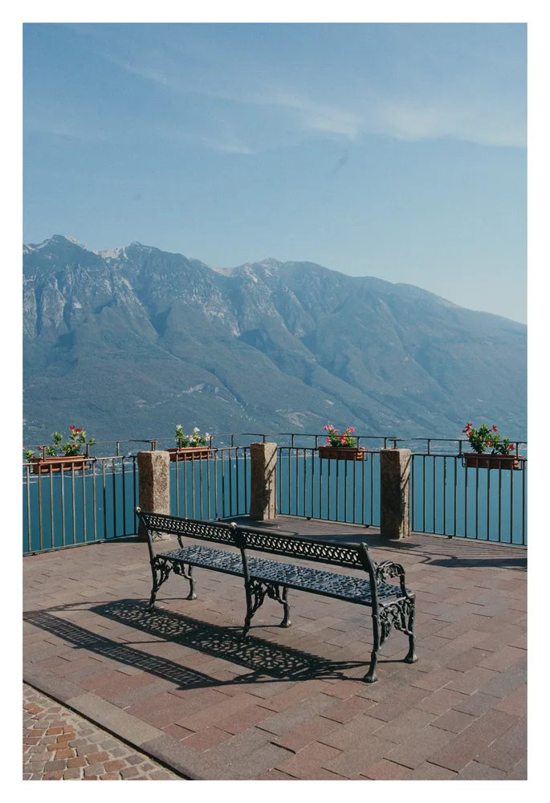
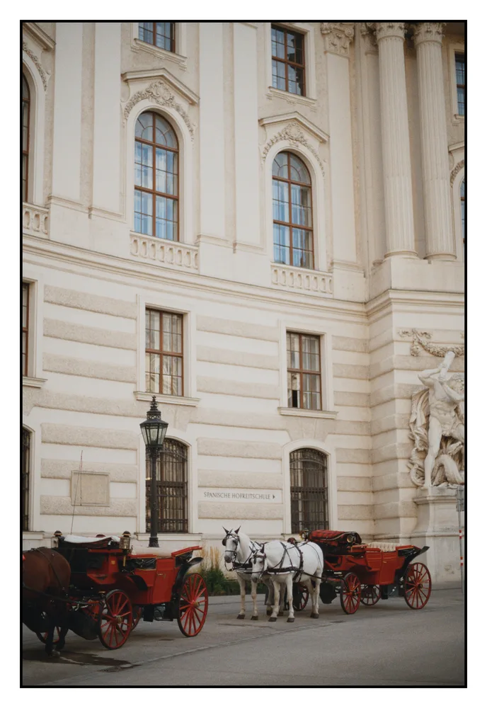
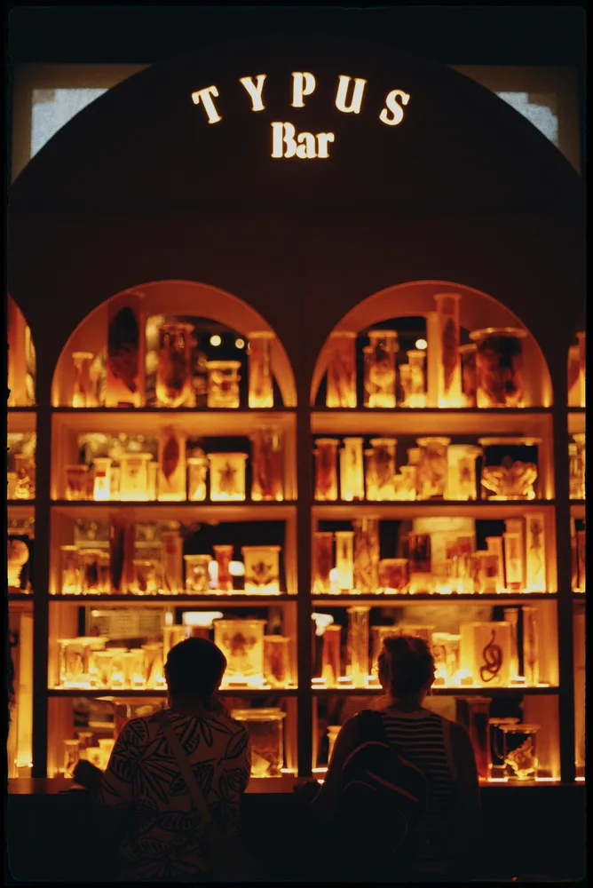
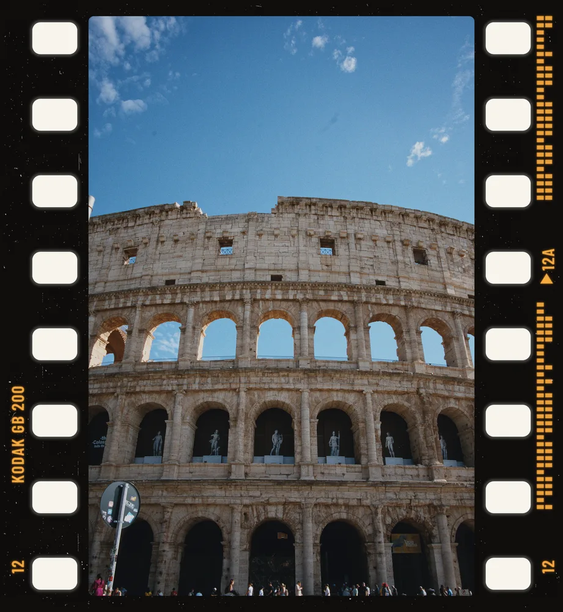
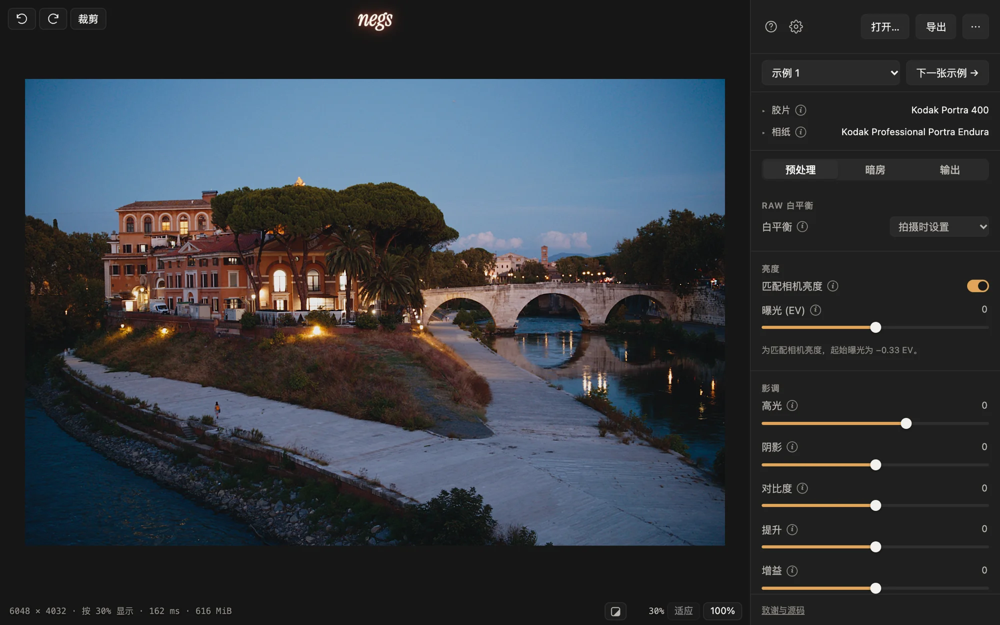
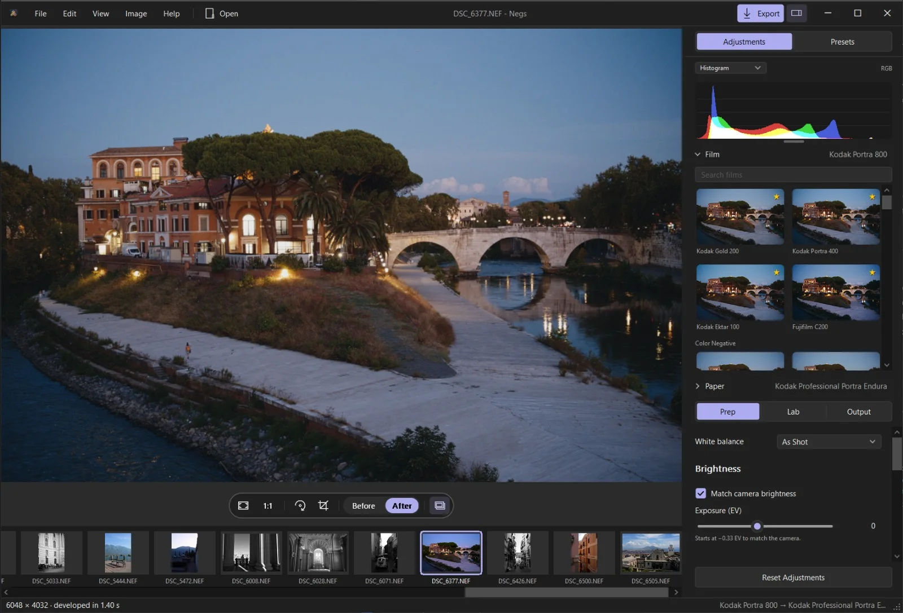
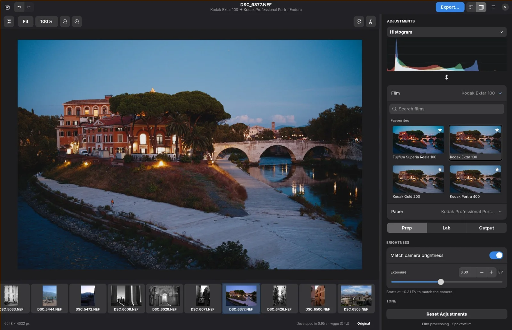

# Negs

[English](README.md) · **简体中文**

[](https://github.com/noahhaasis/negs/releases)

**将你的照片，盛于胶片之上**

Negs 是一款**免费**的照片应用，支持浏览器、Mac、Windows 和 Linux。告别千篇一律的数码滤镜。它通过物理级模拟，逐一还原胶片的染料显色、相纸质感、高光光晕与细腻颗粒，让每张照片都拥有真实的胶片呼吸感。

Negs 建立在两个开源项目之上：Andrea Volpato 的 [spektrafilm](https://github.com/andreavolpato/spektrafilm)——每种胶片背后的光谱胶片模拟，和 turbasvin 的 [spektrafilm-rs](https://github.com/turbasvin/spektrafilm-rs)——让它在 GPU 上运行的 Rust 移植版。Negs 在两者基础上做了改进：GPU 引擎如今与 64 位参考渲染足够接近，导出默认直接走 GPU，快上数倍；还加入了 Apple 的 RAW 解码器和暗房式边框。

> [!TIP]
**实时的胶片模拟** 拖动滑块，画面实时响应。速度远超 spektrafilm-rs 及 Python 版本。

**[▶ 在浏览器里试试](https://getnegs.com/try/)** · 无需安装 · 所有处理均在本地完成，照片不会被上传。

**[Mac 版下载](https://github.com/noahhaasis/negs/releases/download/v0.15.0/Negs-0.15.0-macos-universal.dmg)** · macOS 14 及以上 · Apple 芯片与 Intel 通用 · [安装步骤](#macos-暂无中文版本)

**[Windows 版下载](https://github.com/noahhaasis/negs/releases/download/v0.15.0/Negs-0.15.0-windows-x64-Setup.exe)** · Windows x64 · [便携版](https://github.com/noahhaasis/negs/releases/download/v0.15.0/Negs-0.15.0-windows-x64-portable.zip) · [安装步骤](#windows-暂无中文版本)

**Linux** · x86_64 · [Flatpak](https://github.com/noahhaasis/negs/releases/download/v0.15.0/negs-0.15.0-linux-x86_64.flatpak) · [AppImage](https://github.com/noahhaasis/negs/releases/download/v0.15.0/Negs-0.15.0-x86_64.AppImage) · [Arch 与 Omarchy](#arch-与-omarchy) · [安装步骤](#linux-暂无中文版本)

[getnegs.com](https://getnegs.com)

| RAW · Apple 默认显影 | Negs · Kodak Ektar 100 |
|---|---|
|  |  |

## 暗房



挑一款胶片，配一张相纸，拨动滑块，即可实时见证光影流转。

**打开与整理**
- 打开大多数相机的 RAW 文件——包括 Nikon HE★（仅 Mac）和 6000 万像素中画幅——以及 JPEG、TIFF 和 PNG，并读取 JPEG、PNG、TIFF 的色彩描述文件
- **图库（Mac）：** 直接打开本地文件夹开始选片，省去导入等待。支持网格与胶片条双视图浏览，星标、旗标筛选；每张缩略图都是显影后的最终效果，告别灰蒙蒙的 RAW 原片。所有评分与调整均独立保存在原图旁的附属文件中，导出时自动将星级写入 xmp:Rating，无缝衔接 Bridge 与 Photo Mechanic 工作流。
- 按评分、筛选结果或选区一次批量导出（Mac）

**显影**
- 内置近 60 款经典胶片与相纸预设，点击即可在原图上实时预览效果。
- **预处理：** 高光、阴影、对比度、暗部与亮部映射、自然饱和度、饱和度及中间调细节调节。匹配相机亮度（让 RAW 初始画面与相机屏幕曝光保持一致）
- Mac、Windows 和 Linux 应用中的**镜头校正**：依据文件内的数据修正畸变、暗角和色差；Mac 用 Apple 的解码器，Windows 和 Linux 用 Sony、Fujifilm、OM/Olympus、Panasonic 和 DNG 自带的校正数据
- RAW 白平衡：拍摄时设置、日光、钨丝灯，或自定义色温与色调
- 图像大小在胶片*之前*放大照片，颗粒和光晕按放印尺寸生成，而不是事后拉伸
- 裁剪、校正，加上带每种胶片真实边缘印字的边框
- 存储、应用和分享胶片与暗房预设，包括 Python 版 spektrafilm 的社区预设
- 撤销、快捷键、双指缩放：在 Mac、Windows 和 Linux 上都像原生应用一样顺手

**导出**
- PNG、TIFF 或 JPEG（带质量滑块），保留相机的 EXIF，每通道 8 或 16 位，支持 sRGB、Display P3、Adobe RGB 或 ProPhoto RGB（仅 16 位），内嵌 ICC 描述文件
- GPU 快速导出，或 CPU 上的 64 位参考导出，见[速度](#速度)
- 在所有平台上，通过 文件 → 导出 LUT… 把当前胶片与相纸的色彩导出为 33³ sRGB 的 `.cube` LUT。不需要照片（不包括空间效果和后期编辑）
- 拖动滑块时实时预览，预览所见即导出所得
- 网页应用支持英文和中文（简体中文）

https://github.com/user-attachments/assets/25c00097-e668-48b2-8903-3299668b538e


## 拒绝数码滤镜，还原光学化学本质

Negs 基于每款胶片的公开特性数据，精准重建光线穿过底片、放大机、相纸直至扫描仪的完整光学链路。

- **源自真实光谱的色彩** 你的照片首先被还原为物理光线，依次投射至胶片的三层感光染料，经相纸放印与扫描仪采样后成像。色彩偏移就像真实胶片经历了完全相同的物理过程。
- **真实物理光** 强光处会自然晕开一圈温暖的红芒，精确复现光线穿透片基后在背层反射的光学现象——比如夜色中的街灯、镀铬金属上的日照反光。
- **原生感胶片颗粒** 针对不同染料层与局部影调密度逐点生成，让颗粒真正融入像素结构，彻底告别浮于画面表层的贴图式噪点。
- **显影的边缘锐度** 模拟显影液在明暗交界处的化学反应，微妙强化边缘反差与色彩密度——还原胶片独有锐度。
- **相纸同样决定成片质感** 和真实暗房一样，相纸对最终观感的影响也很重要。
- **暗房放印，或底片直扫** 把负片放印到相纸上得到经典暗房观感，或跳过相纸直接进行胶片扫描输出。

### 为什么不用 LUT？

LUT 的本质是机械地替换色值，但真实胶片是连续的物理系统： 光在乳剂内散射、高光自然溢出、颗粒随密度演变、相邻色彩相互影响。Negs 完整重建了这些空间与化学耦合。于是，在肤色过渡、霓虹高光、极暗阴影与高光天空等 LUT 最易“翻车”的极端区域，Negs 依然游刃有余。

## 边框

为成片配上恰到好处的画框收尾：可自由定制颜色与宽度的纯色留白、极简细线框、经典的暗房黑边，或完整的 35mm 全画幅底片边框

| 白边框 | 细线框 | 胶片框 | 35mm 画幅 |
|---|---|---|---|
|  |  |  |  |

## 速度

拖动滑块时按屏幕分辨率实时渲染，松手后，GPU 以全分辨率重新渲染照片真实比例的颗粒与光晕。快速导出保存的就是这帧全尺寸画面，所以导出不花额外时间。

下表是 MacBook Pro（M1 Pro、32 GB）上的渲染时间对比：每个应用处理同一张照片（Kodak Gold 200 放印在 Portra Endura 上），全分辨率显影。内存为各程序的峰值。

| | Nikon Z 6 · 24 MP | Leica Q3 · 60 MP |
|---|---:|---:|
| **Negs，全分辨率渲染（GPU）** | **0.9 秒 · 2.1 GB** | **2.1 秒 · 5.0 GB** |
| spektrafilm-rs（GPU） | 1.3 秒 · 3.6 GB | 4.1 秒 · 8.9 GB |
| **Negs，参考导出（CPU，64 位）** | **13.2 秒 · 7.1 GB** | **35.3 秒 · 13.9 GB** |
| Negs，参考导出 + *使用更少内存* | 37.5 秒 · 3.9 GB | 99.2 秒 · 9.7 GB |
| Negs（CPU，64 位，LUT） | 8.8 秒 · 5.1 GB | 24.1 秒 · 10.7 GB |
| spektrafilm-rs（CPU，64 位，LUT） | 9.7 秒 · 7.5 GB | 25.9 秒 · 17.2 GB |
| Python spektrafilm（CPU，64 位，LUT） | 43.4 秒 · 13.7 GB | 107.6 秒 · 27.8 GB* |

\* 超出了 32 GB 内存加 macOS 之和：向磁盘交换了最多 7 GB。

Negs 的参考导出为每个像素计算完整光谱。spektrafilm-rs 和 Python 版用小型查找表（LUT）加速其中两个光谱步骤（放大机和扫描仪），更快但有近似。这些不是"胶片感 LUT"：颗粒、光晕和胶片的其余部分仍是模拟的。LUT 那两行是让 Negs 用同样的查找表做同口径对比；应用本身不按该方式导出。

**使用更少内存**（扫描与色彩 → 输出）面向内存较小的 Mac 上大照片的参考导出。如果导出会占满内存拖慢整台机器，打开时画面不受影响，但是导出可能会稍久。

方法、版本与复现：[基准测试](docs/benchmarks.md)。

## 你的胶片架

| | |
|---|---|
| **彩色负片** | Portra 160、Portra 400、Portra 800（+1、+2）、Ektar 100、Gold 200、Ultramax 400、Fujicolor C200、Pro 400H、Pro 160NS、Superia 200 *（近似）*、Superia X-TRA 400、Superia Reala 100、Kodacolor 100、Aerocolor IV 2460、CineStill 800T、CineStill 400D *（近似）*、Lomography Color 100 *（近似）*、Harman Phoenix 200 *（近似）*、LomoChrome Metropolis *（近似）*、LomoChrome Turquoise *（近似）* |
| **反转片** | Ektachrome 100、Kodachrome 25、Kodachrome 64、Kodachrome 200、Velvia 50、Velvia 100、Provia 100F、Astia 100F、Agfachrome 50、Agfachrome 100、Agfachrome 200 |
| **电影胶片** | Vision3 50D、Vision3 250D、Vision3 200T、Vision3 500T、Verita 200D、Eterna 500、Eterna Vivid 500、F-64D、Reala 500D |
| **红外** | Aerochrome III 1443 *（近似）*、Infrared Color *（创意）* |
| **黑白** | Tri-X 400 *（实验性）*、Double-X 5222 *（实验性）*、HP5 Plus、FP4 Plus、Delta 3200、T-MAX 100、Acros 100 II |
| **相纸与印片胶片** | Portra Endura、Endura Premier、Supra Endura、Ultra Endura、Ektacolor Edge、Crystal Archive II、Ilford Multigrade RC、Vision 2383、Vision 2393 |

Kodak、Fujifilm、Ilford、Agfa、Harman、Lomography 和 CineStill 的胶片名称是其所有者的商标。Negs 与它们没有从属关系。

## 安装

### 在浏览器里 (支持简体中文)

无需安装：用任何较新的浏览器打开 **[getnegs.com/try](https://getnegs.com/try/)**。Negs 完全在你的设备上运行，浏览器支持时通过 WebGPU 使用 GPU，照片永远不会被上传。

[](https://getnegs.com/try/)

### macOS (暂无中文版本)

首次打开 Negs 时，macOS 会要求你在系统设置中允许它：

1. **下载** 最新 [release](https://github.com/noahhaasis/negs/releases) 中的 `.dmg`。
2. **拖进应用程序。** 打开 `.dmg`，把 **Negs** 拖入 **Applications** 文件夹。
3. **打开一次。** 双击 Negs。macOS 提示无法验证该应用、不能打开。点**完成**（不要点*移到废纸篓*）。
4. **在设置中允许。** 打开 **系统设置 → 隐私与安全性**，滚动找到关于 Negs 的提示，点**仍要打开**。输入密码后再点**打开**。

为什么多这一步？Negs 没有经过 Apple 公证——那需要付费开发者账号——所以 macOS 请你第一次亲自允许它。

Negs 更新：用 **Negs → 检查更新…**，或在设置中开关自动检查。

### Windows (暂无中文版本)

原生 Windows 应用，与 Mac 版同一个胶片引擎：GPU 预览、裁剪与校正工具、边框，以及快速或参考导出。



1. **下载** [`Negs-0.15.0-windows-x64-Setup.exe`](https://github.com/noahhaasis/negs/releases/download/v0.15.0/Negs-0.15.0-windows-x64-Setup.exe) 并运行安装，并把 Negs 加入**打开方式**，不会更改你的默认照片应用。
2. **如果 Windows SmartScreen 警告**，点**更多信息 → 仍要运行**。Negs 没有代码签名——那需要付费证书。

不想用安装器？解压 [`Negs-0.15.0-windows-x64-portable.zip`](https://github.com/noahhaasis/negs/releases/download/v0.15.0/Negs-0.15.0-windows-x64-portable.zip) 并运行 `Negs.exe`。

Windows 版本暂时没有自动更新：从 [releases 页面](https://github.com/noahhaasis/negs/releases)下载新版安装器，在旧版上运行即可。编辑面板和胶片条默认开启，使用中可用 F7/F6 切换。

Windows 包可以用 [`windows/package.ps1`](windows/package.ps1) 从源码构建；见 [Windows 构建说明](docs/windows-app.md)与[验证状态](docs/windows-ui-validation.md)。

### Linux (暂无中文版本)



原生 GTK4 应用，同一个胶片引擎，x86_64。有三种安装方式；都需要 Vulkan 驱动来加速 GPU（没有时引擎回退到 CPU）。

**Flatpak**，适用于任何装有 [Flatpak](https://flatpak.org/setup/) 的发行版。下载 [`negs-0.15.0-linux-x86_64.flatpak`](https://github.com/noahhaasis/negs/releases/download/v0.15.0/negs-0.15.0-linux-x86_64.flatpak) 并安装：

```sh
flatpak install --user negs-0.15.0-linux-x86_64.flatpak
```

如果没有 GNOME 运行时，Flatpak 会从 Flathub 获取。Negs 在沙箱中运行：它只能看到你打开的照片和文件夹，别无其他。用**打开文件夹…**可在胶片条里浏览整个文件夹。更新时以同样方式安装新的包。

**AppImage**，单个文件，在 Ubuntu 24.04 及以上、当前版 Fedora、Arch 及类似发行版上直接运行，无需安装：

```sh
chmod +x Negs-0.15.0-x86_64.AppImage
./Negs-0.15.0-x86_64.AppImage
```

下载 [`Negs-0.15.0-x86_64.AppImage`](https://github.com/noahhaasis/negs/releases/download/v0.15.0/Negs-0.15.0-x86_64.AppImage)。如果系统没有 FUSE，用 `--appimage-extract-and-run` 运行。更新时下载新的 AppImage。两种方式的设置和预设都保存在 `~/.config/negs`。

AppImage 在可用时优先使用 X11/XWayland，以避开某些 Wayland 桌面上报告的 GTK 崩溃。若仍要用原生 Wayland，以 `GDK_BACKEND=wayland` 运行。

Flatpak 的设置和预设单独保存在 `~/.var/app/io.github.noahhaasis.negs`。在一种版本中导出预设、在另一种中导入即可迁移。[Linux Flatpak 与 AppImage](docs/linux-distribution.md) 讲两者的构建与测试。

#### Arch 与 Omarchy

在 x86_64 的 Arch Linux 和 Omarchy 上，还可以用一条命令为你的用户安装原生包（无需 root）：

```sh
curl -fsSL https://raw.githubusercontent.com/noahhaasis/negs/main/linux/get-negs.sh | sh
```

它会下载最新 release、校验 SHA-256，并安装到 `~/.local` 下。它面向滚动发行版：release 需要相当新的 glibc（2.44），在 Ubuntu LTS、Debian stable 或自带旧版 glibc 的 Fedora 上无法运行，那些发行版请用 Flatpak 或 AppImage。想先看看再执行的话，[脚本](linux/get-negs.sh)很短。这个用户级包内置 OpenBLAS。Negs 需要 GTK 4.16+、libadwaita 1.6+ 和 GPU 的 Vulkan 驱动（没有时引擎回退到 CPU）。Omarchy 上通常都有；其他发行版：

```sh
sudo pacman -S --needed gtk4 libadwaita vulkan-icd-loader
```

运行 `negs`（若 `~/.local/bin` 不在 `PATH` 中则运行 `~/.local/bin/negs`），或从启动器打开。更新时重跑该命令；卸载用 `python3 ~/.local/share/negs/install.py --uninstall`。你的设置和照片会保留。

### 常用快捷键

| | Mac | Windows 与 Linux |
|---|---|---|
| 打开照片 | ⌘O | Ctrl+O |
| 导出 | ⇧⌘E | Ctrl+Shift+E |
| 存储预览 | ⌘S | Ctrl+S |
| 旋转 | ⌘R | Ctrl+R |
| 适应 / 实际大小 | ⌘0 / ⌘1 | Ctrl+0 / Ctrl+1 |
| 显示或隐藏调整 | ⌥⌘I | F7 |
| 按住时显示原图 | \ | O 或 \ |

双指缩放，滚动或拖动平移，双击适应窗口。

## 常见问题

**Negs 是免费的吗？**
是。免费下载，开源，GPL-3.0 许可（见[许可](#许可)）。

**macOS 说 Negs 无法打开，它安全吗？**
每个未经 Apple 公证的应用都会触发这个提示。Negs 没有公证，因为公证需要付费开发者账号。全部源代码都在本仓库中，任何人都可以检查。按[安装步骤](#macos-暂无中文版本)操作：只需要首次打开选择允许就可以。

**能打开哪些文件？**
大多数相机的 RAW，以及 JPEG、TIFF 和 PNG。Mac 版使用 Apple 的 RAW 支持，rawl​er 兜底；Windows 和 Linux 版用 rawler 解码 RAW。

**Negs 会正确识别并保留照片的色彩配置文件吗？**
会的。对于 JPEG、PNG 和 TIFF 文件，Negs 会自动读取其内嵌的 ICC 配置文件或色彩标签（未标记的文件默认按 sRGB 处理）；而 RAW 文件中超出 sRGB 色域的宽广色彩也会被完整保留。画面预览直接基于你设定的目标导出色彩空间进行显影——因此，只要使用广色域显示器，你在编辑时所见的就是原汁原味的 Display P3 或 Adobe RGB 色彩。
若遇到色彩标签缺失或标记有误的文件，你也可以在「暗房」面板的“输入色彩”选项中手动指定读取方式。不过需要注意的是，JPEG 文件本身已固化了机内预设曲线与后期处理，任何色彩配置文件都无法将其还原；若想让胶片物理模拟发挥最大潜力，依然建议使用 RAW 格式。更多技术细节请参阅色彩管理。[色彩管理](docs/colour-management.md)。

**能在 Intel Mac 上运行吗？**
能，只要是 macOS 14 及以上的 Intel Mac。Negs 是通用应用，在 Intel 和 Apple 芯片上都原生运行。它主要在 Apple 芯片上开发和测试，如果在 Intel Mac 上看到异常，请[开一个 issue](https://github.com/noahhaasis/negs/issues)。

**这是一个滤镜预设包吗？**
不是。传统预设和 LUT 的本质只是色彩映射；而 Negs 完整模拟了胶片、相纸与光线的物理反应.正因如此，它的高光光晕、胶片颗粒与显影边缘效应才能如此真实自然。

**支持哪些平台？**
Web 浏览器：访问 [getnegs.com/try](https://getnegs.com/try/) 即可使用（支持所有现代浏览器）。无需安装，且所有照片均在本地处理，不会被上传。
桌面端应用：
macOS：支持 macOS 14 及以上版本（同时兼容 Apple Silicon 与 Intel 芯片），提供独立 [Mac 客户端](#macos-暂无中文版本)。
Windows：支持 Windows x64，提供标准安装版与免安装便携版 [Windows 客户端](#windows-暂无中文版本)。
Linux：支持 x86_64 架构，提供原生 GTK4 应用，支持 Flatpak、AppImage 及 Arch 软件包（详见[Linux 安装指南](#linux-暂无中文版本)）。

**发现 bug 或有好想法？**
[开一个 issue](https://github.com/noahhaasis/negs/issues)。

## 致谢

Negs 核心的胶片模型来自两个开源项目。Negs 在其上构建了快速应用：浏览器里一个，Mac、Windows、Linux 原生各一个。

- **[spektrafilm](https://github.com/andreavolpato/spektrafilm)**，Andrea Volpato 出品：胶片与放印的光谱模拟。物理和胶片数据都来自这里。
- **[spektrafilm-rs](https://github.com/turbasvin/spektrafilm-rs)**，turbasvin 出品：Negs 起步所基于的 spektrafilm Rust 移植版。

默认的光谱上采样表来自 [vkdt](https://github.com/hanatos/vkdt) 的作者 [Johannes Hanatos](https://github.com/hanatos)。可选的 Arctic 2026 表来自 Andrea Volpato（spektrafilm），Mallett 2019 表是 spektrafilm 对 Ian Mallett 与 Cem Yuksel（2019）光谱主色分解的表格化。来自 spektrafilm 的档案和表格采用 CC BY-SA 4.0（[许可](data/SPEKTRAFILM_LICENSE.txt)、[变更](data/CHANGELOG.txt)）。另有 29 个胶片档案（24 个彩色、5 个黑白）改编自 MUAStudio Inc. 的 [Fotufilm](https://fotufilm.com)，同样采用 CC BY-SA 4.0（[许可](data/FOTUFILM_LICENSE.txt)、[变更](data/CHANGELOG.txt))。部分数学代码移植自 numpy、scipy、scikit-image 和 colour-science。Apple 读不了的 RAW 用 [rawler](https://github.com/dnglab/dnglab) 解码；Windows 和 Linux 上 Sony、Fujifilm、OM/Olympus 与 Panasonic 的镜头校正移植自 [darktable](https://www.darktable.org) 的内嵌元数据镜头校正；更新由 [Sparkle](https://sparkle-project.org) 递送；Mac 应用的字体排版采用 Production Type 的 [Newsreader](https://github.com/productiontype/Newsreader)。

预处理标签页、相机亮度匹配、RGB 波形和 Apple RAW 9 → 8 回退来自 [yosoyelchris](https://github.com/yosoyelchris) 的 Negs 分支（[详情](docs/prep.md)）。

## 许可

Negs 是**GNU 通用公共许可证第 3 版**下的自由软件（[全文](LICENSE)），与它所基于的 spektrafilm 和 spektrafilm-rs 相同。

这意味着你可以把 Negs 用于任何用途，包括商业作品。你用它做出的照片归你所有，许可证对照片没有任何约束。你也可以分享和修改本应用。如果你分发它,无论是否修改,必须使用同样的许可：以 GPL-3.0 发布并提供源代码。

- Copyright © Andrea Volpato（spektrafilm）
- Copyright © turbasvin（spektrafilm-rs）
- Copyright © 2026 Noah Haasis（Negs：应用与引擎改动）
- Copyright © 2026 yosoyelchris（预处理控件、相机亮度匹配与示波器）

第三方组件保留各自的许可证。Mac 应用内置的更新框架 Sparkle 采用 MIT 许可证；内置字体 Newsreader 采用 SIL Open Font License 1.1（[许可](macos/Fonts/OFL-Newsreader.txt)）。

## 面向开发者

从源码构建、命令行工具、与原 Python 项目的精度对比，以及代码结构：见 [docs/development.md](docs/development.md)（英文）。

### 构建 web 应用

[`web/`](web/) 中的网页应用运行同一个 Rust 胶片引擎的 WebAssembly 编译版，WebGPU 引擎与桌面应用共享着色器。构建方式及与原生渲染的吻合程度见 [docs/web-wasm.md](docs/web-wasm.md)（英文）。

### 构建 Linux 应用

Linux 应用是同一 Rust 胶片引擎上的 GTK4/libadwaita 编辑器。构建运行或打 Arch 包，见 [Linux 构建与安装细节](docs/linux-app.md)与 [AUR/Omarchy 发布清单](docs/linux-release.md)（英文）。
