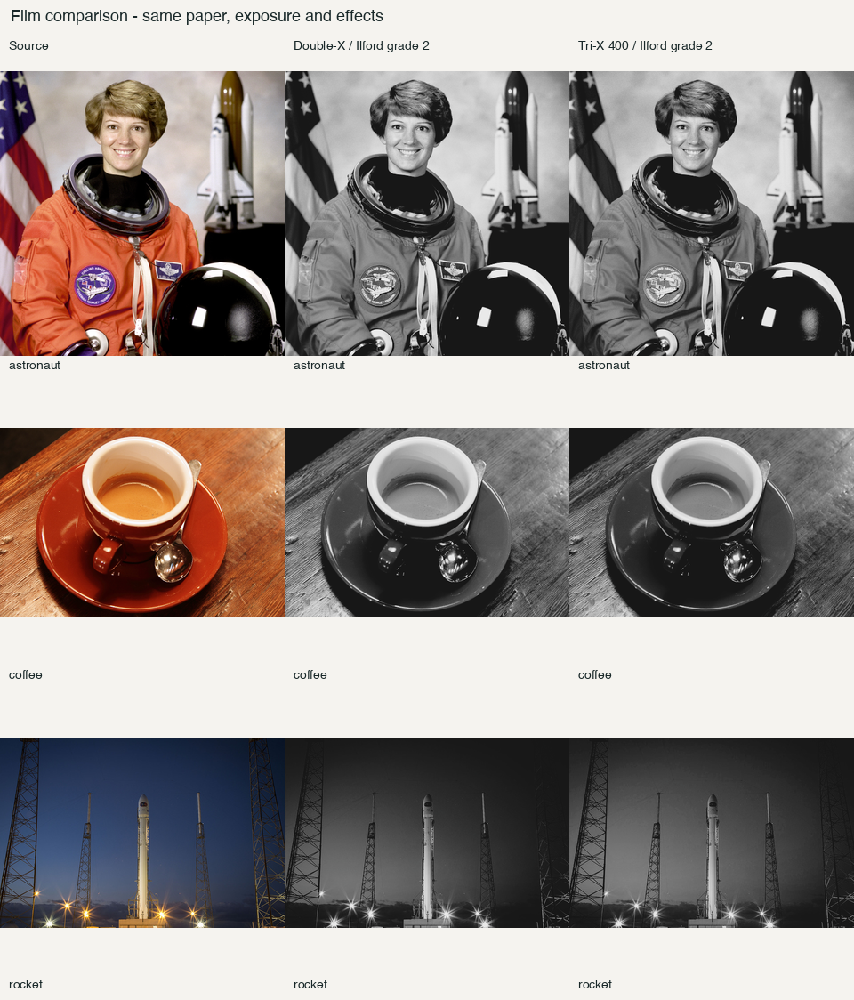
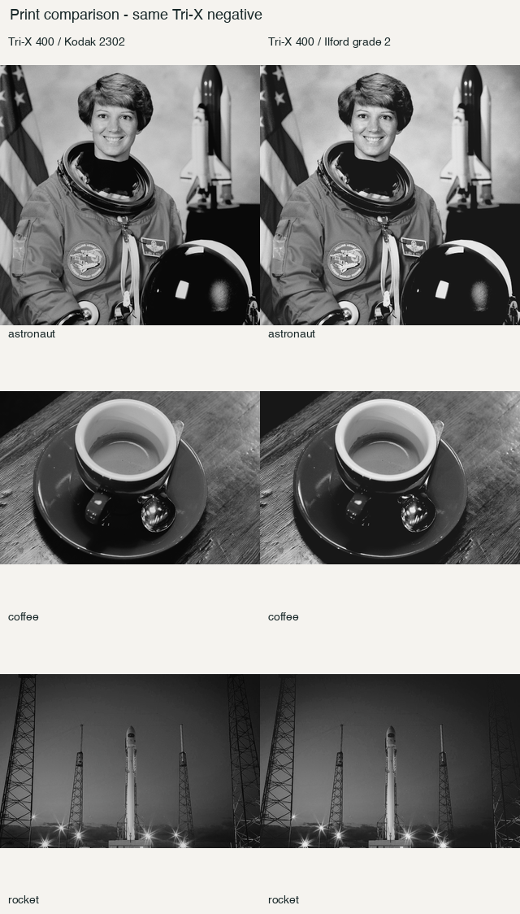
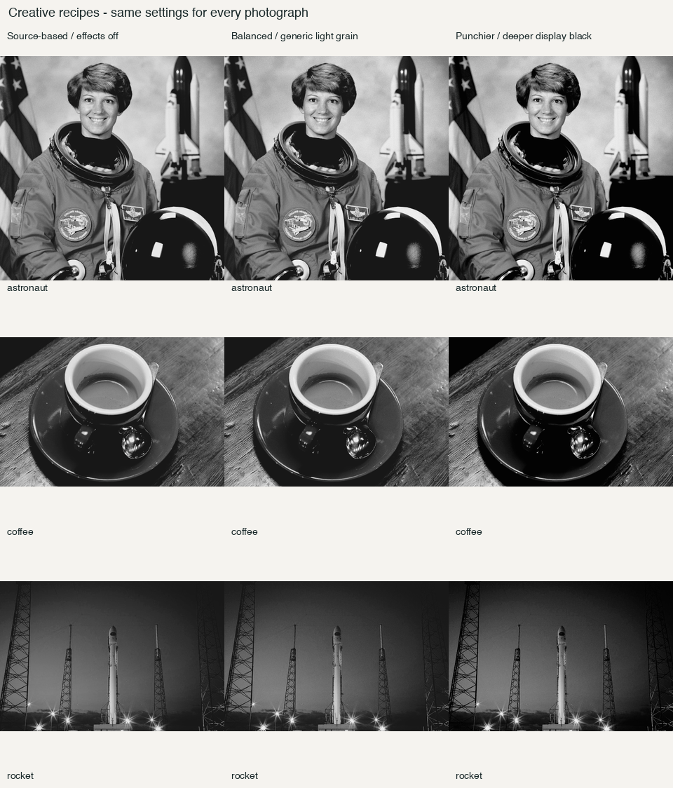
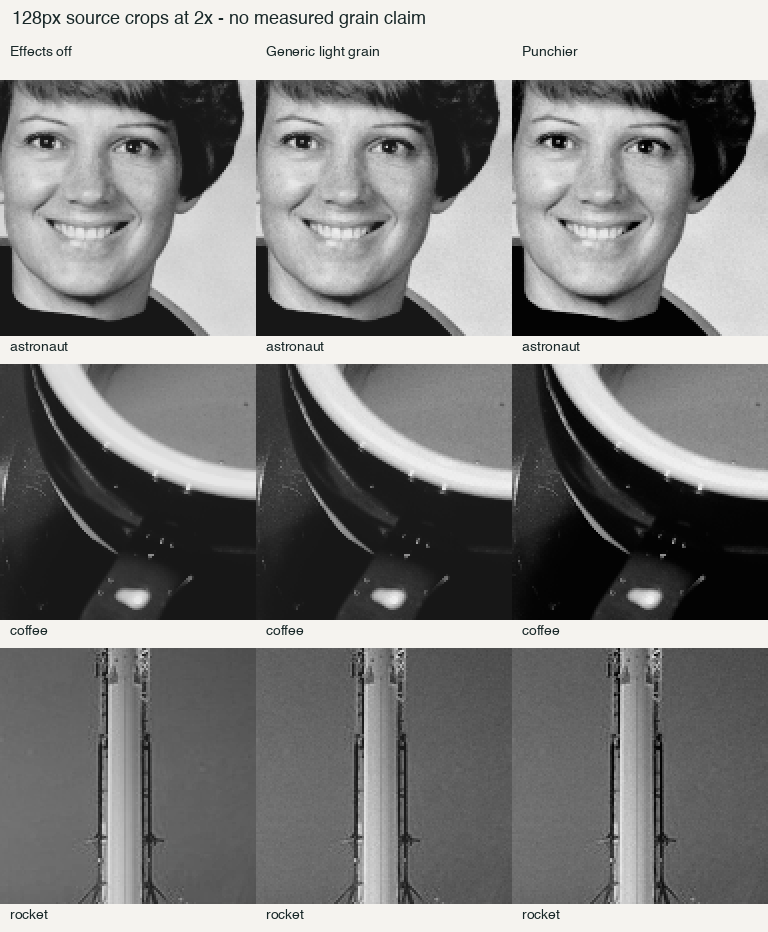
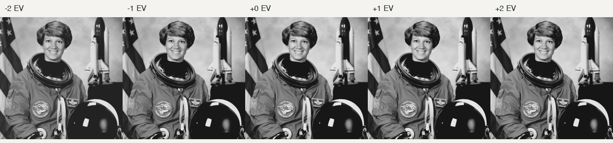
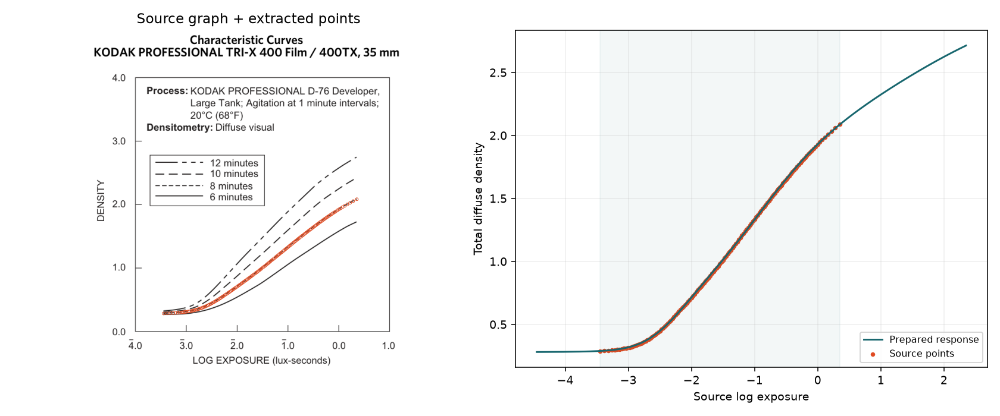
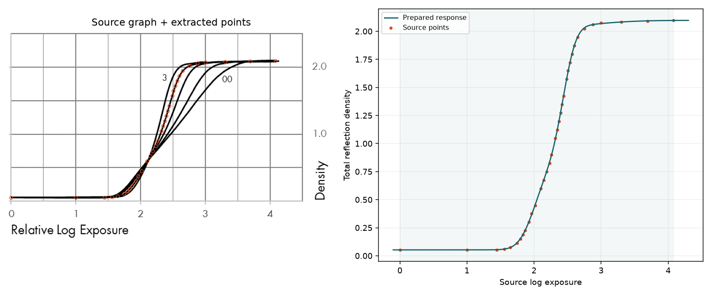
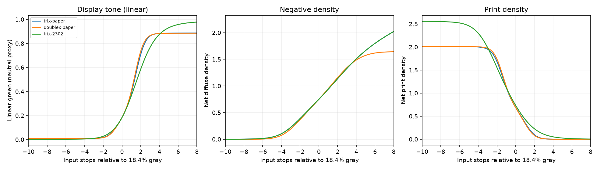

# Tri-X 400 and Ilford paper review — updated 19 October 2026

**Recommendation: try Tri-X 400 with the balanced Ilford Grade 2 recipe.** It gives a useful, restrained B&W result with gentle blacks and preserved detail. Keep the paper labelled experimental until we have measured paper spectra and real print comparisons. The punchier recipe is an optional look, not a more accurate calibration.

| Option | What you will notice | Evidence and limits | Status | Recommendation |
|---|---|---|---|---|
| Tri-X 400 / 400TX, D-76 8 min, 35 mm | A conventional camera negative; modest tonal differences from Double-X in these photos | Kodak processing curve and relative sensitivity; extrapolated extreme highlights, generic texture | Ready to try | Use as the new camera-film option; existing Tri-X 7266 reversal remains separate |
| Tri-X + Ilford Multigrade RC Deluxe, Grade 2 | Gentler black floor and a paper-white plateau; larger visible change than switching films here | Real fifth-generation Ilford reflection-density curve; neutral spectra assumed; fixed grade and normalized neutral-negative printing only | Experimental | Use for local review with the balanced recipe |
| Balanced recipe | Cleaner whites, subtle grain, no added blur | Deliberate scanner white correction and generic grain; not measured Tri-X grain | Ready to try within the paper's experimental scope | Preferred everyday look |
| Punchy recipe | Deeper blacks and stronger contrast; less gradual tonal separation | Creative endpoint correction and density gamma 1.12 | Optional creative variant | Reserve for images that benefit from stronger contrast |

The [candidate app](../dist/spektrafilm-bw-sharing-20261019/Spektrafilm.app) and [ZIP](../dist/spektrafilm-bw-sharing-20261019.zip) are the Apple Silicon macOS sharing build, including the B&W expansion and the generated `KODAK 400TX` label on full-frame and half-frame 35mm borders. Select **Kodak Tri-X 400 / 400TX - D-76, 8 min, 35 mm**; its target print is **Ilford Multigrade RC Deluxe - Grade 2 (experimental neutral)**. The catalogue contains 33 entries. No existing stock has been replaced. The balanced recipe is supplied as reproducible settings below; selecting a film does not automatically apply a new stock-specific texture preset.

The PM is keeping this version and sharing it with friends; detailed feedback is deferred. This Markdown review and its comparisons are retained for that feedback. Run the commands below from the repository root. All nine controlled photograph renders were repeated with the `9579d36` packaged exporter on 19 October and match these figures pixel-for-pixel. The creative grain variants remain the original renders. The subsequent border-only change is commit `aa20096`.

The sharing build’s [package audit](../dist/spektrafilm-bw-sharing-20261019-package-report.json) and [validation files](../dist/spektrafilm-bw-sharing-20261019-validation/) accompany the ZIP. The [full-frame border](../data/borders/35mm/full/kodak_trix400_d76_8min.png) and [half-frame border](../data/borders/35mm/half/kodak_trix400_d76_8min.png) use the same stock table as exports.

**Controlled film comparison.** Same Ilford paper, input, exposure and disabled effects in each column. The portrait remains close across the films; wood, coloured objects and darker tones show modest separation changes. There is no evidence here that one film universally produces better skin tones. Auto exposure is off and no image has its own corrective settings.



**Controlled printing comparison.** Same Tri-X negative and processing settings. Kodak 2302 is motion-picture print film. The Ilford result has a lighter physical black floor and reaches its white plateau sooner in the diagnostic ramp. This makes the printing material a substantial part of the final look. White/black scanner correction is off in this comparison, so the source-based endpoints remain visible.



**Recommended appearance.** Balanced enables scanner white correction and restrained generic grain (particle area 0.12 µm², grain blur 0), leaving black correction off. Punchy also enables black correction and increases print density gamma to 1.12. All other policies are shared across all three photographs. Balanced keeps a gentler transition in the portrait and dark scene; punchy gives the coffee scene more impact but makes tonal transitions less subtle.





Detail crops use 128 source pixels enlarged 2× with nearest-neighbour sampling. The selected zero-blur grain setting preserves detail; grain is deliberately subtle at this scale. This is an appearance judgement, not a measured stock-specific granularity or sharpness claim. Full-resolution PNGs are in [renders](bw-expansion-review/renders/). Photo credits are in [inputs/README.md](bw-expansion-review/inputs/README.md).

The −2 to +2 EV bracket below keeps the engine's print exposure compensation enabled. Overall brightness therefore remains fairly stable; underexposure still loses dark detail. It is not a demonstration of five uncompensated scan brightnesses.



**What is supported.** The film response comes from Kodak's [October 2021 F-4017](https://kodakprofessional.com/sites/default/files/wysiwyg/film/f4017_trix_320400.pdf), p9, with relative spectral shape from p8. The paper uses the NEW Deluxe/Portfolio filter-2 curve in Ilford's [October 2020 RC-paper sheet](https://www.ilfordphoto.com/wp/wp-content/uploads/2021/01/MULTIGRADE-RC-Papers-J20.pdf), p3, developed in Multigrade 1+9 for one minute at 20°C. The [source record](../data/profile-sources/bw-expansion/README.md) explains extraction, conditions and explicit assumptions.





The [spectral overlay](bw-expansion-review/trix400-sensitivity-validation.png) preserves the published solid curve's shape. Maximum source-point density error is 0.004702 for film and 0.016645 for paper, inside tolerances based on graph resolution. Extreme film highlights use an assumed continuation because the published curve has no measured shoulder. Paper white, black and contrast are supported by its plotted reflection curve; paper tint, texture and calibrated sensitivity are not.

For neutral B&W negatives with normalized print exposure, the unknown common spectral weighting cancels. That permits this fixed-grade paper route without pretending to have a calibrated sensitivity spectrum. It does not justify colour-negative printing, absolute paper speed, preflash or adjustable Multigrade filters. The scanner converts total reflection density to reflectance once; a regression specifically checks this and the base-density contribution.



**Checks completed before the border follow-up.** These establish software consistency and usable behaviour; they do not prove an exact film/lab match.

| Check | Result |
|---|---|
| Workspace f32 / f64 on the new base | 157 / 159 passed, zero failures, one existing external-RAW fixture test ignored in each; recorded in the [resume handoff](handoff-bw-expansion-resume.md) |
| Python parity comparator unit tests | 7 passed |
| Clean pinned Python comparison, repeated 19 October | 30 cases using the extracted current package across new pair, Double-X/new paper and new film/2302; LUT on/off; all four intermediate/final stages pass at absolute tolerance 1e-6 |
| Physical diagnostics | Neutral ramp, coloured patches, exact black, near-black and HDR through 1e6 finite; monotonic neutral response; reflection-density check passes |
| Stable preparation | Both profiles regenerate byte-identically in the pinned environment |
| Packaged f64 CPU / f32 CPU / f32 Metal | All checked against Python; maximum Metal error 8.54e-6 versus 0.003 gate |
| Native preview and export | Actual `wgpu (GPU)` backend on Apple M1 Pro; 512×512 portrait preview/save and f64 export agree within one 8-bit level; default target paper exercised |

The earlier `9579d36` ZIP passed signature, architecture, dependency, bundled-data and source-snapshot verification again on 19 October: four executables, 120 data files and 840 source files. See the [package report](bw-expansion-review/validation/resume-20261019/package-report.json) and [new verification summary](bw-expansion-review/validation/resume-20261019/summary.json). The native Metal preview/export check also passed again. The app is locally ad-hoc signed, not notarized or publicly released. Manual clicking through the SwiftUI controls was not assessed. The new base has pre-existing formatting complaints in `border.rs`; details and earlier CPU/CUDA formatting findings remain in the handoffs.

To reproduce the balanced render from the repository root using the candidate's exact exporter and bundled profiles:

```sh
SPEKTRAFILM_BACKEND=cpu \
  dist/spektrafilm-bw-sharing-20261019/Spektrafilm.app/Contents/MacOS/spektrafilm-f64 \
  process docs/bw-expansion-review/inputs/astronaut.png \
  -o /tmp/trix-balanced.png \
  --film kodak_trix400_d76_8min --paper ilford_mgrc_deluxe_grade2 \
  --params docs/bw-expansion-review/recipes/balanced.json \
  --data-dir dist/spektrafilm-bw-sharing-20261019/Spektrafilm.app/Contents/Resources/data
```

[Controlled settings](bw-expansion-review/recipes/trix-paper.json), [balanced settings](bw-expansion-review/recipes/balanced.json) and [punchy settings](bw-expansion-review/recipes/punchy.json) are separate from material calibration. Render commands, input/profile hashes and backend are preserved in [the manifest](bw-expansion-review/render-manifest.json). Technical details and next steps are in [the results handoff](handoff-bw-expansion-results.md).

The next investment should be a calibrated step-wedge print and spectral reflectance measurements for this paper, followed by a small set of matched real negatives/prints. That would resolve paper tint and validate the complete look. Adding another film before that would expand choice without addressing the largest fidelity uncertainty.
