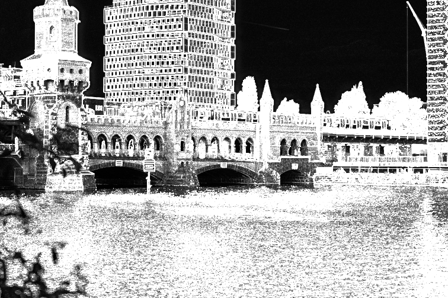
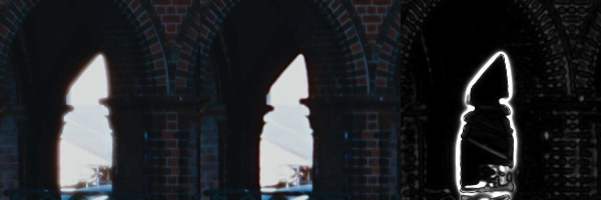
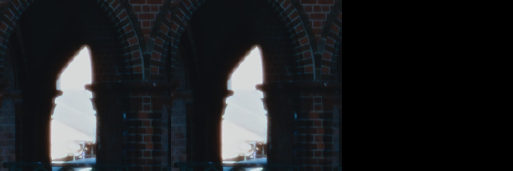

# GPU preview vs f64 export — measured quality, 18–19 October 2026

Question: does the GPU engine (f32, wgpu/Metal, used for the live preview)
produce the same image as the f64 CPU engine the macOS app exports with? If it
does, preview matches export, and export could run on the GPU (Q3 60 MP: about
5.6 s instead of 33 s).

**Answer: yes, after the fixes of 19 October.** On 18 October colour, tone,
grain and glare matched, but halation and DIR couplers did not (the preview was
visibly sharper, with less halation glow), and grain drifted in a
low-particle regime. All three were shortcuts in the GPU code. They are fixed,
and the whole matrix was re-measured:

| Part of the pipeline (wgpu backend) | Before (18 Oct) | After (19 Oct) |
|---|---|---|
| Colour pipeline, 42 cases | Worst pixel ΔE00 0.13 | Unchanged (code not touched) |
| Halation, scatter, DIR, 42 cases | Worst pixel 40.6, p99 up to 7.0, up to 32% of pixels > ΔE 1, 8-bit steps up to 134 | **Worst pixel 0.19, p99 ≤ 0.040, no pixel > ΔE 0.5, at most 1 step in 8 bit** |
| Fine-detail energy, DSC_5009 | GPU 8–25% higher than export | GPU/export = 1.0001 at every scale |
| Grain, 10 cases incl. 60 MP stress | Up to 6.7% amplitude error, 0.35 L* tone bias | Within the run-to-run spread of the reference itself |
| GPU time, alternating old/new (relative) | — | 4–10% faster |

Details of the fixes and the after-measurements are in
[After the fixes](#after-the-fixes-19-october). Everything below that section
describes the state on 18 October and is kept as the record of what was wrong.

The experimental CUDA backend was **not** updated (it can't be tested on this
machine) and still has the 18 October behaviour.

### State on 18 October

| Part of the pipeline | GPU vs f64 reference | Verdict |
|---|---|---|
| f32 vs f64 arithmetic (same CPU code) | max ΔE00 0.11 | Irrelevant |
| Colour: spectral upsampling, film and print curves, enlarger, scanner, gamut mapping, unsharp mask | 42 cases: worst pixel ΔE00 0.13, worst p99 0.005, at most 1 step in 8 bit | **Identical** |
| Halation / scatter and DIR couplers | 42 cases: worst p99 7.0, worst pixel 40.6, up to 32% of pixels over ΔE 1 | **Visibly different** |
| Grain, Z6 24 MP, normal settings | Amplitude within 0.3–1.1%, same spectrum, no colour bias | Matches (≈ run-to-run noise) |
| Grain, Q3 60 MP slide highlights / coarse grain | Amplitude off by 4–7%, tone bias up to 0.35 L* | **Measurably different** |
| Viewing glare | Same mean, spread and spatial correlation | Matches |

ΔE00 ≈ 1 is the usual "just noticeable" difference; under 0.5 is invisible in
practice.

## Method

- **Reference:** `spektrafilm-f64` with `SPEKTRAFILM_BACKEND=cpu`, the exact
  binary and settings the macOS app exports with (`RuntimeParams::default()`,
  spectral LUTs off). Earlier parity work showed it matches the Python
  reference within `1e-6` ([upstream-sync.md](upstream-sync.md)).
- **Test:** `spektrafilm` (f32) with `SPEKTRAFILM_BACKEND=wgpu`, the preview
  engine, at full resolution.
- **Inputs:** six RAWs — five Nikon Z6 shots (24 MP: portrait, saturated blue
  interior with window light, high-contrast stripes and skin, river and brick
  bridge under sky, neutral grey street) and the Leica Q3 file (60 MP).
- **Stocks:** Portra 400 → Portra Endura, Gold 200 → Portra Endura, Pro 400H →
  Crystal Archive, Vision3 500T → 2383, Double-X → 2302, and Velvia 100 and
  Tri-X reversal scanned directly.
- **Metric:** both engines dump the float output buffer (`--raw-out`). It is
  clipped to the saved range, decoded from sRGB, and converted to CIELAB
  (D65). Then CIEDE2000 is computed for every pixel; statistics are over all
  24–60 M pixels.
- **Modes:** *colour* switches off every spatial and random effect (grain,
  halation/scatter, DIR couplers, print and film glare). *det* switches off only
  the random ones (grain, glare). Random effects can't be compared pixel by
  pixel, so they are tested statistically (below).

Pitfall found while testing: on the direct-scan path (`--scan-film`) glare is
read from `film_render.glare`, not `print_render.glare`. Disabling only the
print glare left a random field in place and looked like a GPU error in
slides. With both off, slides match like everything else.

## Colour pipeline: identical

| Film | Photos | Mean ΔE00 | Worst p99 | Worst p99.9 | Worst pixel | Pixels > ΔE 1 | Max 8-bit step |
|---|---:|---:|---:|---:|---:|---:|---:|
| Pro 400H → Crystal Archive | 6 | 0.002 | 0.005 | 0.013 | 0.13 | 0 | 1 |
| Velvia 100 (scan) | 6 | 0.002 | 0.005 | 0.014 | 0.11 | 0 | 1 |
| Double-X → 2302 | 6 | 0.002 | 0.004 | 0.007 | 0.04 | 0 | 1 |
| Gold 200 → Portra Endura | 6 | 0.002 | 0.004 | 0.010 | 0.10 | 0 | 1 |
| Portra 400 → Portra Endura | 6 | 0.002 | 0.004 | 0.010 | 0.11 | 0 | 1 |
| Tri-X reversal (scan) | 6 | 0.002 | 0.004 | 0.008 | 0.03 | 0 | 1 |
| Vision3 500T → 2383 | 6 | 0.001 | 0.004 | 0.010 | 0.09 | 0 | 1 |

f32 on the CPU against f64 on the CPU (Portra 400, DSC_4990, halation and DIR
on) gave max ΔE00 0.106 and p99 0.046. **Floating-point precision is not a
quality factor.**

## Halation and DIR couplers: visibly different

| Film | Photos | Mean ΔE00 | Worst p99 | Worst p99.9 | Worst pixel | Pixels > ΔE 1 (worst photo) | Max 8-bit step |
|---|---:|---:|---:|---:|---:|---:|---:|
| Pro 400H → Crystal Archive | 6 | 0.487 | 5.89 | 13.7 | 36.4 | 29.1% | 127 |
| Velvia 100 (scan) | 6 | 0.546 | 7.04 | 15.2 | 40.6 | 31.9% | 134 |
| Double-X → 2302 | 6 | 0.217 | 3.95 | 9.4 | 25.9 | 17.5% | 69 |
| Gold 200 → Portra Endura | 6 | 0.484 | 5.50 | 12.6 | 33.9 | 29.1% | 120 |
| Portra 400 → Portra Endura | 6 | 0.481 | 5.45 | 12.2 | 31.0 | 28.8% | 104 |
| Tri-X reversal (scan) | 6 | 0.254 | 4.50 | 11.1 | 33.9 | 18.4% | 98 |
| Vision3 500T → 2383 | 6 | 0.364 | 4.56 | 10.3 | 29.2 | 21.3% | 107 |

The size of the difference depends on the photo. Soft portraits: about 1% of
pixels over ΔE 1. Detailed, contrasty scenes (DSC_5009, the bridge; the Q3):
21–32%. The errors sit on edges and fine detail, never in flat areas.





The f64 export has a soft warm glow around the bright window and softer
brickwork. The GPU is crisper with almost no glow. Over the whole frame the GPU
has 8%, 18%, 25% and 21% more detail energy below 0.7, 1.5, 3 and 6 px
respectively. Average brightness is the same (−0.0015 in encoded RGB).

Ablation on DSC_5009 / Portra 400:

| Mode | Mean ΔE00 | p99 | Worst pixel | Pixels > ΔE 1 |
|---|---:|---:|---:|---:|
| Grain and glare off | 0.858 | 5.45 | 31.0 | 28.8% |
| …and halation/scatter off | 0.086 | 0.51 | 13.7 | 0.10% |
| …and DIR off (halation on) | 0.571 | 3.99 | 26.0 | 16.5% |

Cause: shortcuts in the GPU halation and DIR passes
(`crates/spektrafilm-core/src/pipeline.rs`, `HalationGpuParams` and
`DirCouplersGpuParams` construction; `crates/spektrafilm-gpu/src/wgpu_backend.rs`,
`build_halation_state` and the DIR state):

1. **Scatter tail is one Gaussian.** CPU and Python use an exponential PSF (a
   sum of three Gaussians with σ = 0.536, 1.524, 2.768 × λ;
   `exponential_filter_channel`). The GPU blurs once with σ = λ.
2. **Scatter core and tail sizes are averaged over R, G, B.** The CPU uses the
   per-channel values (core 2.2 / 2.0 / 1.6 µm, tail 9.3 / 9.7 / 9.1 µm).
3. **Halation bounce σ is averaged over channels.** This makes no difference
   with the defaults (65 µm for all three), only for profiles with unequal σ.
4. **The DIR diffusion tail is one Gaussian**, where the CPU uses the
   exponential filter.
5. The GPU blur is a 3σ FIR everywhere; the CPU uses Young–van Vliet IIR for
   σ > 3. This is a minor, low-frequency difference.

## Grain: matches except in a low-particle regime

Grain is random, so there is no pixel-to-pixel comparison. For each engine the
**grain residual** is (grain on) − (grain off) in CIELAB, same input, same
engine. The reference is rendered twice: once on the full frame (A), and once
with the input shifted by one pixel (B), which gives an independent grain
realization of the same content. **A vs B is the yardstick:** the GPU passes if
it is no further from A than B is. Halation and DIR were off in these runs to
isolate grain; unsharp mask stayed on.

Compared, per 10-L* band of tone: grain standard deviation in L*, a*, b*; mean
shift (bias); skew; L–a–b correlation; radially averaged noise power spectrum
of ΔL* (grain size and texture); and ΔE00 after a σ = 4 px blur (colour once
the grain averages out).

| Case | Grain σ, worst dev: 2nd CPU run | GPU | Tone bias, worst ΔL*: 2nd CPU | GPU | Spectrum, worst dev: 2nd CPU | GPU | Low-pass ΔE vs A: 2nd CPU | GPU |
|---|---:|---:|---:|---:|---:|---:|---:|---:|
| Z6 Ektar 100 | 0.38% | 0.89% | 0.020 | 0.016 | 2.0% | 2.3% | 2.061 | 2.060 |
| Z6 Portra 800 push 2 | 0.32% | 1.06% | 0.020 | 0.022 | 3.8% | 3.7% | 2.149 | 2.148 |
| Z6 Portra 400 | 0.35% | 0.88% | 0.004 | 0.005 | 3.6% | 1.5% | 1.982 | 1.983 |
| Z6 Double-X | 0.18% | 0.33% | 0.009 | 0.006 | 2.7% | 4.0% | 0.398 | 0.398 |
| Z6 Velvia 100 | 0.24% | 2.10% | 0.004 | 0.065 | 3.1% | 3.4% | 0.930 | 0.932 |
| Z6 Gold 200 | 0.30% | 0.49% | 0.009 | 0.009 | 2.7% | 2.5% | 1.223 | 1.223 |
| Z6 Vision3 500T | 0.21% | 0.44% | 0.020 | 0.007 | 2.2% | 4.1% | 0.843 | 0.845 |
| Q3 Velvia 100 | 0.18% | **6.66%** | 0.006 | **0.349** | 0.9% | **7.9%** | 0.997 | 1.008 |
| Q3 Portra 400, particle area 1.0 µm² | 0.69% | **3.94%** | 0.019 | **0.338** | 1.6% | **7.2%** | 3.846 | 3.830 |
| Q3 Portra 800 push 2 | 0.28% | 1.24% | 0.008 | 0.018 | 2.3% | 1.3% | 1.540 | 1.537 |

On the Z6 the GPU grain is statistically the same as the reference: same size
and texture, same colour correlation, no bias. A small, consistent excess of
0.3–1% in b* (the blue layer has the largest particles) is the first sign of
the problem below.

The Q3 stress cases show where it breaks. In Velvia highlights (L* 70–90) the
GPU grain is 5–7% weaker, less skewed, and 0.35 L* darker on average. With
coarse grain, GPU shadows are 0.3 L* lighter and the grain is 1–2.5% stronger.

Cause: `crates/spektrafilm-shaders/wgsl/grain.wgsl` draws Poisson(λ) and
Binomial(n, p) with a normal approximation. The CPU draws exact numpy
`rk_poisson` / `rk_binomial` for every λ (`crates/spektrafilm-model/src/grain.rs`).
The comments in `grain.wgsl`, `crates/spektrafilm-gpu/src/lib.rs` and
`pipeline.rs` claiming the CPU also approximates "whenever λ > 30" are wrong.
The approximation fails when particles per pixel are few:
- small pixels (60 MP),
- large particles (blue layer, high-ISO stocks, the grain size slider),
- or few developed grains (slide highlights, `p` near 0).

## Viewing glare: matches

Print glare on minus off, DSC_4990 / Portra 400. ΔL* mean in the shadows is
0.185 (f64) vs 0.186 (GPU), and 0.038 vs 0.038 in the midtones. Standard
deviation is 0.127 vs 0.128, and neighbour correlation 0.502 vs 0.503.

## After the fixes (19 October)

### What changed (wgpu backend)

1. **A reference-matching blur, `RefBlur`** (`crates/spektrafilm-gpu/src/wgpu_backend.rs`,
   shaders `ref_blur_fir.wgsl` and `ref_blur_iir.wgsl`). It mirrors
   `gaussian_blur_channel` per channel:
   - below σ = 3: FIR with `radius = int(3σ + 0.5)`, kernel built in f64;
   - from σ = 3: Young–van Vliet IIR with the same coefficients and edge
     initialization, one invocation per row or column, all channels at once.

   It can scale its result and add it to the output, so weighted sums need no
   extra full-size buffer.
2. **Halation/scatter:** per-channel core σ, an exponential tail made of three
   Gaussians with per-channel λ, and per-channel bounce σ computed in f64. The
   CPU's gating is mirrored: no scatter when `scatter_amount` is 0, and no
   halation when no channel has strength.
3. **DIR diffusion:** `(1 − w)·G(σ) + w·exp_filter(λ)` like the CPU, skipped when
   σ is 0.
4. **Grain:** the GPU now draws Poisson and binomial counts with numpy's exact
   algorithms (multiplication or PTRS, inversion or BTPE), the same ones the
   CPU uses, from a per-pixel PCG32 stream. The pattern differs from the CPU's,
   as any reseed would, but the distribution is exact.

Three problems surfaced while doing this:

- **f32 IIR gain at large σ.** On the Q3 the DIR tail reaches σ ≈ 146 px, where
  the Young–van Vliet b's sum to within about 1e-6 of 1. Rounding them to f32
  shifted the filter's DC gain by percents, and the whole frame came out 0.25%
  darker (worst ΔE 1.0). `a` is now derived from the rounded b's, which gives
  unit gain: worst ΔE 0.19, and no offset. *Superseded on 19 October (later
  session):* the direct form also accumulates rounding error, amplified by up
  to 1/(1 − Σb); at 100 MP (σ ≈ 190 px) it reached p99 0.089. The GPU now runs
  the same filter as a first-order plus a second-order section in difference
  form (`IirCascade`), which has unit gain by construction and is
  well conditioned: Q3 det worst pixel 0.19 → 0.012, p99 0.040 → 0.004.
- **Silently dropped dispatch.** With 1024-thread workgroups, as every other
  per-pixel pass uses, the heavier grain shader never ran on Metal and there
  was no error. Grain now uses 256-thread groups, on a 2D grid so 60 MP stays
  under the 65535-groups-per-dimension limit.
- **A test catches the dropped dispatch.** `grain_matches_poisson_binomial_moments`
  runs the grain pass on a flat density and checks mean and variance against
  Poisson(λp). Its three channels exercise every sampler branch. It fails
  (variance 0) with 1024-thread groups. `grain_dispatch_grid_covers_every_pixel_within_limits`
  covers the grid maths up to 100 MP.

### Halation, scatter and DIR on (42 cases, grain and glare off)

| Film | Photos | Mean ΔE00 | Worst p99 | Worst p99.9 | Worst pixel | Pixels > ΔE 0.5 | Max 8-bit step |
|---|---:|---:|---:|---:|---:|---:|---:|
| Pro 400H → Crystal Archive | 6 | 0.005 | 0.039 | 0.056 | 0.16 | 0 | 1 |
| Velvia 100 (scan) | 6 | 0.004 | 0.040 | 0.060 | 0.12 | 0 | 1 |
| Double-X → 2302 | 6 | 0.002 | 0.012 | 0.017 | 0.03 | 0 | 1 |
| Gold 200 → Portra Endura | 6 | 0.005 | 0.040 | 0.056 | 0.12 | 0 | 1 |
| Portra 400 → Portra Endura | 6 | 0.004 | 0.039 | 0.056 | 0.19 | 0 | 1 |
| Tri-X reversal (scan) | 6 | 0.002 | 0.011 | 0.015 | 0.03 | 0 | 1 |
| Vision3 500T → 2383 | 6 | 0.003 | 0.030 | 0.043 | 0.07 | 0 | 1 |

That is the same level as the colour-only mode, which is f32 rounding. The
worst pixels are on the Q3, where the widest blurs run through the f32
recursion.



### Grain (10 cases)

| Case | Grain σ dev: 2nd CPU run | GPU | Tone shift ΔL*: 2nd CPU | GPU | Spectrum dev: 2nd CPU | GPU | Low-pass ΔE: 2nd CPU | GPU |
|---|---:|---:|---:|---:|---:|---:|---:|---:|
| Z6 Ektar 100 | 0.38% | 0.43% | 0.020 | 0.013 | 2.0% | 2.4% | 2.061 | 2.062 |
| Z6 Portra 800 push 2 | 0.32% | 0.38% | 0.020 | 0.008 | 3.8% | 2.9% | 2.149 | 2.150 |
| Z6 Portra 400 | 0.35% | 0.26% | 0.004 | 0.005 | 1.2% | 1.6% | 1.982 | 1.985 |
| Z6 Double-X | 0.18% | 0.19% | 0.009 | 0.010 | 2.4% | 1.9% | 0.398 | 0.398 |
| Z6 Velvia 100 | 0.24% | 0.40% | 0.004 | 0.012 | 3.1% | 2.9% | 0.930 | 0.929 |
| Z6 Gold 200 | 0.30% | 0.23% | 0.009 | 0.006 | 2.6% | 1.4% | 1.223 | 1.222 |
| Z6 Vision3 500T | 0.21% | 0.32% | 0.020 | 0.007 | 2.0% | 2.2% | 0.843 | 0.843 |
| Q3 Velvia 100 | 0.18% | **0.20%** (was 6.66%) | 0.006 | **0.010** (was 0.349) | 0.9% | 1.9% | 0.997 | 0.997 |
| Q3 Portra 400, coarse | 0.69% | **0.45%** (was 3.94%) | 0.019 | **0.023** (was 0.338) | 1.6% | 0.9% | 3.846 | 3.857 |
| Q3 Portra 800 push 2 | 0.28% | 0.21% | 0.008 | 0.012 | 2.3% | 1.1% | 1.540 | 1.542 |

The spectrum column now skips the lowest frequency band, because it has few
samples and picks up image content. Even two CPU runs differ there by up to
3.6%. In Q3 Velvia highlights (L* 80–90), grain σ is 1.856 / 1.853 / 1.855
(CPU A / CPU B / GPU), the mean 0.148 / 0.150 / 0.148, and the skew
−1.34 / −1.33 / −1.34.

### Speed

Alternating old/new runs, best warm iteration of 6, on battery in Low Power
Mode, so read these as relative only:

| Case | Old GPU | New GPU |
|---|---:|---:|
| Z6, 6 MP preview size | 942 / 928 ms | 844 / 821 ms |
| Z6, 24 MP full | 1134 / 1136 ms | 1063 / 1065 ms |
| Q3, 60 MP full | 3922 / 3898 ms | 3771 / 3766 ms |

The recursive filter costs the same for any σ, so it beats the wide FIR
kernels it replaced, even with the extra exponential-tail passes.

### Known limits

- **CUDA backend** (experimental, opt-in) is unchanged: channel-averaged
  sizes, single-Gaussian tails, normal-approximation grain.
- **Other blurs** (unsharp mask, lens blurs, glare, grain blur, diffusion
  filter) still used the old 3σ FIR. *Fixed later on 19 October*, see
  [Later on 19 October](#later-on-19-october-every-blur-and-the-diffusion-filter).
- **About 67 MP limit on the GPU path (lifted on 19 October, see the
  handoff's results).** Every other per-pixel pass dispatched `ceil(n / 1024)`
  workgroups in x only, so above 65535 × 1024 pixels the dispatch was invalid
  and a 100 MP file (GFX100, X2D) failed. Highlight boost, which runs one
  thread per value, already failed above 21.8 MP. All linear passes now use
  the 2D grid (`linear_dispatch_grid`).
- **Any heavy per-pixel shader at 1024 threads** risks the same silent
  drop as grain. Today's set was verified by the matrix, but a new heavy pass
  should get a moment test like grain's.

## Later on 19 October: every blur and the diffusion filter

A second session (see the Results in
[handoff-gpu-parity-next.md](handoff-gpu-parity-next.md)) lifted the 67 MP
limit, made the recursive blur well conditioned in f32 (`IirCascade`), moved
every remaining GPU blur onto `RefBlur`, and replaced the downsampled
diffusion filter with an FFT convolution of the CPU's exact PSF. It also
measured the effects that are off by default for the first time.

### What changed

- **Unsharp mask, camera and scanner lens blur, glare blur, grain blur** and
  the non-resident `gaussian_blur` now use `RefBlur` (FIR with
  `int(3σ + 0.5)` below σ = 3, the recursive filter above, like
  `gaussian_blur_channel`). The old FIR used `ceil(3σ)` and never switched
  to the recursive filter, so σ ≥ 3 (large lens blur, unsharp radius 3)
  differed by up to ΔE00 24, and the default unsharp mask (σ 0.7: radius 3
  instead of 2) was the residual of the colour-only mode. RefBlur can now
  blur in place and on selected channels.
- **Diffusion filter (camera and enlarger):** the CPU convolves each channel
  with the exact exponential PSF by FFT, reflect-padded by the PSF radius.
  The GPU blurred a copy downsampled up to 10× with three Gaussians per
  exponential, which smeared the core and got the borders and very wide
  blooms wrong (ΔE00 7–16). It now does what the CPU does: a mixed-radix
  (2, 3, 4, 5) Stockham FFT in f32 (`fft_stage.wgsl`) on a grid of at least
  (h + 2r) × (w + 2r), the PSF evaluated on the GPU from the CPU's
  exponentials (`diffusion_psf_spec`) and normalized by its DC term,
  reflect padding, crop and mix (`fft_conv.wgsl`). A unit test compares it
  with `convolve2d_reflect` in f64: max error 4e-7.

### Default settings, 42 cases per mode

Worst over six photos per film. f64 CPU reference vs GPU.

| Film | det: worst p99 | det: worst pixel | colour: worst p99 | colour: worst pixel | Max 8-bit step |
|---|---:|---:|---:|---:|---:|
| Pro 400H → Crystal Archive | 0.0039 | 0.005 | 0.0039 | 0.005 | 1 |
| Velvia 100 (scan) | 0.0038 | 0.005 | 0.0038 | 0.005 | 1 |
| Double-X → 2302 | 0.0040 | 0.005 | 0.0040 | 0.005 | 1 |
| Gold 200 → Portra Endura | 0.0038 | 0.005 | 0.0038 | 0.005 | 1 |
| Portra 400 → Portra Endura | 0.0038 | 0.005 | 0.0038 | 0.005 | 1 |
| Tri-X reversal (scan) | 0.0038 | 0.004 | 0.0038 | 0.004 | 1 |
| Vision3 500T → 2383 | 0.0027 | 0.004 | 0.0030 | 0.004 | 1 |

Before: det worst pixel 0.19 and p99 0.040, colour worst pixel 0.13. Both
modes are now at the same level, 0.005: what remains is f32 rounding of the
colour pipeline. The 100 MP synthetic frame (the Q3 upscaled to
12288 × 8192) in det mode: worst pixel 0.008, p99 0.0036.

### Effects that are off by default

DSC_5009 and DSC_4990, Portra 400 → Portra Endura, det base (grain and glare
off), worst of the two photos. Parameters are in
`scripts/gpu_cpu_quality/params/fx/` (run `effects.sh`).

| Effect | Before (worst pixel / worst p99 / pixels > ΔE 1 / 8-bit step) | After (worst pixel / p99 / 8-bit step) |
|---|---|---|
| Diffusion, Black Pro-Mist 0.5 | 7.16 / 1.61 / 2.7% / 24 | 0.005 / 0.0036 / 1 |
| Diffusion, Glimmerglass 1.0, warm halo | 12.59 / 2.62 / 8.7% / 40 | 0.004 / 0.0036 / 1 |
| Diffusion, Cinebloom 1.5, scale 2, bloom size 2 | 16.08 / 6.59 / 61.8% / 48 | 0.004 / 0.0036 / 1 |
| Enlarger diffusion, Pro-Mist 0.7 | 10.84 / 2.69 / 9.1% / 30 | 0.004 / 0.0036 / 1 |
| Camera lens blur 10 µm (σ 1.7 px) | 0.26 / 0.035 / 0 / 1 | 0.005 / 0.0036 / 1 |
| Camera lens blur 40 µm (σ 6.9 px) | 15.93 / 1.10 / 1.3% / 54 | 0.004 / 0.0037 / 1 |
| Scanner lens blur 1.5 px | 0.005 / 0.004 / 0 / 1 | 0.004 / 0.0036 / 1 |
| Scanner lens blur 4 px | 15.74 / 1.08 / 1.2% / 45 | 0.004 / 0.0036 / 1 |
| Unsharp 2.5 px, amount 1.2 | 0.005 / 0.004 / 0 / 1 | 0.005 / 0.0036 / 1 |
| Unsharp 3 px, amount 1 | 24.00 / 1.74 / 2.4% / 83 | 0.005 / 0.0036 / 1 |
| Highlight boost 1 EV | 0.02 / 0.004 / 0 / 1 | 0.005 / 0.0036 / 1 |
| Preflash 0.2, M +10, Y −5 | 0.003 / 0.002 / 0 / 1 | 0.002 / 0.0015 / 1 |
| Print-curve morph (γ 1.2, exhaustion 0.3, …) | 0.03 / 0.004 / 0 / 1 | 0.004 / 0.0035 / 1 |
| Halation ×2, scale 3, 5 bounces, unequal σ | 0.04 / 0.004 / 0 / 1 | 0.005 / 0.0036 / 1 |
| DIR amount 1.5, 60 / 400 µm, tail weight 0.4 | 0.08 / 0.008 / 0 / 1 | 0.005 / 0.0036 / 1 |

"Before" is this branch after the dispatch and cascade fixes. On the
original branch highlight boost also crashed the GPU above 21.8 MP.
`enlarger.lens_blur` exists in the parameters but neither engine applies it.

### Grain (10 cases, re-run)

The grain blur moved to `RefBlur` (same kernel for the default σ 0.65, so
the same output), and the unsharp mask changed (radius 2 instead of 3 at
σ 0.7). Grain still matches within the run-to-run spread of the reference:

| Case | Grain σ dev: 2nd CPU run | GPU | Tone shift ΔL*: 2nd CPU | GPU | Spectrum dev: 2nd CPU | GPU | Low-pass ΔE: 2nd CPU | GPU |
|---|---:|---:|---:|---:|---:|---:|---:|---:|
| Z6 Ektar 100 | 0.38% | 0.45% | 0.020 | 0.013 | 2.0% | 2.4% | 2.061 | 2.062 |
| Z6 Portra 800 push 2 | 0.32% | 0.38% | 0.020 | 0.008 | 3.8% | 2.9% | 2.149 | 2.150 |
| Z6 Portra 400 | 0.35% | 0.27% | 0.004 | 0.005 | 1.2% | 1.6% | 1.982 | 1.985 |
| Z6 Double-X | 0.18% | 0.18% | 0.009 | 0.010 | 2.4% | 1.9% | 0.398 | 0.398 |
| Z6 Velvia 100 | 0.24% | 0.39% | 0.004 | 0.012 | 3.1% | 2.9% | 0.930 | 0.929 |
| Z6 Gold 200 | 0.30% | 0.20% | 0.009 | 0.006 | 2.6% | 1.4% | 1.223 | 1.222 |
| Z6 Vision3 500T | 0.21% | 0.31% | 0.020 | 0.007 | 2.0% | 2.2% | 0.843 | 0.843 |
| Q3 Velvia 100 | 0.18% | 0.21% | 0.006 | 0.010 | 0.9% | 1.9% | 0.997 | 0.997 |
| Q3 Portra 400, coarse | 0.69% | 0.46% | 0.019 | 0.023 | 1.6% | 1.0% | 3.846 | 3.856 |
| Q3 Portra 800 push 2 | 0.28% | 0.20% | 0.008 | 0.011 | 2.3% | 1.1% | 1.540 | 1.542 |

### Cost

The FFT diffusion filter needs two complex grids and one real spectrum of
at least (h + 2r) × (w + 2r): on the 100 MP frame with Black Pro-Mist the
GPU render's peak memory footprint grew from 9.2 GB to 13.7 GB, and it took
8–13 s instead of about 4 s. At 24 MP with diffusion the GPU still renders
in about 2.5–3 s, and at preview size (6 MP) it is as fast as the old
downsampled version.

## What this does not prove

It proves the GPU reproduces the f64 implementation. It says nothing about how
close the simulation is to real film; that depends on the model and the
profile data, not on the engine. The test set is six photos, seven stock
pairs, one machine (M1 Pro, Metal). Other GPUs (CUDA, Vulkan/DX12 via wgpu)
are untested.

## Reproduce

Scripts are in [`scripts/gpu_cpu_quality/`](../scripts/gpu_cpu_quality).
Python needs `numpy scipy colour-science tifffile pillow`. Set `PYTHON` to the
interpreter, `OUT` to a scratch directory (default `target/gpu-cpu-quality`),
and `KEEP_DUMPS=1` to keep the 0.6–1.4 GB float dumps.

```bash
cargo build --release -p spektrafilm-cli --bin spektrafilm --bin decode_raw_gui
cargo build --release -p spektrafilm-cli --bin spektrafilm-f64 --features precision-f64
P=scripts/gpu_cpu_quality/params
# Pixel comparison (append the printed lines to a results file):
scripts/gpu_cpu_quality/pair.sh m_det_DSC_5009_kodak_portra_400 $PWD/$P/det.json \
  ~/Downloads/Z\ 6/DSC_5009.NEF kodak_portra_400 kodak_portra_endura | tee -a results.txt
# Effects that are off by default (params/fx/*.json over det.json):
scripts/gpu_cpu_quality/effects.sh            # or: effects.sh diff_bpm lens_cam_large
# GPU_BIN=/abs/path/to/spektrafilm pair.sh … compares another build against kept ref dumps.
# Grain statistics (suffix _coarse uses the 1.0 µm² particle params):
scripts/gpu_cpu_quality/grain_case.sh target/memory-study/leica-q3.dng fujifilm_velvia_100 scan
# Tables:
python3 scripts/gpu_cpu_quality/summarize.py results.txt target/gpu-cpu-quality/runs summary.json
```

Machine-readable results: [gpu-vs-cpu-quality-results.json](gpu-vs-cpu-quality-results.json).
