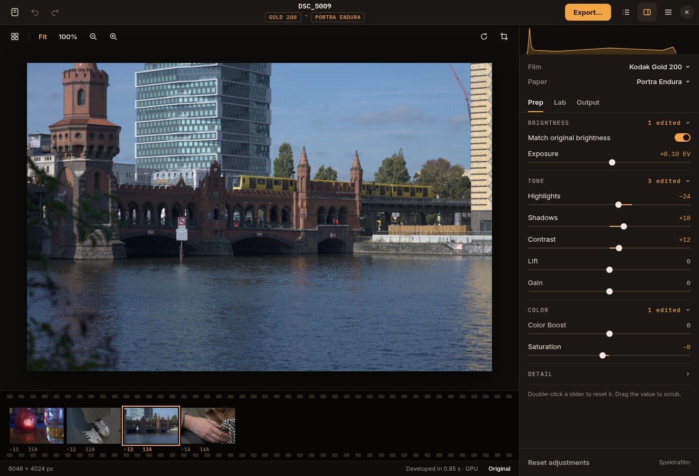

# Handoff: Linux "own look" redesign (written 5 November 2026)

You are implementing a visual redesign of the native Linux client
(`linux/`, GTK4 + libadwaita via gtk4-rs). The product owner picked
**option 4, "own look"**, out of five mockups. Two requirements were added:

1. **It reacts to Omarchy themes.** On Omarchy, the app takes its colours from
   the current Omarchy theme and changes them live when the user switches theme,
   without a restart.
2. **The photograph is never transparent.** This holds in every window state,
   in every theme, and in every Omarchy opacity or glass mode.

The user is the product owner. They are technical but not a film or colour
scientist. Report outcomes in product terms, with before/after screenshots.
Leave out the internals.

The mockup uses the built-in palette (what non-Omarchy desktops get). On
Omarchy, the same layout is drawn with the theme's colours.

## Where things are

- Work on `main`, following `AGENTS.md`: commit and push completed changes
  directly, with no PR. The main checkout
  (`/home/noah/Work/Negs`) may hold other people's uncommitted work. On
  5 November that was `linux/run.sh` and `docs/highlights-shadows-plan.md`.
  Do not commit, revert or reformat those. If the checkout is dirty, work in
  a separate worktree from `main`.
- End commit messages with
  `Co-Authored-By: Claude Opus 5.5 <noreply@anthropic.com>`.
- Linux only. Do not change the macOS, Windows or web clients.
- Relevant code:
  - `linux/style.css`: the whole app stylesheet, loaded once at
    `linux/src/main.rs:947`. Today it is mostly stock libadwaita.
  - `linux/src/main.rs`: window, header bar, canvas toolbar, photo well
    (`.photo-well`, around line 323), status bar.
  - `linux/src/inspector.rs`: the adjustments panel. It has the Prep, Lab and
    Output tabs, sections built by `section()` at line 390, and slider rows
    built by `knob()`. Slider definitions are in `linux/src/fixtures.rs`.
  - `linux/src/filmstrip.rs`: thumbnail strip.
  - `linux/src/canvas.rs`: draws the photo. `theme_background()` at line 42
    reads `view_bg_color`, and `set_viewer_background()` at line 566 applies
    the user's custom viewer background preference.
  - `linux/src/preferences.rs`: the Appearance preference (System, Light,
    Dark) and the viewer-background preference.
  - `linux/omarchy/negs-window-rules.lua` and
    `linux/install_omarchy_rules.py`: the Hyprland rule that keeps Negs opaque.
  - `docs/linux-ui-validation.md`, section "Opaque photograph follow-up":
    how opacity was proven last time.
- Machine on 5 Nov: Omarchy 4.0.0.alpha, Hyprland 0.56.2, GTK 4.24.1,
  libadwaita 1.10.0. The Cargo features target GTK 4.16 and libadwaita 1.6
  APIs, so stay inside those or gate newer calls.

## What the look is

Keep the current structure: header bar, canvas toolbar, photo, filmstrip,
status bar, and the inspector on the right. Restyle it as follows. Measurements
are from the mockup at 1× scale.

**Overall**
- A dark, quiet "darkroom" feel with one accent colour. Neutrals carry a
  slight bias toward the accent; the photo well is the exception (see below).
- Header bar and canvas toolbar use flat buttons: icon only, no grey pill
  behind them. The active toggle (sidebar pane, Fit) shows in the accent
  colour, not a filled box.
- **Export…** is the only filled button: accent background, with text in
  whichever of the theme's background or foreground gives more contrast on
  the accent.

**Title**
- File name without its extension, in the monospace font.
- Below it, film and paper as two small outlined tags (accent text, 1 px
  border, about 4 px radius, uppercase monospace at about 10 px), with a muted
  arrow between them. Use the short stock names ("GOLD 200",
  "PORTRA ENDURA"), the ones the inspector already shows.

**Photo well**
- Near-black and neutral (see "The photo well" below), with a soft drop
  shadow under the photo.

**Filmstrip, drawn as a strip of negatives (about 118 px tall)**
- A near-black film base. Rows of sprocket holes along the top and bottom
  edges: about 11×7 px, 2 px radius, in a slightly lighter shade than the
  base, evenly spaced.
- Frames are about 102×68 px with square corners and a 6 px gap.
- Under each frame, edge-print frame numbers in about 9 px monospace:
  `▸13   13A`, numbered by position in the strip.
- The selected frame gets a 2 px accent outline with a 2 px offset, and its
  frame number turns accent-coloured. Other numbers use a dim accent.
- Every thumbnail is drawn at full opacity. The first mockup dimmed unselected
  frames; that is ruled out by the "never transparent" requirement. Show
  selection with the outline and number colour only.

**Status bar**
- 11 px muted text, separated from the strip by a hairline.

**Inspector, about 340 px wide (still resizable)**
- Histogram: a 56 px strip across the full width of the panel, with no card
  around it. Draw it as an accent line over a light accent fill. Remove the
  stray ↕ resize glyph.
- Film and Paper: two plain rows, with a muted label on the left and the
  value plus a small chevron on the right. They open the existing stock
  browser.
- Prep, Lab and Output: text tabs. The active tab has a 2 px accent
  underline; inactive tabs are muted.
- Section headers (BRIGHTNESS, TONE, COLOR, DETAIL, CAMERA, and so on):
  monospace, letter-spaced, muted. The header is a button that collapses its
  section, with a chevron that rotates. When values in a section differ from
  their defaults, show "N edited" in the accent colour on the right.
  Remember which sections are open in preferences.
- Slider rows replace today's card, spin button and −/+ buttons:
  - One row with the label on the left and the value on the right.
  - The value is in monospace with tabular figures and a unit
    (`+0.10 EV`), and uses a real minus sign.
  - Under it, a 2 px track with a 12 px knob. The track fills in the accent
    from zero to the value.
  - Edited values and their labels are drawn brighter, and the value turns
    accent-coloured.
  - Interactions: double-click the slider to reset it. Click the value to
    type a number. Drag the value to scrub it. Keyboard arrows still work.
  - Keep the accessible names and the AT-SPI behaviour that
    `linux/check_ui.py` and `linux/check_controls.py` test.
- Switches: small, accent when on.
- Footer: "Reset adjustments" as a flat text button on the left, the
  "Spektrafilm" credit muted on the right.

**Type**
- UI text uses the system UI font.
- Numbers, the file name, the tags, section headers and frame numbers use the
  system `monospace` family, not a bundled font. Omarchy sets that family with
  its font switcher, so it follows the user's font choice too.

**Behaviour**
- Layout, keyboard shortcuts and every existing feature stay as they are. This
  is a restyle plus the slider-row and collapsible-section changes.

## Omarchy themes

### Where the theme lives and how a switch happens

- Current theme folder: `~/.local/state/omarchy/current/theme/`. The palette
  is `colors.toml` inside it.
- `omarchy-theme-set` builds the new theme in `current/next-theme`, then
  `rm -rf current/theme` and `mv next-theme theme`. Only after that does it
  write a new token to `~/.local/state/omarchy/current/theme.generation`.
- So **watch the directory `~/.local/state/omarchy/current/`** (a
  `gio::FileMonitor`) and re-read the palette when `theme.generation`
  changes. Do not monitor `theme/colors.toml` itself: the folder is replaced,
  and a monitor on the old file stops firing.
- Debounce the reload by about 150 ms, and ignore a generation you have
  already applied.
- Omarchy also sets the GNOME `color-scheme` (`prefer-dark` or
  `prefer-light`), but in a slower background batch. Take light or dark from
  `colors.toml` so the app doesn't briefly mix light colours with a dark
  scheme.

### Reading the palette

- Example keys, from the current theme ("starship"):
  - `mode`
  - `accent`, `selection`, `muted`
  - `background`, `dark_background`, `darker_background`,
    `lighter_background`
  - `foreground`, `dark_foreground`, `light_foreground`, `bright_foreground`
  - eight ANSI colours and their `bright_` variants
- Older or user-made themes may be missing keys. Omarchy resolves missing keys
  with a fallback cascade. Prefer running `omarchy-theme-color --all`, which
  prints every resolved `key<TAB>value`. It is the same resolution the rest of
  the desktop uses, and `mode` comes out of it too. When that command is
  missing, parse `colors.toml` directly and use the built-in palette for
  anything absent.
- Light themes ship with Omarchy: `catppuccin-latte`, `flexoki-light`,
  `rose-pine`, `lupine` and `white`. The redesign must work in light mode, not
  just dark.

### Mapping

Generate a CSS block of `@define-color` values from the palette and load it
from its own `gtk::CssProvider` at application priority, above `style.css`.
Make `style.css` refer only to these names. On a theme change, call
`load_from_string` on that provider again; nothing else should rebuild.

| Negs token | Omarchy source | Notes |
| --- | --- | --- |
| `negs_bg` (window, header, inspector) | `background` | |
| `negs_raised` (popovers, hover) | `lighter_background` | |
| `negs_sunken` (histogram strip, film base) | `darker_background` | |
| `negs_border` | `selection`, else 10% mix of `foreground` into `background` | hairlines |
| `negs_fg` | `foreground` | |
| `negs_muted` | `muted` if ≥ 4.5:1 on `background`, else `dark_foreground`, else mix toward `foreground` until it passes | labels and section headers |
| `negs_accent` | `accent` | tabs, edited values, histogram, outline, tags, Export |
| `negs_on_accent` | whichever of `background` or `foreground` contrasts more with `accent` | Export text, switch knob |
| `negs_sprocket` | `lighter_background` at the base's lightness + 6% | |
| `negs_warning` | `red` | clipping and errors, never the accent |

Also feed `accent` into libadwaita's own accent colour so stock widgets
(focus rings, the stock browser) match. On libadwaita ≥ 1.6 that is the
`accent_bg_color`, `accent_color` and `accent_fg_color` overrides.

### Which palette applies

| Appearance preference | On Omarchy (palette readable) | Elsewhere, or no palette |
| --- | --- | --- |
| System | Omarchy palette and its `mode` | built-in palette for the system light or dark scheme |
| Light or Dark | Omarchy palette if its `mode` matches, otherwise the built-in palette for that mode | built-in palette for that mode |

- Built-in dark palette (the mockup):
  - bg `#1a1714`, raised `#24201b`, sunken `#0f0d0b`, border `#2b2620`
  - fg `#efe9e1`, muted `#a89f94`, accent `#f2a541`, on-accent `#1a1003`
- Built-in light palette: design a counterpart that passes the same contrast
  rules. Do not simply invert the dark one.
- `NEGS_APPEARANCE` keeps overriding everything, as it does today, because the
  test scripts rely on it.
- Add `NEGS_OMARCHY_STATE_DIR`, defaulting to `~/.local/state/omarchy`, so
  tests can point the app at a fake theme folder.

### Packaging

- Native and AUR packages: everything above applies.
- Flatpak: the sandbox has no access to `~/.local/state`, so it gets the
  built-in palettes. **Do not edit the Flatpak manifest.** The user handles
  Flathub changes personally. If you think a read-only permission is
  worthwhile, say so in your report.

## The photograph is never transparent

"Photograph" means every pixel of a photo the app shows:
- the main canvas
- crop mode
- filmstrip thumbnails
- stock browser and preset previews

None of it may let the desktop, another window or the window behind show
through, and none of it may be faded with opacity. This has two layers.

### Inside the app (GTK)

- The photo well and the canvas fill their background with an opaque colour
  before drawing the photo. The canvas already does this (`canvas.rs:134`);
  keep it, and make sure that colour has alpha 1 after theming.
- Never use `alpha()` or a translucent theme colour for any surface under or
  around a photo.
- No `set_opacity` below 1 on any widget that shows a photo.
  `stock_browser.rs:44` sets 0.55 on stale previews today. Replace that with
  an opaque treatment, such as a spinner or a busy badge, so the preview
  pixels stay at full opacity. That file changed recently (0d096e2), so
  re-read it before editing.
- Filmstrip thumbnails stay at full opacity (see the look).
- Omarchy's Glassy mode adds `window { backdrop-filter: blur(20px); }` to the
  user's `~/.config/gtk-4.0/gtk.css`. User CSS outranks application CSS.
  Make sure Negs's window, the well and the canvas still paint fully opaque
  when that file is present. Test it with Glassy mode on.

### In the compositor (Hyprland)

- GTK cannot undo opacity that Hyprland applies to the whole window.
  `linux/omarchy/negs-window-rules.lua` handles that. It currently removes a
  `default-opacity` tag. On Omarchy 4.0.0.alpha the tags that cause
  transparency are different:
  - `transparent-window`, added by `o.transparent_window(...)`
  - `transparent`, added by Omarchy's transparency hotkey to any window,
    Negs included
  - the `window-glassy` and `window-opaque` toggles
  Update the rule so Negs stays at `1 override` focused, inactive and
  fullscreen in all of these cases, while still matching older Omarchy (keep
  the `default-opacity` removal). Prefer the smallest rule that wins by order,
  and prove it on the real compositor rather than reasoning about it.
- The rule is installed only by the native launcher and
  `install_omarchy_rules.py`. Check that the AUR or Omarchy package path
  installs or documents it too. If it doesn't, tell the user rather than
  editing their Hyprland config silently.

## Validation

Follow the style of `docs/linux-ui-validation.md`: real Hyprland session,
release build, and screenshots under `target/linux-validation/own-look/`.
Record the results in a new section of that file.

1. **Theme matrix.** Screenshot the same scene in each of:
   - `starship` (the user's current theme)
   - `tokyo-night`, `gruvbox`, `vantablack`, `hackerman`
   - the light themes `catppuccin-latte` and `white`
   - a non-Omarchy run with the built-in dark and light palettes
   Use the fake state folder (`NEGS_OMARCHY_STATE_DIR`) for these, built from
   `/usr/share/omarchy/themes/<name>`. Check text contrast on each.
2. **Live switch.** With the app open on the fake folder, replace the theme
   folder the way Omarchy does: `rm -rf theme`, `mv next-theme theme`, then
   write a new `theme.generation`. Check that it recolours within about
   half a second with no flicker, no restart and no lost edits. A real
   `omarchy-theme-set` changes the user's whole desktop. Do that only with
   the user's OK, and set their theme back afterwards (`theme.name` holds
   `starship` today).
3. **Opacity.** Repeat the earlier alpha-zero PNG test (an opaque region plus
   a transparent region, captured from Wayland and compared with GTK's
   rendering) in each of these states:
   - focused, inactive and fullscreen
   - with the `transparent` tag added to the Negs window
   - with Glassy windows on, which also writes the `gtk.css` block
   - on a light theme
   The compositor must report opacity 1, and the captured photo pixels must
   match exactly. Put the toggles back the way you found them.
4. **Regression.** `check_ui.py`, `check_controls.py`, `check_presets.py`,
   `check_borders.py` and `measure_ui.py`. Startup and interaction times must
   not get worse; theme reloads must not trigger a re-render of the photo.
5. Release build and Clippy are clean.

## Decisions already made, and open questions

- Made: the look is option 4. It follows Omarchy themes live. Photos are
  never transparent or faded.
- Default chosen here, confirm with the user: **the photo well stays a neutral
  grey and never takes the theme's tint.** A coloured surround shifts how
  colours in the photo are judged, which matters in a colour tool. Take the
  lightness of `darker_background` and remove its colour (for example in
  OKLab, keeping L and setting chroma to 0). On light themes this gives a
  light grey well. The existing custom viewer-background preference still
  overrides it. If the user would rather have the well tinted, or always dark
  even on light themes, it is a one-line change.
- Open: should the filmstrip negative styling stay on light themes, or become
  a plain row there? Default: keep it, using the light theme's
  `darker_background` as the film base, and show both in the report.
- Open: Flatpak theme access (see "Packaging").
