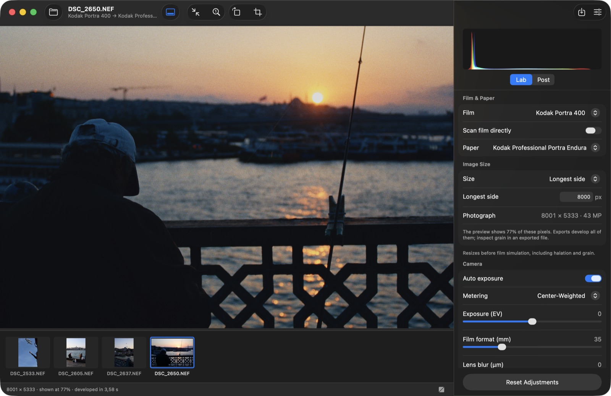
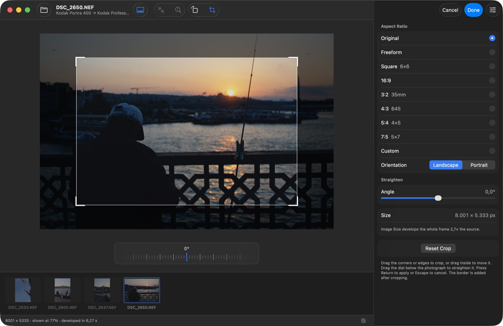
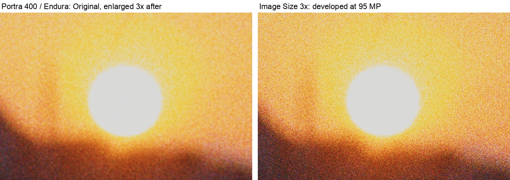
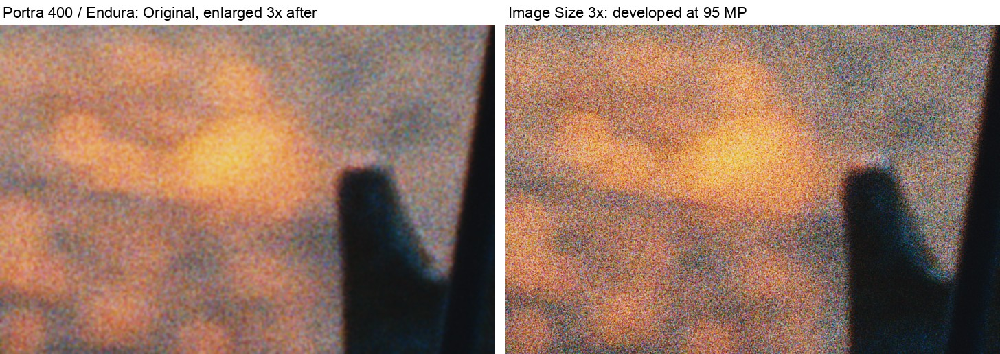
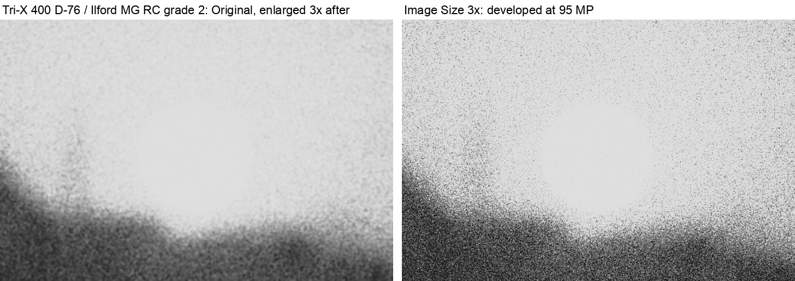
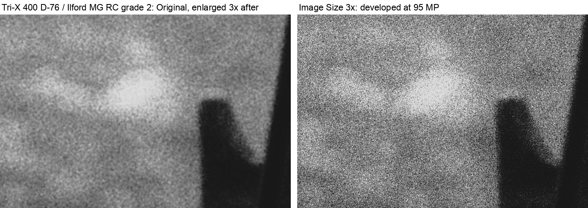
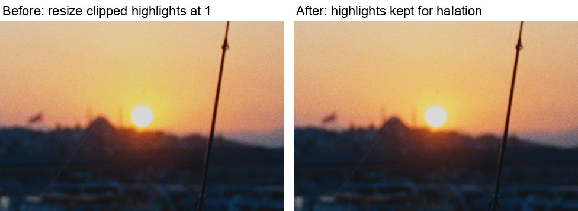

# Image Size

Image Size resizes the photograph **before** the film simulation, so grain,
halation and every other effect measured on the film form at the new size.
Enlarging a finished render afterwards only stretches its grain; developing at
the larger size gives grain of the same physical size on more pixels. This
restores the Python app's early enlargement (`io.upscale_factor`), with a
target that follows the crop. It was requested on
[discuss.pixls.us](https://discuss.pixls.us/t/gpu-accelerated-macos-gui/61485/20)
([3× comparison](https://discuss.pixls.us/t/spektrafilm-darktable-module-implementation-discussion/58744/283)).
The plan and its review are in [upscale-plan.md](upscale-plan.md) and
[upscale-opus-review.md](upscale-opus-review.md).

## In the apps

**Image Size** is in the Lab between *Film & Paper* and *Camera*, on macOS
and Windows:

```text
Image Size
Size             [Original / Longest side]
Longest side     [8000] px
Photograph       8001 × 5333 · 43 MP

Resizes before film simulation, including halation and grain.
```

- **Original** develops the source's own pixels. The crop trims them.
- **Longest side** (16–65,535 px) sets the *cropped photograph's* longest
  side, before borders, the Instagram extension and any export size. Smaller
  targets reduce the photograph. The field commits on Return/Enter or when it
  loses focus; an invalid or too-large value stays in the field with its error
  and changes nothing. Escape restores the current value.
- Choosing Longest side offers the last value used (a preference, never part
  of the edit), else the crop's own longest side.
- The *Working resolution* slider is gone. Sessions saved with it open at
  Original: the apps reset `io.upscale_factor` to 1 on restore.
- **Reset Adjustments** keeps the Longest side, like the crop and border.
- **Photograph** shows the exported photograph. When the preview has fewer
  pixels than the export (the 12 MP limit, or the 8192 px display texture),
  the inspector and the status bar say so ("shown at 68%"); inspect grain in
  an exported file then. Viewport rendering at full resolution is not part of
  this change.
- The crop panel shows the exported size of the crop being drawn. With a
  target, a smaller crop needs a larger frame; past the limit the panel shows
  the error and Done keeps the crop open.
- The export panel states the photograph's size; borders and export sizes are
  summarised as before.

## Processing

```text
load/decode → resolve size → resize source → film/halation/grain
            → print/scan/post → crop/straighten/rotation
            → borders/Instagram → optional export reduction
```

`io.photo_long_side_px` (default `null`) holds the target. The engine keeps
`io.upscale_factor` for CLI params files and the legacy GUI; the native apps
leave it at 1. A target requires factor 1; the CLI and helper reject
the combination instead of multiplying them. Non-finite or non-positive
factors are rejected too.

`spektrafilm_io::image_size::resolve` turns a request into the **working
frame** (the whole frame the film develops) and the **photograph** (the crop's
pixels in it). For a source `W0 × H0`, crop extent `cw × ch` and target `T`:

```text
s = T / max(cw·W0, ch·H0);  W = round(W0·s);  H = round(H0·s)
```

Only the crop's extent counts, never its position or straightening angle, so
panning a crop never develops the film again, and the photograph is within one
pixel of `T`. The crop still applies after the simulation, to the whole
developed frame, so the film format still spans the full working frame and
physical (µm) effects keep their size on the film. Example: a 6000 × 4000
source, a centred half-extent crop and a 6000 px target develop a 12000 × 8000
frame and export a 6000 × 4000 photograph.

Enlargements are limited to **128,000,000 working pixels**
(`MAX_WORKING_PIXELS`), about 3× a 12 MP photograph. It is a product bound,
checked before anything is allocated at the new size, not a memory guarantee:
see the measurements below. Sources already larger still develop at their own
size or smaller. A 12 MP preview limit never bypasses the check.

The CLI resolves with `--crop`; `--long-edge`/`--short-edge` still only reduce
the finished, bordered file:

```sh
echo '{"io": {"photo_long_side_px": 9000}}' > size.json
spektrafilm process input.NEF -o out.tiff --film kodak_portra_400 \
    --params size.json --crop 0.25,0.25,0.5,0.5 --data-dir data
```

The native helper receives the crop with a target, resizes the retained source
once, keys renders by the resolved working size (not the crop), and reports
`working_width/height` and `photo_crop_width/height` beside the existing
`photo_width/height` (the preview frame the canvas lays out). Drag previews
never enlarge the source: their frame is reduced to fit inside it and area-
averaged; only the settled frame is enlarged. A render is saved instead of
re-developed for Fast export only when it is at the uncapped working size.
LUT export ignores Image Size. Original never enlarges.

### Highlights and the resampler

The `image` crate's resize clamps its output to [0, 1] for `f32` images, so
RAW highlights were clipped before halation and metering whenever the source
was resized (the legacy factor below 1 and the 12 MP preview). All early
resizes now use `spektrafilm_io::resize::catmull_rom`: the same Catmull–Rom
weights, pixel centres, edges and accumulation order in f32, parallel, without
an intermediate image, keeping values above 1 and flooring only the negative
undershoot. Its output is bit-identical to `image`'s wherever that didn't
clamp. Where it did, results change on purpose: source highlights above 1, and
cubic overshoot above 1 next to bright edges even when the source is within
[0, 1]. Python uses a different cubic, so pixel parity with Python is not
claimed.

### Exposure

Auto exposure meters the full source frame before any resize, as upstream
experimental does (ticket 16.5): the film raw of a ≤256 px metering preview
of the source (`stages::filming::metering_preview`). The CLI and the native
helper compute that preview once from the loaded source and hand it to the
pipeline (`Pipeline::with_metering_preview`), so Original, every Image Size
target, the 12 MP preview cap and the interactive frames all get the same EV,
and the live preview has the export's exposure. The crop is applied after the
pipeline, so it never changes the exposure either. Metering the working image
instead used to drift by up to 0.0095 EV between sizes (highlight-weighted;
0.0021 EV centre-weighted) on four 12 MP photographs. The
`auto_exposure_is_the_sources_at_every_size` test in `tests/image_size.rs`
checks both.

## Validation

Measured on 2026-10-25 on an M1 Pro (32 GB) at branch commits
`5bf1ac0`–`23feb6f`. Other sessions were building in parallel (load average
20–38), so **timings are indicative only**; memory figures and pixel
comparisons are unaffected.

### Automated checks

| Check | Result |
|---|---|
| `cargo test --locked -p spektrafilm-io -p spektrafilm-core -p spektrafilm-native -p spektrafilm-cli` | pass |
| Same with `precision-f64` (CLI, core, IO) | pass |
| `swift test --package-path macos` | 74 tests, 0 failures, 6 skipped (environment-gated snapshot, RAW-sample and benchmark tests) |
| `cargo check --locked -p spektrafilm-gui` | pass; egui keeps its factor slider |
| Windows app and tests, `cargo check --tests --target x86_64-pc-windows-msvc` on macOS | compile; **not run on Windows** |

The tests cover: the resolver (portrait/landscape, full, fractional, panned,
straightened, half-pixel and 20,000 random crops within 1 px; limit boundary
at exactly 128 MP; overflow, range, mixed target/factor and invalid crops
failing before allocation); the resampler (bit-identical to `image` where it
didn't clamp, constants 0/0.18/1/2.5, an impulse of 40, cubic overshoot above
1, floored undershoot; f32 and f64 builds); placement (the pipeline's own
resize equals preparing then rendering at factor 1; developing first and
enlarging afterwards differs); physical scale (a 750 µm lens blur's edge width
in pixels grows 1.85–2.15× at 2×); GPU capacity fallback with a target; LUT
export unchanged by a target; the helper (sizes, crop-pan reuse of the same
render, drag frames inside the source, over-limit and mixed requests keeping
the last render, Original never enlarging); macOS identity, startup cache,
sessions with an old factor opening at Original, the remembered target, Reset, crop Done/Cancel/limit,
panning without a render, Undo/Redo, Original, and a Fast export of an enlarged
preview; and the Windows identity, resolver and cache tests (compiled only).

### Preview and export

Native helper Save vs the Fast CLI, DSC_2650.NEF (3984 × 2656), target 8000,
crop 0.1, 0.12, 0.8 × 0.75: both develop a 10000 × 6667 frame and write an
8000 × 5000 photograph; the PNG files are **byte-identical**. The display
proxy was 8192 × 5462, which didn't limit Save. With *Limit preview* the
render was 4242 × 2828 and reported `export_resolution: false`, so Fast export
develops again instead of saving it.

### Memory and time

DSC_2650.NEF, Portra 400/Endura, no crop, CLI exports via
`scripts/profile_memory.py` (peak RSS; sampled peak footprint, which includes
compressed memory):

| Working frame | Scale | Fast (GPU) wall | Fast footprint | Reference (f64 CPU) wall | Reference footprint |
|---|---|---|---|---|---|
| 4243 × 2829 (12 MP) | 1.07× | 0.9 s | 1.3 GiB | 15 s | 2.6 GiB |
| 6000 × 4000 (24 MP) | 1.5× | 1.3 s | 2.0 GiB | 16 s | 4.8 GiB |
| 8486 × 5657 (48 MP) | 2.1× | 2.2 s | 3.8 GiB | 43 s | 7.1 GiB |
| 12000 × 8000 (96 MP) | 3.0× | 4.5 s | 6.9 GiB | 74 s | 11.8 GiB |
| 12729 × 8486 (108 MP) | 3.2× | 5.0 s | 7.7 GiB | 75 s | 13.0 GiB |
| 18144 × 12096 (219 MP) | 4.6× | rejected in 0.4 s | 0.1 GiB | rejected in 0.4 s | 0.3 GiB |

The native helper at 96 MP: peak footprint 7.3 GiB during the first render,
2.7–2.9 GiB retained between edits (source, resized source and float output);
a post-only edit reused the render in 0.6 s, a drag frame rendered
2400 × 1600 (inside the source) in 0.16 s, and settling again took 2.9 s.
Killing a 108 MP Reference export after 5 s, as the apps' Cancel does, ended
it in 0.44 s without writing the file. macOS never fell back to the CPU:
`image_capacity` only applies on Windows, which wasn't measured.

So the 128 MP bound admits renders that are comfortable on 32 GB but not on
small Macs: a 108 MP Fast export needs about 8 GiB and a Reference export
13 GiB, so an 8 GB Mac will swap heavily. The bound is unchanged pending
measurements on such machines.

### Visual evidence

The app with Image Size at 8000 px and a 0.75 crop: the photograph readout is
within one pixel of the target, and the inspector and status bar say the
preview shows 77% of the export's pixels.



The crop panel projects the exported size and the frame Image Size develops
(captured before the readout switched to ungrouped digits, hence "8.001"):



100% crops of exported files: Original (3984 × 2656) enlarged 3× afterwards
with Lanczos, against Image Size developing at exactly 3× (11952 × 7968), Fast
export, from the RAW with the sun's highlights:






The legacy 0.5 factor before (the main checkout's release CLI, built from
`main` before this change) and after removing the early clamp: 68% of pixels
change, nearly all by a level or two because auto exposure now meters the
unclipped sun; 8.9% change by more than two levels, at most 38, around it.



### Not checked

- The Windows app was only type-checked on macOS: no run, screenshots,
  capacity, CPU fallback or driver-reset measurements on Windows.
- No measurements on an 8 GB Mac or Intel.
- No screenshot of the crop panel's over-limit error (covered by tests): the
  test window's SwiftUI inspector doesn't render off screen.
- Reference exports were compared to Fast by size only here; the existing
  GPU/CPU quality policy (docs/gpu-vs-cpu-quality.md) was not rerun.
