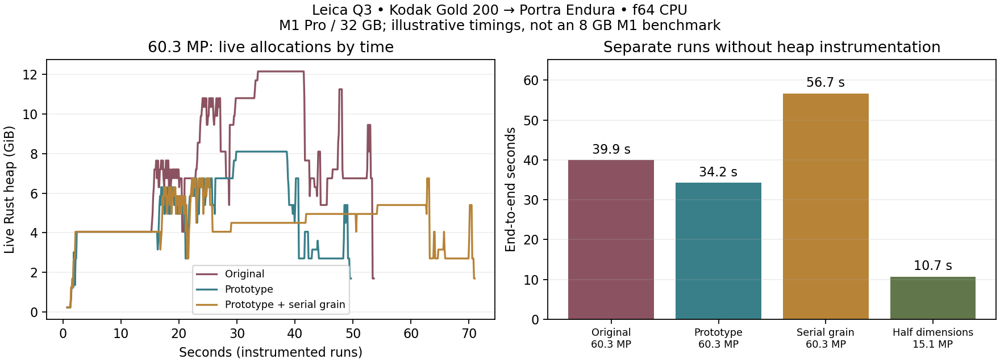

# Leica Q3 memory investigation — 17 October 2026

The main problem is overlapping full-resolution buffers, in both the CPU export and GPU preview. The tested CPU prototype reduces peak live Rust allocations by **33%**, preserving the output exactly. It does **not** yet make full-resolution f64 export comfortable on an 8 GB Mac. **Agreed follow-up:** GPU scratch reuse first, then further CPU ownership/buffer reuse. The user wants full-resolution previews retained and has deferred smaller previews. Reducing overall memory is the goal; 8 GB is not a hard requirement. See [the current handoff](handoff-memory.md).

The sample is `~/Downloads/7858115920.dng`, copied to `target/memory-study/leica-q3.dng`. Its metadata identifies a Leica Q3; it decodes to **9520 × 6336 (60.32 MP)**. The compressed file is approximately 81 MiB. Tests used the M1 Pro / 10-core / 32 GB host, release builds, Kodak Gold 200 → Portra Endura, default effects and TIFF output. CPU export enables enlarger/scanner LUTs, as GUI Export does. Baseline source: `3704ff2`.

## Measured results

Each command ran in a fresh process, with no other benchmark or build intentionally running alongside it. These are illustrative measurements on this host, not base-M1 timings or an enforced 8 GB memory test.

| CPU export configuration | Peak live Rust heap¹ | Peak macOS footprint² | End-to-end time² | Output |
|---|---:|---:|---:|---|
| Original f64 | 12.14 GiB | 15.05 GiB | 40.0 s | 60.3 MP |
| Prototype f64 | 8.10 GiB | 11.82 GiB | 34.2 s | Identical 60.3 MP TIFF |
| Prototype f64, serial grain | 6.75 GiB | 9.96 GiB | 56.7 s | Identical 60.3 MP TIFF |
| Prototype f32 CPU | Not instrumented | 5.83 GiB | 32.0 s | 60.3 MP, numerically different |
| Prototype f64, half dimensions | Not instrumented | 5.61 GiB | 10.7 s | 15.1 MP; reduced detail |

¹ Counting allocator in a **separate run**. Counts requested live Rust allocation sizes, including allocated capacity, but excludes native allocator caches/overhead, stacks and native driver/BLAS allocations. Instrumentation changes timing, so its timings are not used for speed comparisons.

² Normal production binaries. Footprint is sampled every 100 ms using macOS `proc_pid_rusage`; it includes memory charged to the process beyond the live Rust heap, including compressed memory accounting. It is not interchangeable with RSS or total machine RAM usage. The first original run took 55.8 s and peaked at 9.60 GiB RSS; its repeat took 40.0 s and peaked at 12.17 GiB RSS. This variability is why RSS alone is an unreliable comparison here. The original instrumented run's footprint was 13.83 GiB; the prototype instrumented run's was 11.16 GiB. Live heap savings are much more stable than OS accounting/timing.

| GPU rendering path, through CLI | Peak macOS footprint | End-to-end | Pipeline time |
|---|---:|---:|---:|
| Full 60.3 MP | 8.27 GiB | 6.41 s | 4.88 s |
| 2999 × 1996, approximately 6 MP | 3.01 GiB | 2.83 s | 1.60 s, including 1.30 s resize |

These GPU runs include full-resolution RAW decode, one render and TIFF saving. They do **not** include the GUI's previous output, display textures, repeated interactions, or a simultaneous export subprocess. They demonstrate the rendering-path opportunity, not the final GUI memory budget. At 6 MP the actual GPU chain took about 0.26 s. Caching a reduced input would avoid resizing on every slider change. The current resizer still decodes the original first, which limits the reduction in loading peak.



## Where the memory goes

For this image, one RGB frame is **1.348 GiB in f64** or **0.674 GiB in f32**. A single f64 channel is **0.449 GiB**. The source DNG's compressed size is therefore a poor guide to RAM requirements.

- **CPU stage lifetimes:** `Pipeline::process` retained the source, log exposure and film density into later stages. Filming also cloned its RGB input. Rust normally drops local values at their scope boundary, rather than automatically freeing a large buffer at its last use; explicit ownership/drop changes matter here. [Rust Reference](https://doc.rust-lang.org/reference/destructors.html#drop-scopes).
- **Grain:** three channels run concurrently. Each originally held density, accumulated grain, probability, saturation, Poisson seeds and generated grain planes. Just the probability/saturation planes total **2.70 GiB**. Recomputing those scalars avoids storing them, while preserving the required whole-image Poisson-then-binomial RNG order. Serializing channels reduces concurrency, but blur and DIR scratch then become the limiting stages.
- **DIR couplers and blurs:** copies of silver density, correction and three blended channels overlapped with Gaussian/exponential scratch. The prototype releases silver density early and writes each blended channel directly into correction. Large blur intermediates and borrowed inputs remain.
- **Glare:** a scalar noise field was expanded into three identical channels for blur. The existing single-channel blur gives the same result without those RGB copies. Grain's optional particle blur received the same change.
- **RAW loading:** rawler clones sensor data and develops/crops at full resolution. Our conversion creates another RGB representation; its parallel `flat_map_iter().collect()` is another candidate for a preallocated, indexed destination. Releasing the decoded sensor buffer early helps, but does not redesign decoding. Opening another file or changing RAW white balance can overlap old and newly developed GUI inputs.
- **GPU buffers:** the default resident chain prepares ten full-image buffers together: ping/pong **2**, halation **2**, DIR **3**, unsharp **2**, glare **1**. Their requested sizes total **6.74 GiB** at Q3 resolution, before host images, optional readback and driver overhead. CPU and GPU share the memory pool on this machine; GPU allocation is not a separate allowance. [Apple unified-memory API](https://developer.apple.com/documentation/metal/mtldevice/hasunifiedmemory).
- **GUI retention:** the full input `Arc<ImageBuf>` and previous full output alone are about **1.35 GiB**, plus preview textures and in-flight output. Export runs in a child while the GUI remains alive. Arc cloning itself is cheap; retaining the full pixels is the issue.

The direct CPU spectral path is **already tiled**: 262,144 pixels × 81 wavelengths × 8 bytes is approximately **162 MiB** of spectral scratch, reused between tiles. It does not allocate a full 60 MP × 81-wavelength cube. LUT export works on small grids for those contractions. Retuning spectral tile size is not the first priority.

In separate allocation-instrumented runs, sampled stage peaks illustrate the shift:

| Stage | Original live heap | Prototype live heap |
|---|---:|---:|
| Expose / halation | 7.65 GiB | 6.30 GiB |
| DIR couplers | 10.79 GiB | 6.75 GiB |
| Grain including final blur | 12.14 GiB | 8.10 GiB |
| Printing | 6.75 GiB | 4.05 GiB |
| Scanning | 11.24 GiB | 5.40 GiB |

## Options investigated and current decisions

The table records the investigated options. The agreed implementation order is GPU scratch reuse, then CPU buffer reuse. Smaller previews and precision changes are deferred.

| Priority / option | Expected benefit | Speed and quality tradeoff | Work remaining |
|---|---|---|---|
| **1. Keep the tested prototype** | Measured 33% lower peak live heap | Exact output; 34.2 s versus 40.0 s in the normal runs, with host variability | Included in this change; validate on the friend's Mac |
| **Deferred: separate smaller preview from export size** | About 90% smaller image buffers at 6 MP; GPU experiment above | Faster interaction; full export can retain 60 MP. Preview grain/sharpness is not a 1:1 view | Cache a reduced developed input, release the full input, preserve original dimensions, and offer a deliberate 100% detail/ROI preview. Reduce decode/conversion peak separately |
| **Next, second: consume/reuse CPU stage buffers** | Further savings in multiples of 1.35 GiB | Same precision; expected neutral or faster, to be measured | Owned expose/develop/scan APIs, reuse density/correction/output storage, release log exposure after DIR before grain, reuse single-channel blur scratch. Aim for a measured 3–4 GiB export budget, rather than treating that as an achieved result |
| **Next, first: reuse GPU scratch between nonoverlapping passes** | Potentially replace ten full buffers with roughly five; up to 3.37 GiB saved at full size | Same calculations; probably neutral/faster if kept in one submission | Build a scratch allocation plan respecting wgpu binding rules and GPU execution lifetime. Dropping a Rust buffer handle alone cannot free resources still referenced by commands |
| **5. Optional serial grain** | Measured live peak 6.75 GiB versus 8.10 GiB | Exact output, but measured 66% longer overall than the parallel prototype | Implemented as `settings.serial_grain`, exposed under Output in the GUI and off by default. Under swapping, the speed tradeoff may differ |
| **6. Optional f32 CPU export** | Measured footprint 5.83 GiB | Only modest speed improvement here. Loses f64 reference parity; grain texture changes | Expose an explicit quality/precision choice and validate more images/stocks. Some RNG and spectral work stays f64, so savings are not uniformly 50% |
| **7. Tile/stripe export with a bounded working set** | Strongest route to a predictable memory ceiling | Border work, extra passes or disk backing can cost speed; avoiding swap can outweigh this | Larger redesign: global metering, FIR halos, IIR state continuity, FFT overlap handling, deterministic RNG streams, streamed output. Naïve independent tiles introduce seams or change grain |

For B&W, processing the identical grain channels once and broadcasting the result is another promising optimization. It needs an explicit invariant and tests for the resolved monochrome profiles.

The f32 result should not be described as pixel-equivalent: on this Q3 render its mean absolute 16-bit channel difference was 3416/65535 (about 5.2%), primarily reflecting a different grain realization. Whole-image mean RGB differed by less than 0.00004 per channel. A separate 128 × 96 synthetic comparison with grain and glare disabled had maximum output difference **3.16e-7**. That supports a precision option, but is not a perceptual-quality validation across stocks and settings.

For immediate use, the existing **Working resolution = 0.5** produces **4760 × 3168 (15.1 MP)** and was much faster. It currently reduces **both preview and export dimensions**. The code defaults to 1.0; there is no automatic 6 MP preview cap despite the README's description. Simply changing that global default would silently reduce exports, so the preview/export controls need to be separated.

Measure **GUI plus export plus OS headroom**. There is no hard 8 GB acceptance requirement. Preserve full-resolution preview behavior and default parallel exports while reducing their combined footprint. Apple also recommends freeing unused memory and carefully limiting cached scratch buffers; caching everything can trade allocation speed for an excessive footprint. [Apple memory allocation guidance](https://developer.apple.com/library/archive/documentation/Performance/Conceptual/ManagingMemory/Articles/MemoryAlloc.html).

## Changes and validation

The original prototype changed six source files: CPU stage lifetime releases, RAW sensor-buffer release, DIR channel reuse, grain probability/saturation recomputation, single-channel glare/particle blur, and an opt-in serial grain path. Default precision, effects and dimensions are unchanged. Serial grain now uses `settings.serial_grain` (default false), passed explicitly into the model. The GUI exposes it under Output and clears it only in preview parameters, including CPU fallback. Reset settings turns it off. The experimental `SPEKTRAFILM_SERIAL_GRAIN` environment flag used for the historical measurements has been removed.

- Original, lifetime-only, optimized parallel and optimized serial **full-resolution TIFFs match byte-for-byte**. Hashes are in `target/memory-study/output-validation.json`.
- Four synthetic comparisons against the saved original binary have **bit-identical f64 output buffers**, both with and without serial grain: colour, direct spectral/LUT-off, B&W, and slide. They exercise different layer counts and glare blur settings. This checks these cases, not every possible parameter combination.
- Initial core/model/IO/math tests passed in both precisions (110 passed, 1 ignored each). After adding the UI/JSON option, the full workspace suite passed: **126 tests in the default build, 128 in f64, 1 ignored in each**. The ignored test requires an external RAW fixture. The new JSON-controlled serial mode was also rechecked against the original full-resolution Q3 TIFF and all four synthetic cases.
- `git diff --check` passes. The initial investigation was uncommitted; the user subsequently authorized committing this working version with the UI option. Existing untracked `TODO.txt`, `problem.txt`, and `dist/` were left alone.

The profiler is an example binary, so normal application builds have no counting-allocator overhead. Logs, params, snapshots, binaries and output artifacts are under ignored `target/memory-study/`; the report and profiler sources are reviewable changes. A compact copy of measurements and output checks is in [memory-study-q3-results.json](memory-study-q3-results.json).

## Reproduce

```sh
cargo build --release -p spektrafilm-cli --bin spektrafilm-f64 --features precision-f64

# export.json contains:
# {"settings":{"use_enlarger_lut":true,"use_scanner_lut":true}}
SPEKTRAFILM_BACKEND=cpu SPEKTRAFILM_STAGE_TIMINGS=1 \
  python3 scripts/profile_memory.py target/memory-study/repeat \
  target/release/spektrafilm-f64 process target/memory-study/leica-q3.dng \
  --film kodak_gold_200 --params target/memory-study/export.json \
  -o target/memory-study/repeat.tiff

# Set settings.serial_grain to true in export.json for serial scheduling.
# Omit it or set it to false for the default parallel grain.

# Measure live Rust allocations separately:
cargo build --release -p spektrafilm-cli --example memory_profile --features precision-f64
# Run target/release/examples/memory_profile with the same process arguments.
# Its heap lines are allocation diagnostics, not a fair production speed benchmark.
```

For f32, build `--bin spektrafilm` without `precision-f64` and force the CPU backend for the precision comparison. For GPU, use `SPEKTRAFILM_BACKEND=wgpu` and default settings; the small-preview experiment uses `{"io":{"upscale_factor":0.315}}`. The CLI GPU run uses its existing working-image resizer; a future cached GUI preview should avoid repeating that cost.
