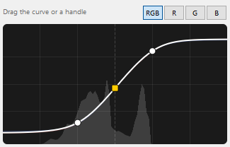
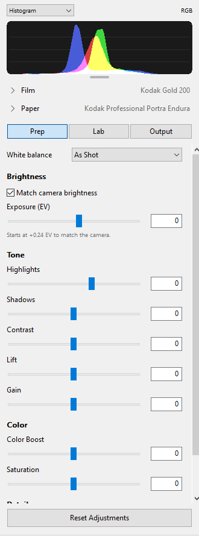
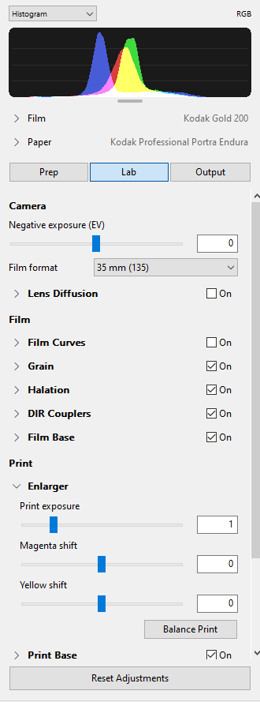
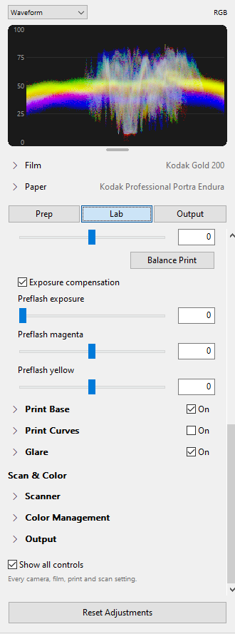
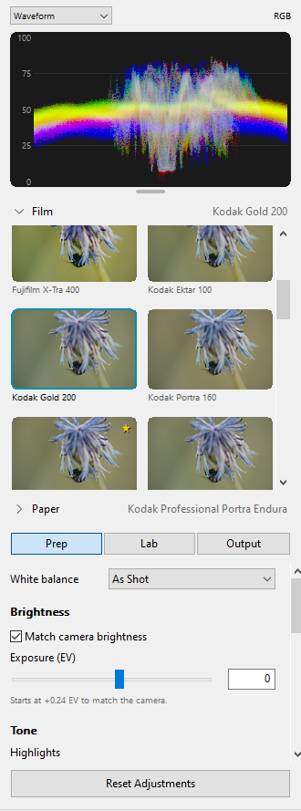
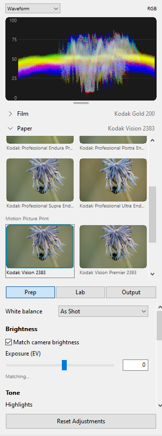
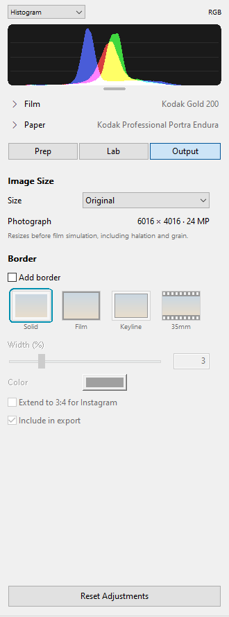
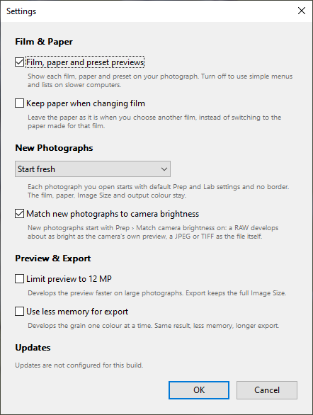

# Windows app

The Win32 client lives in `windows/`, in its own Cargo workspace. Build with
`cargo build --release --locked --manifest-path windows/Cargo.toml` and test
with `cargo test --locked --manifest-path windows/Cargo.toml`.
Run `windows/target/release/Negs.exe` from the checkout; the helper and exporters
must already be built in `target/release` (see `windows-agent-handoff.md`).

## Approved decisions (2026-10-23)

The startup spike was approved: use Win32 common controls and build the
inspector after the first frame. Preview colour uses matrix/TRC monitor ICC
profiles with an sRGB fallback. RAW Show Original uses a helper command with
the same decoder/framing and no film processing. Export options belong in
the save dialog. Crop uses C; Show Original uses backslash and O. Updates use
WinSparkle and a per-user installer; winget is deferred.

## Implementation and validation in progress

Both the adjustments panel and film strip start enabled on every launch,
regardless of their saved visibility. F6/F7 can hide them during the session;
the film strip appears once a photograph is open.

The visible film strip watches its current folder using
`FindFirstChangeNotificationW`, including file names, attributes, sizes and
last-write times. One background worker waits on OS notifications and a stop
event; there is no idle polling. Bursts debounce for 200 ms (at most one second
during a continuing import), scans run serially, and at most one snapshot waits
for the UI thread. Refreshes preserve selection and scroll position, retain
unchanged thumbnails, and reject stale thumbnail results after folder switches
or file changes. Hiding the strip stops the watch; showing it rescans even the
same folder. `cargo test --locked --manifest-path windows/Cargo.toml folder_watch`
exercises arrivals, later writes, renames, removals, idle waiting and cancellation
on Windows.

The client includes the shell, inspector, Vulkan canvas, crop/border
presentation, session storage, helper client, exports, film strip, ICC parser
and dynamic WinSparkle integration. It is not yet a validated release.
The `original` helper command leaves the retained film render available for
Save and uses the existing image loader and preview sizing policy.

On resuming the implementation, the ICC test fixture did not compile; its
byte buffer now has an explicit type. All 43 Windows unit tests pass. All six
helper unit tests pass, including Original followed by Save of the retained
render. The native integration harness passes 17 requests, including both
export paths. DX12 has been removed to respect the Vulkan-only decision.
Successful exports no longer acquire the Windows hidden attribute.

Further review fixed keyboard accelerators being discarded by a reentrant
App borrow, malformed numeric text being silently rewritten, and unchecked
WinSparkle key rejection. The app now sets the installer’s AppUserModelID.
The WinSparkle return-value contract is documented in its
[official header](https://github.com/vslavik/winsparkle/blob/master/include/winsparkle.h).

Both exact matrices pass: each has 116 f32 CPU, 184 f64 and 184 GPU renders
IDENTICAL to its previous same-machine backend-report manifest. The Mac
engine tools build and all six helper tests pass in the isolated verification
worktree. Reports are `scripts/golden/reports/{windows,macos}-ui-exact.json`.
`python -I windows/check_original.py INPUT.NEF` additionally checks matching
preview dimensions and byte-identical Save before/after Original; it passes
on the test D750 NEF (602 × 402 at 10% resolution).

## Presets

Step 5 of [presets-design.md](presets-design.md), matching the macOS app.
`src/presets.rs` handles the files in `%APPDATA%\Negs\Presets` (under
`NEGS_PROFILE_DIR` when set): the naming policy (NFC + case-folded key via
`NormalizeString`, Windows device names also with an extension), the
`.order.json` order file in the Mac's format (hidden), and the identity check
(size and modification time, read fresh) before rename, delete and read.
New files are written to a dot-prefixed temporary file and moved into place
with `MoveFileExW` without `MOVEFILE_REPLACE_EXISTING`. That never replaces,
like the hard link the handoff suggested, and also works off NTFS; a
case-only rename of the same file succeeds. Sharing violations (Explorer's
preview pane) are reported, never retried into another name.

The model (`// MARK: Presets` in `model.rs`) applies a preset as one undo
step, `Apply Preset “Name”`, replacing the params with the helper's
`preset_import` answer and setting film and paper without `choose_film`'s
resets; it asks again if the edit changed while the helper answered. Undo
names are now `Cow<'static, str>`. Unchecked files are sent to the helper
only once the photograph is on screen, so a remembered Presets panel never
delays the first render.

`ui/presets.rs` is the panel: a header with "+" and a "…" menu, then a
report-view ListView (`LVS_EDITLABELS`, custom-drawn two-line rows, a
one-pixel image list for the row height). Refused files are greyed with the
reason as subtitle and info tip. Click or arrow keys apply, double-click and
Enter apply again, a drag doesn't; F2, Delete and the context menu (Apply,
Rename, Export…, Delete…) work as specified. The label edit is moved onto the
name's line. Dragging rows draws its own insertion line (the list view's
insertion mark isn't drawn in report view) and saves the order at once; the
OLE drop target in `ui/drop.rs` imports files dropped on the panel, between
the rows they are dropped between. The panel is created the first time it
shows, after the window's first frame. While cropping, the column shows the
crop panel. The shown pane is the `inspectorPane` preference.

The Adjustments | Presets switch at the top of the column; View ▸ Presets
(F8), File ▸ New Preset (Ctrl+Shift+S) and Import Presets… (Ctrl+Shift+O). The
uninstaller's full cleanup deletes the Presets folder, and its second button
reads "Keep settings, presets and editing session".

Validation (2026-10-28, this machine): 73 Windows tests pass, among them 9
storage tests and 6 that drive the model with the release helper (apply and
undo/redo keep Image Size, rotation, Post, CAT16 and the preview limit; film
A → preset → B → A restores the film's own DIR, halation and grain presets; a
saved session restores the same params; New Preset → Escape leaves no file;
refused files carry the reason; the frozen default GUI state and any files in
`NEGS_PRESETS_TEST_DIR` import, apply and re-export). With the 19 community
and 5 spektrafilm-generated test presets in `%USERPROFILE%\negs-presets-test`
(not in the repository), all 24 and the default state pass that test, and
the panel lists all 24 as valid. Driven in the running app with a scratch
profile: apply by click, New Preset → Escape and → Enter, F2 with an invalid
name, the delete prompt, Import Presets… with one good and one refused file,
a real OLE file drop between rows, dragging a row, Export… (byte-identical
copy), the empty state, and relaunch with the panel remembered.
`check_original.py` passes. The uninstaller test wasn't run: it needs Inno
Setup and a disposable user profile.

Startup, release builds, `docs/card.jpg` passed on the command line, warm
profile, 6 runs each after a warm-up, medians in ms from process start
(`NEGS_STARTUP_REPORT` stamps; each window closed automatically once the
photograph was on screen, all exits clean):

| Build | first window composited | adjustments column shown | photograph on screen |
|---|---|---|---|
| branch before presets (`8b1d9a8`) | 98.0 | 339.0 | 947.8 |
| presets, Adjustments panel | 97.7 | 333.4 | 947.9 |
| presets, Presets panel remembered (8 presets) | 98.4 | 307.9 | 925.5 |

## Film, paper and preset previews

Film and Paper are foldouts of thumbnails of the photograph under each stock, and each
preset row has a thumbnail, as on macOS and Linux ([stock-previews.md](stock-previews.md)).
File ▸ Settings… turns them off ("Film, paper and preset previews", the `previews`
preference), which brings back the menus and the plain preset list. Design, measurements and
screenshots: [the handoff's Windows results](handoff-stock-previews-windows.md#windows-results).
Settings also has "Keep paper when changing film" (`keep_paper`, off by default; see
[handoff-keep-paper.md](handoff-keep-paper.md)).

### Film search

The Mac's `b8ad592` (2026-11-05). A "Search films" field sits over the Film grid, outside
its scrolling; Paper has none. Every word typed must be in the film's name, its id with `_`
read as spaces, or its group title, ignoring case and accents (`state::matching`, through
`FindNLSStringEx` in the invariant locale). While searching, the favourites hide and each
match shows once under its group, in catalog order; groups without matches drop out, and
with none the grid says `No films match “…”`. The grid keeps its height. Return chooses the
first match (one "Change Film" undo step, as a click on its tile), Escape clears the field.
A new search scrolls to the top; clearing it goes back to the current film. A search hides
tiles and lays the rest out again, so tiles and thumbnails stay, and thumbnails are made
only for the matches, in the order shown. The search lasts for the session (closing and
opening the foldout keeps it) and isn't a preference; turning previews off clears it.
Thumbnails still wait for the settled frame (`previews_may_render`), so a search typed while a
quick frame shows, or while a held frame's match solves, asks for nothing until the settled
frame is on screen; Return chooses the film exactly as a tile click does, with the quick frame
and the match (`lifecycle_tests.rs`, "Film search with the held and quick frames").

## Lens corrections

A RAW whose decode finds the camera's lens data (DNG opcodes; Sony, Fujifilm, OM/Olympus
and Panasonic maker notes) shows a "Lens corrections" checkbox after RAW White Balance. It
is on for each newly opened photograph and after Reset Adjustments, off for sessions saved
before it, and kept when a preset is applied. Details:
[lens-corrections-plan.md](lens-corrections-plan.md#windows-ui-done-2026-11-02).

## Tone graph (prototype)

A port of the Mac's ticket 20 prototype (`d351348`, `ToneGraph.swift`). Print Curves opens
with a graph of the paper's response to a ramp of greys. Behind it is the photograph's film
exposure, which comes from the render's `film_histogram`. The RGB, R, G and B buttons show the
neutral curve or one layer; the choice is the `toneGraphChannel` preference. Drag the yellow
middle handle sideways to set Print exposure. Drag a side handle up or down to set Slow or
Fast gamma, or drag the curve anywhere else to set Gamma. A contrast drag also turns Print
Curves on. Each drag is one `Change Tone Curve` undo step, and double-clicking a handle resets
it. The cursor shows which way a handle moves.

`src/tone_graph.rs` holds the logic, kept free of windows so it can be tested. It covers
parsing the helper's `tone_curve` reply and the histogram, the local prediction, the handle
geometry, hit testing and the drag solve, all ported line for line. `ui/tone_graph.rs` is the
window. GDI only draws aliased lines, so the window draws with the shared anti-aliased
`Canvas` of the UI polish (see [Visual polish](#tone-graph-in-the-polished-look)). The
inspector row holds the label and the buttons.

The model asks for a curve only while the graph is on screen. That means Print Curves is
expanded, Adjustments is shown, the Lab tab is open and no crop is in progress, and the
helper advertises `tone_curve`. Only one request runs at a time. Edits made while it runs set
a stale flag, so the curve is requested again when the answer arrives. An identical request is
never sent twice. While a drag waits for the next curve, the last curve is predicted to the
current controls. That curve is drawn dimmed if anything else changed since it was computed,
such as the film, paper or filters. A failed reply keeps the last curve. Opening another
photograph clears the histogram at once, and renders of an earlier photograph are already
dropped. While the film is scanned directly, the graph is disabled and dimmed with the print
groups.

Limitations, as upstream: the histogram ignores the crop and spatial effects, and the curve
hasn't been checked against the GPU render. Toe and shoulder drags are sensitive and
approximate. In the release app, dragging the shadows handle 25 px took Slow gamma to its
0.5 limit. Once the helper's curve for the new value arrived, the handle sat a few pixels
short of the pointer, because the engine's slow and fast gammas change the print less than the
prediction's scaling of paper exposure assumes. Doubling print exposure also pushes the
deepest shadows beyond the last curve's paper exposure. The prediction holds the darkest
value it knows there, about 0.01 too bright, until the next curve arrives.

Validation (2026-11-03, this machine, helper rebuilt from `f0d0ff9`): 101 Windows tests pass,
13 of them new. Eight test the pure rules: prediction exact for print exposure and gamma on a
linear curve, handle placement, hit testing, the middle drag, the curve and side-handle solves,
and malformed replies. Three test the drawing. One tests the histogram across a photo change.
The last drives the model with the release helper. It checks that one request runs at a time,
that an edit meanwhile re-asks on the answer, that a failed reply keeps the curve, and that the
predicted curve for print exposure 2 is within 0.002 of the helper's own wherever the shifted
paper exposure is one the last curve reached.

In the release app (`NEGS_PROFILE_DIR` profile, D750 NEF, driven by synthetic input) each
of the four drags moved only its own control. The middle handle moved one stop gave Print
exposure 1.47. Undo and redo stepped one drag at a time, and a contrast drag's automatic
Print Curves On was undone with it. Double-clicking reset Print exposure. Hover labels named
each handle. R emphasised the red layer and was saved. Scanning film directly disabled the
graph. Collapsing Print Curves hid it.

## Prep, Lab basics and camera brightness (ticket 26)

A port of the macOS commits from `fafda8f` to `6b4d456` (see `docs/prep.md`). The
helper already had Prep, `place_exposure` and the kept prepared frames, so this is UI and
app logic. Decisions (2026-11-03): GPU Prep stays deferred, and Windows follows the Mac on
Post, Start fresh and the Highlights range.

- **Column:** the scope, then the film and paper (pinned, on every tab), then a
  Prep | Lab | Output switch. The column opens on Prep. Settings files from before Prep
  stored `"Lab"` whether chosen or not, so a tab counts as chosen only once it has been
  clicked (`inspectorTabChosen`). An open stock grid is at most 290 DIP tall. It scrolls
  inside itself and opens on the current stock.
- **Prep:** white balance (RAW), Brightness (Match camera brightness or Match original
  brightness, Exposure, the note, and Auto exposure and Metering when matching is off,
  unavailable or they're changed), Tone, Color, Detail, Lens corrections, Input Colour.
- **Lab:** Negative exposure, Film format (110 … 4×5, Custom… shows the long-edge
  slider), each group's basic controls plus anything changed, and Show all controls. Scan
  film directly sits at the top of Print. Scan & Color and its Output group (preview colour
  space and curve) show when changed or with all controls. The Enlarger lists Balance Print
  fourth, as on the Mac.
- **Output:** Image Size and Border. Post's tone and colour rows are gone, and a restored
  session's `post` values reset to neutral, as on the Mac.
- **Settings:** New photographs (Start fresh by default, or Keep the previous edits), Match
  new photographs to camera brightness (on), Limit preview to 12 MP, Use less memory for
  export. The last two are preferences outside Undo and Reset. A session from before them
  lends its per-photo preview limit once.
- **Scope:** Histogram or RGB waveform, the `scopeMode` preference. The grabber below resizes
  it from 88 to 420 DIP: drag, double-click for 88, or Up and Down when focused (`scopeHeight`).
  Both scopes follow the crop, straightening and quarter turns (`histogram.rs`, `Scopes`).
- **Tooltips:** every control and group (`help.rs`), with the Mac's `ControlHelp` texts; a
  test compares the two tables. **Favourites:** a star on each film and paper tile, shown on
  a favourite or under the pointer; a click on it, or the tile's context menu, stars or
  unstars. Favourites lead the grid and the plain menus.

 

 

**Matching.** As in `EditorModel`: `prep.exposure_ev` holds the total, and
`EditState.brightnessMatch` holds the solved part and the inputs it was solved for
(`state::match_inputs`: everything except Prep, print exposure, grain, rotation, crop and
output encoding). One solve runs at a time, after the settled preview. A reply is applied only
if its inputs are still current, and it gets no undo step of its own. Opening another
photograph supersedes a solve. Save and Export wait for a pending match and its preview.
Failures read as on the Mac: a problem with the reference holds for the photograph, a solve
failure holds until the next edit.

**Held frame** (2026-11-06, as macOS `e4a9f92`). A settled frame that arrives while its match is
pending is held, not shown (`render_finished` accepts it, then `release_held` or an edit decides):
the previous frame and the "Updating" badge stay up, the preview isn't current (so thumbnails,
Save and the tone graph's histogram wait), and the solve starts from it. If the match moves the
exposure by 0.05 EV or more, that's an edit: the held frame is dropped and the matched one
renders, so the canvas goes from the previous frame straight to the matched one. If the match
keeps the exposure, fails, or is turned off, the held frame is shown once the solve is back.
Any edit, Undo, another photograph or closing drops it; drag frames and frames while cropping
are never held. A waiting Save or Export keeps waiting while a render or solve is running or due
(a large RAW on the CPU takes about a minute) and then writes the matched frame. If nothing will
finish the match (its render failed, or 30 s passed with nothing running) it says it couldn't
save or export, rather than skipping the save silently or exporting the old exposure. The cost:
on the 33 MP ARW (Vulkan, medians of 8 steps) a film change whose match stays shows its frame
2.29 s after the click, after the solve, where it showed at 1.91 s before; one whose match moves
(Gold 200 and Superia 200) shows only the matched frame, at 4.08 s, two renders and a solve.

**Quick frame** (ticket 28, 2026-11-07, as macOS `30de494` and `8a73944`). A discrete edit (a
film or paper pick, a menu, Undo) on a photograph of 4.5 MP or more first renders only as many
pixels as the canvas shows, then the settled frame at once, with no delay. The quick frame's
status reads "Preview · W × H · developed in …" (with " on the CPU" when it is), the preview
isn't current (Save, thumbnails and the preset check wait), and it isn't saved to the
rendered-preview cache. The canvas keeps its fit, zoom and 1:1 stop: they follow the
photograph's size, not the frame's.
- **When.** `render_step` decides when a render starts: a drag while a slider moves; otherwise a
  quick frame if the canvas shows under half the pixels (scale² ≤ 0.5, in physical pixels, so
  DPI counts), the photograph is 4.5 MP or more, a frame this helper developed of it is on
  screen (not the first frame, not the restored launch frame), the edit hasn't had its quick
  frame yet, and the helper can't answer from its kept output. That last one covers post-only
  edits (about 90 ms on 6 MP instead of a full render). The app keeps the key of the helper's
  last settled render (the request without `preview_path` and `post`, compared by value) with
  the epoch of the helper process that made it: a restarted helper keeps nothing, and one that
  has exited counts as the next epoch already. Border, rotation and crop edits render nothing,
  as before; with Longest side a crop of another extent renders, with a quick frame.
- **Reuse lost after a crop move (Longest side).** The request carries the whole crop, its
  position and angle too, as on the Mac, while the helper keys on the resolved working size.
  After moving or straightening a crop (which renders nothing), the next post-only edit's
  request no longer matches the kept settled render's, so it gets a quick frame and a full
  render (0.40 s on 6 MP, about 2 s on the 33 MP ARW) where the helper alone would reuse its
  output (0.15 s). After a quarter turn the helper doesn't reuse either (`io.rotate_cw` is in
  its key), so there only the quick frame is added. Keying on the crop's extent alone is open
  for Noah, for both apps.
- **Settling.** The step travels with the render to `render_finished`: only a drag re-renders on
  release (a release goes straight to export size), and a quick frame settles only through
  `settle_quick_frame`, once no render, solve, held frame or slider holds it. A failed quick
  frame is silent; the settled render reports its error once and nothing retries. A quick frame
  of an edit already superseded still shows (fast clicks, Ctrl+Z held); the latest edit renders
  next.
- **With the match.** A quick frame whose match is pending is held like a settled one, and the
  solve starts from it (the helper holds its decode). If the match moves the exposure, that edit
  gets its own quick frame, then the one settled render of the matched exposure; the old
  exposure never renders at export size. Previous frame → matched quick frame → settled.
- **Save and Export** asked for while a quick frame shows wait for its settled frame
  ("Developing the preview…"), then write it.
- **Where Windows differs from the Mac.** Save and Export wait for the settled frame (the Mac's
  Save is disabled during a quick frame and skips silently otherwise). A settled render already
  scheduled waits for a solve that started after it (matching turned on while a quick frame
  shows, at exposure 0, which is no edit); the Mac sends it at the old exposure. The kept-output
  key includes the helper's epoch; the Mac's doesn't.

Timings, Gold 200 and Portra 400 alternated, medians from the click (the protocol of "Render
lifecycle tests and timing" below; Vulkan 8 changes, CPU 4; ms):

| Photograph, matching | Vulkan first change, before → after | Vulkan settled, before → after | CPU first change, before → after | CPU settled, before → after |
|---|---|---|---|---|
| 60 MP DNG, off | 3717 → **175** | 3717 → 3474 | 96 922 → **2110** | 96 922 → 97 467 |
| 33 MP ARW, off | 1873 → **192** | 1873 → 2228 | 51 984 → **2105** | 51 984 → 54 988 |
| 33 MP ARW, on | 2289 → **570** | 2289 → 2640 | 52 056 → **3496** | 52 056 → 54 671 |
| 12 MP JPEG, off | 695 → **104** | 695 → 845 | 19 733 → **1254** | 19 733 → 23 919 |
| 12 MP JPEG, on | 734 → **464** | 734 → 1263 | 19 040 → **3220** | 19 040 → 25 862 |

- **"Before"** is the baseline below, from before the held frame, except the ARW with matching on
  on Vulkan, which is the held frame's 2289 ms. The held frame was not measured on the CPU or on
  the JPEG.
- **With matching on** the first change includes the solve (about 0.29 s on Vulkan, 1.3–1.8 s
  on the CPU), because the quick frame is held for it.
- **The quick render** itself takes 80–165 ms on Vulkan and 1.2–2.1 s on the CPU.
- **The settled frame comes later, as expected:** by the quick render plus 150–400 ms on Vulkan
  (the 60 MP DNG varies more than that from run to run), and by 0.5–4 s on the CPU. The 12 MP
  CPU settled render was itself 15 % slower in this run (22.6 against 19.7 s).
- **Memory.** The helper's working set grew by 1–27 MB idle and by up to 56 MB at its peak
  (60 MP DNG on Vulkan: 1631 / 2357 MB against 1606 / 2301 MB). The Mac reported 211 MB on
  60 MP.

**Integrated build** (2026-11-07, branch `win-nov5`: film search, the held frame and quick
frames together, app and helper built from `c953839`; the helper's source is unchanged from
`3c9e166`). The same protocol, machine (Ryzen 5 3600, GTX 1660 SUPER, Windows 10 19045, one
monitor at 125 %, mains power) and files, rerun with nothing else running; medians in ms:

| Photograph, matching | Vulkan first change | Vulkan settled | CPU first change | CPU settled | Helper working set idle / peak MB (Vulkan; CPU) |
|---|---|---|---|---|---|
| 60 MP DNG, off | 232 | 3568 | 2134 | 96 539 | 1606 / 2331; 1416 / 6248 |
| 33 MP ARW, off | 181 | 2045 | 2115 | 53 658 | 978 / 1389; 788 / 3413 |
| 33 MP ARW, on | 553 | 2476 | 3642 | 55 066 | 978 / 1388; 789 / 3413 |
| 12 MP JPEG, off | 81 | 763 | 1095 | 20 350 | 629 / 771; 303 / 1282 |
| 12 MP JPEG, on | 409 | 1082 | 2664 | 21 474 | 624 / 772; 304 / 1282 |

Every measured step made one quick and one settled render and presented `quick, settled`. The
numbers are within run-to-run noise of the quick-frame table above: settled −183 to +94 ms
on Vulkan (the 60 MP DNG the slower one) and −4.4 to +0.4 s on the CPU, following the
helper's own render times (the 12 MP CPU settled render took 19.2 s this run against 22.6 s
then); first change −56 to +57 ms on Vulkan. The benchmark runs
with previews off; with previews on and a search active, a Return on the 33 MP ARW with the
match on presented the matched quick frame at 818 ms and the settled frame at 2574 ms, and the
first thumbnail went out after the settled render, so the search adds nothing before the
settled frame. With the crop overlay up, a film change's quick and settled frames leave the
overlay, its handles and the straighten dial where they were.

The reference (`brightness.rs`) is the RAW's embedded preview through rawler, oriented,
letterbox bars trimmed when its shape differs, at most 512 px. For JPEG, PNG and TIFF it is
the file itself through WIC with its profile; transparent and floating-point files are
refused. Its colour space comes from a DNG preview's PreviewColorSpace, the EXIF ColorSpace, the Nikon, Canon or Pentax maker note, or an
embedded JPEG's EXIF. Adobe RGB is converted to sRGB. A preview that says nothing is read as
sRGB on every platform (2026-11-04); one in another declared colour space (a DNG's ProPhoto or
gray gamma 2.2) reads "The camera preview’s colour space isn’t supported." The Mac reads
the same preview through ImageIO but asks the helper for this declaration
(`preview_colour_space`), so the rule is the same everywhere.

**Validation** (2026-11-03, this machine, helper from `6ec07ac`; the crates are unchanged on
this branch): 130 Windows tests pass, 29 of them new. They cover the Mac's lifecycle and
exposure-placement rules: Start fresh and Keep, sessions, the preview limit through Undo and
Reset, film formats, matches applied only for their inputs, offsets kept across a new match,
Undo restoring a paper with its match, superseded and failed solves, waiting outputs, the
Lab's basics and Prep's meter rule. Also scopes, tooltips against the Swift file, letterbox
trimming, colour-space reading and preference migration. One test drives the real helper:
`docs/card.jpg` matches itself at +0.09 EV, and with `NEGS_TEST_RAW` the D750 NEF (Adobe RGB
in its Nikon maker note) matches its preview at +0.24 EV. Build warnings are unchanged (16, 14
in tests).

In the release app (`NEGS_PROFILE_DIR` profile, driven through UI Automation) the NEF opened on
Prep with "Starts at +0.24 EV to match the camera.". Choosing Vision 2383 showed "Matching…"
and then a new solve within 0.05 EV, which keeps the value. The session saved the match
(`brightnessMatch` in `session.json`) and a relaunch restored it. All three tabs, Show all controls, the waveform at 170 DIP, the film
grid with a starred Portra 400, and the Settings dialog look as in the screenshots.

Performance, on a Ryzen 5 3600, warm profiles, `docs/card.jpg`, medians of 9 alternating runs
against `main`'s build:

| Stamp | main | this branch |
|---|---|---|
| `first_window_composited` | 109 ms | 106 ms |
| `inspector_shown` | 296 ms | 257 ms |
| `first_image_on_screen` | 973 ms | 975 ms |

The first column builds fewer rows (create 36–41 ms against 100–107 ms), since the Lab shows
only its basics. A first visit to Lab costs about 86 ms and to Output about 58 ms; after that a
switch only shows and hides rows. The new visibility rules cost about 0.1 ms per inspector
update (Prep 113 µs, Lab 96 µs, release build, real catalog). Through the helper on a 24 MP
NEF, Prep's controls add 35 ms per 12 MP drag frame, and the match itself takes about 0.3 s
(`docs/windows-prep-port-plan.md`).

The screenshots above are from before the UI polish; the polished Prep, Lab and Output are
under [Prep in the polished look](#prep-in-the-polished-look), where sliders also fill from
their default.

Not done or not verified here: the RAW samples with letterboxed previews and other
makers' colour spaces (no files on this PC; trimming and the maker-note readers are unit-tested
only); Save and Export while a match is pending in the release app (unit-tested); Windows 11,
150 % scaling and high contrast. Hover effects (the tile star) were seen only through the
favourite's filled star.

## Visual polish (2026-11-03)

[handoff-windows-ui-polish.md](handoff-windows-ui-polish.md), on Win32 and GDI as before.
Every control stays the real one (window class, focus, keys, accessible name); only
its painting changed.

- **Painting** (`ui/theme.rs`, `ui/draw.rs`): one palette for every owner-draw,
  custom-draw and `WM_CTLCOLOR*` handler, and an anti-aliased back buffer (rounded
  shapes, GDI text) shared by all control paints on the UI thread. Trackbars, push
  buttons, checkboxes, radio buttons and the two-part switches are drawn through
  `NM_CUSTOMDRAW`; group headers, foldouts, swatches, border samples and tiles through
  `WM_DRAWITEM`; drop-down lists' closed boxes, the toolbar, the status bar and the
  menu bar through `WM_PAINT` subclasses.
- **Controls:** sliders are a thin track with the accent from the default value to
  the round thumb (centre-out for Exposure), with hover, pressed and focus states;
  double-click and Alt-click reset and wheel routing are unchanged. Lab | Post and
  Landscape | Portrait are segmented switches (still radio buttons). Open Photograph…,
  Done and OK are accent filled; other buttons have a subtle fill and border. Value
  boxes are borderless until hovered or focused; reset glyphs are grey until hovered.
  Recent photographs in the empty state are link-styled buttons (a SysLink's colour
  can't follow the theme), so they read as buttons, not links.
- **Typography and spacing:** Segoe UI Variable Text and Display where installed
  (Windows 11; the size still comes from `SystemParametersInfoForDpi`), a semibold
  section size, one secondary grey. The column, crop panel, Presets panel, empty
  state and Settings use an 8 DIP grid with one control column for all rows. A DPI
  change now gives each inspector control back its own font (before, all got the
  UI font: section titles lost their weight and reset glyphs became letters).
- **Dark mode** follows `AppsUseLightTheme` and switches on `WM_SETTINGCHANGE`
  ("ImmersiveColorSet"), `WM_SYSCOLORCHANGE` and accent changes. High contrast uses the
  system colours only. Title bars use `DWMWA_USE_IMMERSIVE_DARK_MODE` (20, or 19 before
  build 18985). Scroll bars, lists, tooltips and the progress bar use
  `DarkMode_Explorer`. Popup menus use the undocumented uxtheme exports by ordinal:
  `AllowDarkModeForWindow` (#133), `SetPreferredAppMode` (#135) and `FlushMenuThemes`
  (#136). They're looked up only on build 18362 and later, and menus stay light if
  they are missing. **Risk:** these ordinals are not a public API and a Windows
  update could change them; the lookup fails safe to light menus. The canvas surround
  is `#2b2b2b` in dark (the photograph's pixels and colour management don't change).
  `NEGS_THEME=light|dark` overrides the system, for tests and screenshots.
- **Windows 11** (build 22000 and later): `DWMWA_WINDOW_CORNER_PREFERENCE` = round.
  Mica is not used: it only shows where nothing paints opaquely, and the band's text,
  glyphs and toolbars are GDI, which paints opaque. Making them alpha-correct is more
  work than it's worth without a Windows 11 machine to check it on.
- **Title bar** (`ui/titlebar.rs`): `WM_NCCALCSIZE` gives the caption's place (and
  the old menu bar's) to a 40 DIP band holding the icon, the menu bar, Open, the
  title, Export, the panel button and the caption buttons. The photograph's tools
  (zoom, rotate, crop, Before | After, film strip) are a pill the canvas draws under
  the photograph, with tooltips placed over it; a fitted photograph keeps clear of it. The side and bottom frame stay the system's, and a
  maximised window is kept on its monitor. `WM_NCHITTEST` returns `HTCAPTION`, top
  edge resize, and `HTMINBUTTON`/`HTMAXBUTTON`/`HTCLOSE` (for Windows 11 snap
  layouts); the caption buttons' clicks are handled in `WM_NCLBUTTONDOWN/UP` so the
  system draws no classic buttons. The menu bar is a toolbar control (MSAA shows
  File … Help as menu items) that opens the same popups with `TrackPopupMenuEx`; a
  `WH_MSGFILTER` hook moves between menus on the pointer and Left/Right. Alt and F10
  give the menu bar the keyboard, and Alt+letter opens a menu; it's taken before
  dialog navigation, which swallowed it. Full screen keeps the band without caption
  buttons (the old menu bar was hidden in full screen).
- **Motion** (`ui/motion.rs`): about 140 ms, ease-out, on the timed tasks. Lab | Post
  and entering or leaving crop fade the panel in (a layered child while it runs);
  opening or closing a group or foldout slides the rows below, and the revealed rows
  show when they arrive. Off when `SPI_GETCLIENTAREAANIMATION` is off; nothing runs
  while idle.

### Results

Validation (2026-11-03, this machine, Windows 10 22H2 build 19045, one 3440 × 1440
monitor at 100 %, system app theme dark): `cargo test --locked` passes all 88
Windows tests (`NEGS_PROFILE_DIR` scratch profile, `NEGS_ALLOW_MULTIPLE=1`). The
release build has 15 warnings, all pre-existing; `origin/main` had 16, and one went
away with the replaced accent code.

**Startup:** release builds, `docs/card.jpg` on the command line, warm profile and
pipeline cache, scratch profiles, `NEGS_STARTUP_REPORT` stamps from process start.
Each window was closed once the photograph was on screen (all exits 0). This machine
was shared with other work, and single runs vary by ±20 ms or more. So the two builds
ran interleaved in ABBA order (each first and second equally often), with one warm-up
each and 12 measured runs, rather than as separate batches of 6. Medians in ms:

| Build | first window composited | adjustments column shown | GPU ready | photograph on screen |
|---|---|---|---|---|
| session 1: `origin/main` (`c721589`) | 105.2 | 295.2 | 632.5 | 912.2 |
| session 1: this branch, system theme (dark) | 104.5 | 292.8 | 543.5 | 898.2 |
| session 2: `origin/main` (`c721589`) | 106.4 | 296.0 | 541.0 | 879.5 |
| session 2: this branch, `NEGS_THEME=light` | 105.9 | 296.5 | 639.8 | 916.9 |

GPU initialisation is bimodal in both builds: about 540 or about 635 ms, whichever
build runs. The photograph's time follows it, so whichever build gets more fast runs
in a session wins its median. Within one mode the builds match: slow-mode medians of
the photograph on screen were 920.5 vs 918.2, 916.3 vs 909.9 and 917.9 vs 918.2 ms
(`origin/main` vs branch) in three sessions. Two earlier sessions, before the shared
paint buffer, drawn combo boxes and message-loop hover, measured the adjustments
column at +7.9 and +10.5 ms. Those three changes took out per-control DIB sections,
per-combo dark themes (about 3.6 ms in dark) and per-control subclasses (about 1.7 ms).

**Screenshots** (window only, `docs/windows-ui-polish/`): before is `origin/main`,
which has no dark mode; it was captured with the system in dark and looks the same in
light. These predate the Prep port's column (scope, pinned film and paper, three tabs);
see [Prep in the polished look](#prep-in-the-polished-look) for the column as it is now.

| | before | after, light | after, dark |
|---|---|---|---|
| Empty state | [before](windows-ui-polish/before-empty.png) | [light](windows-ui-polish/after-light-empty.png) | [dark](windows-ui-polish/after-dark-empty.png) |
| Lab, film foldout open | [before](windows-ui-polish/before-lab.jpg) | [light](windows-ui-polish/after-light-lab.jpg) | [dark](windows-ui-polish/after-dark-lab.jpg) |
| Lab, groups open | [before](windows-ui-polish/before-groups.jpg) | [light](windows-ui-polish/after-light-groups.jpg) | [dark](windows-ui-polish/after-dark-groups.jpg) |
| Post, border on | [before](windows-ui-polish/before-post.jpg) | [light](windows-ui-polish/after-light-post.jpg) | [dark](windows-ui-polish/after-dark-post.jpg) |
| Presets with thumbnails | [before](windows-ui-polish/before-presets.jpg) | [light](windows-ui-polish/after-light-presets.jpg) | [dark](windows-ui-polish/after-dark-presets.jpg) |
| Crop | [before](windows-ui-polish/before-crop.jpg) | [light](windows-ui-polish/after-light-crop.jpg) | [dark](windows-ui-polish/after-dark-crop.jpg) |
| Settings | [before](windows-ui-polish/before-settings.png) | [light](windows-ui-polish/after-light-settings.png) | [dark](windows-ui-polish/after-dark-settings.png) |

**Behaviour**, checked in the release build:
- **Window management** (real pointer and keys): maximise and restore by the caption
  button and by double-clicking the band (a maximised client starts at the monitor's
  top), minimise and close (exit 0), F11 in and out. Menus open by click and follow
  the pointer to the next menu. Alt+F opens File and Right moves to Edit. F10 then
  Right, Right, Down opens View. Popup menus are dark in dark mode.
- **Adjustments column**, the same steps on `origin/main` and the branch, through
  posted input messages: real input was withheld once the window lost the foreground
  to another app. Results were identical:
  - Tab order through the column (21 distinct stops in 30 Tabs from Exposure).
  - Slider Right/Left keys and the value box following.
  - Double-click reset back to the default.
  - Typing into the value box with Enter (value and slider follow).
  - F6 hides and shows the film strip.
- **Dark drop-down lists:** a combo box's list is dark when it opens.
- **Focus rings** show after keyboard use (screenshots with the Film foldout,
  Add border and the Settings checkbox focused).

**Accessibility:** the MSAA tree was dumped on both builds (Lab and Post tabs, every
visible element's role, name, value and state; Narrator reads Win32 controls through
these). It is the same apart from the menu bar, which now appears in the client area
as File, Edit, View, Image and Help menu items. Sliders keep their names and values,
value boxes their names ("Exposure (EV)", value "0"), and foldouts their "Film: Kodak
Gold 200, collapsed". Checkboxes, radio buttons and buttons keep their roles and
checked states. Narrator itself wasn't run.

**Not verified here:**
- **Windows 11:** rounded corners, Segoe UI Variable and snap layouts on the maximise
  button (this PC is Windows 10).
- **Live switching between light and dark:** that needs the system setting changed.
  The handler re-reads the theme and re-themes every window, but only
  `NEGS_THEME=light/dark` launches were seen.
- **High contrast and 150 % scaling screenshots, and a DPI change between monitors:**
  these need system settings changed or a second monitor.
- **Real-input checks** (the foreground was in use): Alt-click reset, Escape in a
  value box, the context menu's Reset to Default, and Show Original by holding O or \
  (PrintWindow doesn't re-capture the Vulkan canvas, on either build).
- **Drag and drop** onto the canvas and the Presets panel (`ui/drop.rs` is unchanged).
- **System dialogs:** whether task dialogs and the colour dialog follow dark mode
  (they're system dialogs, not themed by the app; task dialogs are light on Windows 10
  as far as is known). The file dialogs follow the system.
- **F7 and F8:** F7 hid the column, but the second F7 and F8 left it hidden, the same
  on `origin/main`. This is probably the posted messages: the focused control had
  been hidden.

### Tone graph in the polished look

The tone graph (above) landed on main while the polish was on its branch. After merging
`origin/main` (`6ec07ac`), its row was brought into the same look:

- **Graph** (`ui/tone_graph.rs`): painted into the shared `Canvas` instead of its own pixel
  raster. `Canvas` gained `stroke` (a translucent polyline whose segments merge before they
  are blended, so joints don't darken), `fill_under` and `shape`, all through one reused
  coverage mask. The graph's corners take the panel colour (they were `COLOR_BTNFACE`, light
  in dark mode). The well stays dark in light and dark, like the histogram and the Mac's
  graph. High contrast draws the well, grid, curve and handles in the system colours only
  (window, window text, highlight) with a window-text outline, and leaves out the faint
  layers behind the chosen one.
- **RGB | R | G | B** is one segmented switch. Segments gained a middle part
  (`Role::SegmentMiddle`); before, R and G drew as right-hand ends of a two-part switch. A
  disabled switch now keeps its chosen segment's text readable (it was grey on grey).
- **Grid:** the label and the switch share a 32 DIP line (the label centred on the switch),
  the graph is 168 DIP high, with 8 below.
- **Disabled labels:** a disabled static control embosses its text (white over grey) whatever
  colour `WM_CTLCOLORSTATIC` gives it. In dark that showed on every disabled row, for example
  all of Print Curves while it is off. Labels now stay enabled and are dimmed instead
  (`draw::enable`, `draw::is_dimmed`), and a dimmed label's double-click no longer resets its
  disabled row. MSAA no longer reports such labels as unavailable; their controls still are.

**Results** (2026-11-03, this machine, as above): `cargo test --locked` passes all 102
Windows tests (main's 101 plus one for the high-contrast colours; the graph's two raster
tests now test `Canvas`). The release build has 15 warnings, all pre-existing; `origin/main`
(`6ec07ac`) has 16. Startup, `origin/main` (`6ec07ac`, built fresh) against this branch,
ABBA order, a warm-up each and 12 measured runs per build, medians in ms. Every run was in
the slow GPU mode (`gpu_ready` 618–664 ms), so the photograph's times compare directly:

| Build | first window composited | adjustments column shown | GPU ready | photograph on screen |
|---|---|---|---|---|
| session 1: `origin/main` (`6ec07ac`) | 98.1 | 286.5 | 637.2 | 952.0 |
| session 1: this branch, system theme (dark) | 104.2 | 293.1 | 642.7 | 955.4 |
| session 2: `origin/main` (`6ec07ac`) | 104.7 | 298.2 | 643.2 | 955.3 |
| session 2: this branch, `NEGS_THEME=light` | 101.9 | 295.5 | 639.8 | 956.1 |

The differences (+6.1/+6.6/+3.5 ms in session 1, −2.8/−2.7/+0.8 ms in session 2) are within
the 10 ms allowed and of the size of the run-to-run noise. The graph isn't on screen at
startup with the default profile (Print Curves is closed), so its painting isn't in these
numbers.

**Screenshots** (window only, Print Curves open on Lab with all controls, `docs/card.jpg`,
retaken after the Prep merge below):
[light](windows-ui-polish/after-light-tone-graph.jpg),
[dark](windows-ui-polish/after-dark-tone-graph.jpg),
[dark, R layer](windows-ui-polish/after-dark-tone-graph-red.jpg),
[light, scanning film directly (disabled)](windows-ui-polish/after-light-tone-graph-scanning.jpg).
Main's look, for comparison: [windows-tone-graph.png](windows-tone-graph.png).

**Behaviour**, through posted messages in the release build: hovering the middle handle
names it ("Print exposure 1.00 · drag sideways"); dragging it 30 px set Print exposure to
1.64–1.76, with the label following during the drag; double-clicking the handle reset it to
1.00. The same steps on the merged build before this restyling behaved the same.

**Not verified here:** high contrast (it needs the system setting; the colours are checked
by a unit test only), the live light/dark switch (as above; the graph reads the palette on
every paint and is repainted by the theme switch's `RedrawWindow`), 150 % scaling, and
Narrator.

### Prep in the polished look

The Prep port (ticket 26, `windows-prep-port` at `b4d3bb8`, section above) was merged onto
the polish after the tone graph. It was written against the pre-polish look, so the merge
kept its structure and behaviour and the polish's painting:

- **Merge** (`ui/inspector.rs`, 14 conflicts): the Prep port's scope with its grabber, the
  pinned film and paper above the tabs, Prep | Lab | Output, `place_rows` and its new row
  kinds, favourites and the film grid's own scrolling; with the polish's class backgrounds
  from the palette, Canvas tiles, the scope's rounded corners, hover tracking on headers
  (beside the Prep port's help tooltips), the 8 DIP grid and one control column for the new
  rows (Film format, Match brightness, Show all controls, the skipped paper), and the slide
  when a group opens in the scrolled rows (the pinned rows are placed directly). The
  favourite star is drawn into the tile's Canvas; it sits on the photograph, so it keeps
  its fixed gold and white. `ui/dialogs.rs` (2): Settings' new New Photographs and Preview
  & Export sections on the polish's spacing, the New Photographs choice a drawn combo box
  with a themed list.
- **Polished afterwards:** the scope's Histogram | Waveform menu is a drawn combo box with a
  themed list and its RGB label is from the palette (it had a light box in dark). The
  grabber is drawn with `Canvas` (it was a light `COLOR_BTNFACE` strip in dark): a pill that
  darkens under the pointer or while dragged, a focus ring after keyboard use, 8 DIP high.
  Prep | Lab | Output is one switch, Lab its middle segment (`Role::SegmentMiddle`, added
  for the tone graph's RGB | R | G | B). While film is scanned directly, the paper row is
  as tall as the paper foldout it replaces, so the pinned area doesn't jump, and lines up
  with it. The scope's well stays dark in both themes, like the histogram before it.

**Results** (2026-11-03, this machine, as above): `cargo test --locked` passes all 131
Windows tests (the Prep port's 130 and the high-contrast test). The release build has 15
warnings, all pre-existing (`origin/main` 16, the Prep port 16); the tests build with 13.
Startup, ABBA order, a warm-up each and 12 measured runs per build, fresh profiles (they
open on Prep), medians in ms:

| Build | first window composited | adjustments column shown | GPU ready | photograph on screen |
|---|---|---|---|---|
| `origin/main` (`6ec07ac`) | 111.6 | 307.2 | 652.1 | 972.2 |
| this branch | 108.7 | 265.7 | 639.3 | 956.2 |
| `windows-prep-port` (`b4d3bb8`) | 110.7 | 267.6 | 645.9 | 950.3 |
| this branch | 111.1 | 266.3 | 634.8 | 944.3 |

Measured at `0440147`; the later skipped-paper row only changes the layout while scanning.
Against `origin/main` the column is 41 ms sooner, which is the Prep port's doing (it builds
only Prep's rows first). Against the Prep port the polish is no slower on any stamp (+0.4 ms
at most). Some runs had the fast GPU start: 3 of the branch's in the first comparison, 3 of
the Prep port's and 4 of the branch's in the second. With slow-start runs only, the
photograph was on screen at 972.2 against 959.5 ms and at 961.0 against 953.9 ms.

**Screenshots** (window only, `docs/card.jpg`):

| | light | dark |
|---|---|---|
| Prep | [light](windows-ui-polish/after-light-prep.jpg) | [dark](windows-ui-polish/after-dark-prep.jpg) |
| Lab | [all controls](windows-ui-polish/after-light-lab-all.jpg) | [basics](windows-ui-polish/after-dark-lab-basics.jpg) |
| Output | [light](windows-ui-polish/after-light-output.jpg) | |
| Film grid, Portra 400 starred | [light](windows-ui-polish/after-light-film-grid.jpg) | [dark](windows-ui-polish/after-dark-film-grid.jpg) |
| Waveform at 168 DIP | | [dark](windows-ui-polish/after-dark-waveform.jpg) |
| Settings | [light](windows-ui-polish/after-light-settings-prep.png) | [dark](windows-ui-polish/after-dark-settings-prep.png) |

**Behaviour**, through posted messages in the release build: the grabber's Down key twice
made the scope 40 DIP taller and a double-click returned it to 88 (saved as `scopeHeight`);
the three tabs each showed their own rows (Camera, Image Size, Brightness); the tone graph's
row behaves as above.

**Not verified here:** high contrast, the live light/dark switch, 150 % scaling, Narrator and
Windows 11, as above; the tile star's hover and its click (only the favourite's filled star
was seen, as in the Prep port's own check); dragging the grabber with the pointer; the
scope menu's list opening dark (it uses the same handler as the column's lists).

## The Mac's fit, window minimum and viewer background (2026-11-04)

The Mac's `c92b539` made four fixes. Three are ported; the fourth isn't needed:

- **Fit stops at 1:1** (`ui/canvas.rs`, `zoom_amount`): fitting shows the whole photograph
  but never enlarges a small one past one photograph pixel per screen pixel.
- **Window minimum** (`ui/mod.rs`): the client keeps room for the canvas (680 DIP), the
  splitter (5) and the adjustments' minimum (300), so 985 × 520 DIP; with the adjustments
  hidden, 680 × 520. Height stays at Windows' 520 (the Mac's is 560). A smaller saved frame,
  or a window the adjustments are reappearing in, grows to it first (`fit_minimum`), keeping
  its top-left corner and its monitor's work area; maximized and full screen windows are
  left alone. On a screen smaller than the minimum, the work area is the minimum. Unlike
  the Mac's split view, the column's chosen width (300–440) narrows to leave the canvas its
  680 before the window can shrink further, and the splitter can't be dragged past it.
- **Custom viewer background** (Settings › Preview & Export, before Limit preview, as in
  the Mac's order): a checkbox, Choose Colour… (the common colour dialog) and a swatch,
  saved under the Mac's keys `viewerBackgroundCustom` and `viewerBackgroundColor`
  (`#242424` by default). Off, the canvas follows the theme as before. High contrast keeps
  the system's colours either way.
- **Not ported: typed export sizes.** The Mac's Size field cleared partial numbers while
  typing because of its formatter's range. The Windows save dialog's edit box has no
  formatter and clamps only when read, so a typed 1600 exports at 1600 already.

**Results** (2026-11-04, this machine, release build): `cargo test --release` passes all
128 Windows tests, 3 of them new (fit, minimum width, the adjustments giving way). The
brightness tests that moved to `spektrafilm_io::brightness` in the merge left this suite.
In the release app with a fresh profile (`NEGS_PROFILE_DIR`) and a D750 NEF at 100 %: a
saved 700 × 450 frame opened at a 985 × 520 client with the column at 300 DIP; resizing to
400 × 300 stopped at 985 × 520, and at 680 × 520 with the adjustments hidden; showing them
again grew the window back to 985. The custom colour filled the canvas; unticking it
disabled the button, faded the swatch, and after OK saved `false` and showed the theme's
grey again.

**Not verified here:** fit on a photograph smaller than the canvas (covered by the unit
test only), a monitor smaller than the minimum, other scaling than 100 %, light theme and
high contrast with a custom background.

## Render lifecycle tests and timing (2026-11-06)

Groundwork for the held frame and quick frames (`docs/windows-nov5-port`, chunk 0).

**Lifecycle harness** (`windows/src/model/harness.rs`). It drives the model's real lifecycle
against the release helper: `render`, then `render_finished`, `reconcile_brightness_match`,
`brightness_solved` and `render` again, as the app runs it. The model finishes every request by
posting a task to the UI thread (`ui::post`, and `ui::after` for timers).
- **Headless app.** The harness wraps the model in an `App` with no windows and runs those tasks
  unchanged, one at a time, as the message loop's `drain` does.
- **After each task**, it does what `App::refresh` does with the model: it takes the dirty marks,
  collects a reported error and pumps the thumbnails.
- **Isolation.** The task queue is process-wide, and other unit tests post to it. So each
  lifecycle test re-runs itself alone in a child process with a scratch `NEGS_PROFILE_DIR`, one
  child at a time.

Run the lifecycle tests with
`cargo test --release --locked --manifest-path windows/Cargo.toml lifecycle`. They need the
release helper built from the same checkout. Without it they print "skipped" and pass. With
`NEGS_REQUIRE_HELPER=1`, a missing helper fails these tests and the other live tests instead.

What a test can use:
- `lifecycle_test!`, which runs the test in its own child process.
- `Harness::start`, `open`, `edit` (a click or key followed by a refresh), `idle` and
  `run_until`.
- `fire_timers`: runs `ui::after` tasks early.
- `model.render_log`: every render request (kind, revision, generation, interactive scale).
- `commands()`: every helper command, in the order sent.
- `frames`: every frame shown, sampled after each task; `model.frame_log`: every frame
  presented, also one replaced within a task. `errors`: every error reported.
  `model.held_frame()`: the frame held for its brightness match, if any.
- `ui::canvas::set_fixed_scale`: stands in for the canvas. Its value is in physical screen pixels
  per photograph pixel; the app is per-monitor DPI aware, so the same view at 150 % has 1.5 times
  the scale it has at 100 %.
- A deterministic 3072 × 2048 test photograph (6.3 MP).

**Trace and benchmark** (`windows/src/trace.rs`). Both are off unless their environment variable
is set.
- `NEGS_RENDER_TRACE=<file>` writes JSON lines with QPC times: each edit, each render request and
  reply (`elapsed_ms`, `cached_pipeline`, `pipeline_ms`), every helper command, each brightness
  solve (with the Exposure note when idle), and the canvas's first present of each frame (after
  the Vulkan present or the software blit) with DWM's composition after it.
- `NEGS_RENDER_BENCH=<film>,<film>` alternates the films once the preview is idle and shown.
- `windows/measure_render.ps1 -Photo … -Match on|off -Backend vulkan|cpu` runs one benchmark with
  a fresh profile, with previews off and the window at 1600 × 1000 DIP. It samples the helper's
  working set, and `windows/render_trace.py` summarises the run. Steps 1–2 are warm-up; the
  medians are over the rest.

**Baseline**, before the held frame and quick frames, on this machine:
- **Machine and build:** Ryzen 5 3600, GTX 1660 SUPER, Windows 10 19045, one 3440 × 1440 monitor
  at 125 %, mains power, nothing else running. Helper and app built from `3c9e166` (the crates
  are unchanged on this branch); the CPU fallback used `RAYON_NUM_THREADS=6`.
- **Photographs:** a 60 MP Leica M11 DNG (9504 × 6320, from Lightroom), a 33 MP Sony ARW
  (7008 × 4672) and a 12.2 MP iPhone JPEG (4032 × 3024).
- **Edits:** Gold 200 and Portra 400 alternated, warm, 8 measured changes on Vulkan and 4 on the
  CPU.

All times are from the edit to the frame presented, median ms. With matching on, these two films
match within 0.05 EV of each other, so the solve doesn't render again, and the settled frame is
the first frame.

| Photograph | Matching | Vulkan first = settled | Vulkan solve | CPU first = settled | CPU solve | Helper working set, idle / peak (Vulkan; CPU) |
|---|---|---|---|---|---|---|
| 60 MP DNG | off (on: refused, see below) | 3717 (3308–5933) | – | 96 922 | – | 1606 / 2301 MB; 1401 / 6233 MB |
| 33 MP ARW | off | 1873 | – | 51 984 | – | 961 / 1340 MB; 772 / 3397 MB |
| 33 MP ARW | on | 1913 | 212 | 52 056 | 1452 | 970 / 1349 MB; 774 / 3398 MB |
| 12 MP JPEG | off | 695 | – | 19 733 | – | 622 / 764 MB; 295 / 1274 MB |
| 12 MP JPEG | on | 734 | 209 | 19 040 | 1570 | 623 / 765 MB; 295 / 1274 MB |

Notes on the table:
- **Where the time goes.** Nearly all of it is the helper's render: medians of 3363, 1585 and
  632 ms on Vulkan, and 96 818, 51 868 and 19 928 ms on the CPU. On Vulkan the rest (sending,
  reading the buffer back, uploading and presenting) is about 60 ms at 12 MP and 290–350 ms at
  33–60 MP. DWM composes 3–13 ms after the present.
- **The solve's place.** It runs after the settled frame is on screen, so it isn't in the first or
  settled times above.
- **The 60 MP DNG on Vulkan varies run to run** (3.0–5.7 s in the helper). On Vulkan the
  33 MP times spread by at most 10 %, and the 12 MP ones ran 611–746 ms with matching off and
  700–1006 ms with it on. On the CPU every photograph spread by under 5 %.
- **The `pipeline_ms` field.** With the pipeline cached it is about 1 ms; building one takes
  30–70 ms.
- **The 60 MP DNG refuses matching** with "The camera preview is framed differently from the
  photo.", so it measures matching off only. Its Lightroom preview has another shape.

**Shared changes checked on Windows.** Tests in `session.rs` and `model/lifecycle_tests.rs`:
- **Favourites:** a new profile has the four films. An emptied or custom list is kept. In the
  release app a new profile shows Gold 200, Portra 400, Ektar 100 and C200 starred, before the
  groups.
- **Fotufilm:** 52 films and 10 papers, each film in exactly one group, the new films with their
  own 35mm strips (Tri-X 400 keeps the generic one). A catalog cache from before Fotufilm (23
  films) is replaced at launch, both under the current helper's key and as an older helper's
  file. In the release app the grid scrolls through all 52 tiles. With previews on, the 52
  thumbnails of the 12 MP JPEG took 3.5 s (49 ms each in the helper). CineStill 800T shows its
  own 35mm strip on the canvas.
- **Pipeline cache:** a thumbnail's pipeline is reused by the main render. The main render's
  last films stay cached through 49 more thumbnails and `release_thumbnails`. Turning previews
  off sends `release_thumbnails` and still renders.
- **Brightness colour rule:** these files match in the release app:
  - a Lightroom 6.8 DNG of a Leica M10, at −0.23 EV
  - a Leica Q DNG, at +0.45 EV
  - the ARW, at −0.33 EV

  All their previews declare sRGB. No ProPhoto or gray-gamma preview was available, so "The
  camera preview's colour space isn't supported." wasn't seen end to end. The note shows other
  refusals, such as the M11's, the same way.

## Packaging

`windows/package.ps1` builds the three engine tools separately and the app,
then creates `target/windows-dist/Negs-portable.zip` with data, license and a
source archive of HEAD. Package from a committed tree so source and binary
match. Optionally pass `-Iscc` with an Inno Setup 6 compiler to build the
per-user installer. Its Open With registration does not select a default app.
Pass `-WinSparkleDll`, `-AppcastUrl` and `-EdPublicKey` for a configured release;
place WinSparkle's COPYING license beside the supplied DLL.

The GitHub Release workflow builds Windows x64 packages alongside macOS.
Main-branch pushes and manual runs provide a `negs-windows-experimental` artifact; tagged releases
include those assets after both platform jobs pass. Python 3.11+ can run
`windows/verify_package.py` after packaging to check archive integrity, bundled
executables and committed source, then prepare versioned experimental assets
and SHA-256 checksums in `target/windows-release`. Workspace, Windows app and
installer versions must match.

The portable packaging smoke test passes, including ZIP CRCs and presence of
the app, three helpers, data, license and source archive. The output is
`target/windows-dist/Negs-portable.zip`, about 165 MB (157 MiB) on 2026-11-07, up from about
104 MB: the data grew with the Fotufilm profiles, and `source.zip` carries a second copy of it.
The PowerShell script handles compiler warnings on stderr and normalises the
per-command Git ownership exception. The final portable and Inno installer
payloads passed archive, executable-hash and install/uninstall checks on
2026-10-24. The portable app also loaded a photograph, responded to F7 and
closed cleanly. See the validation report for coverage limits.

Continuation results and the current release checklist are in
[windows-ui-validation.md](windows-ui-validation.md). Software presentation
is implemented, and the Vulkan startup/shutdown defects found interactively
are fixed. 47 Windows tests pass; the Mac workspace build/tests pass. Inno
Setup 6.7.3 compilation and all 35 association install/uninstall checks pass.
Visual, pointer and modal testing remains incomplete due to Computer Use
capture/targeting failures; the app is not yet a validated release.

NEGS_SOFTWARE_CANVAS forces software image presentation for validation;
SPEKTRAFILM_BACKEND=cpu also forces CPU development. Test profiles can be
isolated with NEGS_PROFILE_DIR. NEGS_STARTUP_REPORT records QPC stamps,
including actual input reception and compositor completion. Run
windows/measure_startup.ps1 -Photo PATH for repeated process-start measurements
with real keyboard input supplied separately. NEGS_ALLOW_MULTIPLE is for tests.

Restored sessions first check `%LOCALAPPDATA%\Negs\rendered-preview.cache`
(`Cache` under `NEGS_PROFILE_DIR` for isolated profiles). This single atomic file
holds the exact RGBA display frame, dimensions, checksum and full canonical
identity of the rendering settings, source, helper and engine data. The canvas
reapplies the session's crop, rotation and border. A match replaces the raw
startup thumbnail while the helper rebuilds its saveable float output in the
background, with no Updating badge. Rendering edits delete the frame through a
serial I/O queue; only a finished, current, noninteractive render writes it back.
Quit drains that queue. An unfinished edit, missing frame or identity/checksum
mismatch keeps the existing raw-thumbnail and Developing-badge behavior.

The installed app can be removed through **Settings → Apps → Installed apps**.
The uninstaller requires running copies of Negs to close, then offers **Remove
all app data** or **Keep settings and editing session**. Both remove the catalog,
rendered-preview and GPU caches, diagnostic logs, unfinished settings/session
writes and temporary engine files. Full cleanup also removes `settings.json`,
`session.json` and the app's updater preferences under `HKCU\Software\Negs`.
File associations and shortcuts are removed by the normal installer records.
Only known app-owned files/subdirectories are deleted; unrelated files in the
installation or data directories and all original photographs/exports are kept.

Silent uninstall defaults to full cleanup. Add `/KEEPSETTINGS=1` to preserve
settings and the session (`/KEEPSETTINGS=0` explicitly selects full cleanup).
Installing an update does not run this cleanup. Custom `NEGS_PROFILE_DIR` and
engine cache overrides are developer-managed and are not followed by the
uninstaller. Removal failures are logged and reported during interactive use.

`windows/test_uninstall.ps1 -SetupExe target/windows-dist/Negs-Setup.exe` tests
upgrade preservation, running-app protection, both cleanup modes, and preservation
of fixture photographs/exports, including unrelated files in the installation
and data directories. Run it under a disposable Windows user profile; it refuses
existing app-data directories or an existing installation. Installer compilation
and this native uninstall test require Windows and Inno Setup.

### Installer validation (2026-11-07)

Packaged from `1dfc9ee` on `win-nov5` (Windows 10 Pro 22H2 19045, Ryzen 5 3600,
GTX 1660 SUPER, 16 GB). Inno Setup 6.7.4 (6.7.3 is no longer offered; 6.7.4 is
the current 6) and Python 3.11.9. The only change since `c4952cd` is the test fix
below. The run used Noah's own profile, with his permission: the 0.7.0 install
and its app data were backed up and removed first.

| File | Bytes | SHA-256 |
| --- | --- | --- |
| `Negs-portable.zip` | 164 724 743 | `D596E6DD23FA927532978189C3CAA727561A200BF7830942115BCE6C81E2BF18` |
| `Negs-Setup.exe` | 142 233 961 | `B29C3843D9AE2D035358788CADAB82E14D2E2116A5C61E42A1F61A38F1FF1B9B` |

- **`verify_package.py`:** passed ("Verified Windows 0.13.0 packages from
  1dfc9ee…"); workspace, app and installer versions agree at 0.13.0.
- **`test_uninstall.ps1`:** failed at first, then passed after a fix to the test
  (`1dfc9ee`, its own commit). With 6.7.4, `unins000.exe` exits when its
  second phase (`_unins.tmp`) signals completion, about 1.2 s before
  `usPostUninstall` runs `RemoveAppData`. The test checked the caches too early
  (`catalog.json` remained) and the next uninstaller collided with the running
  one (exit 1). The installed behaviour was right once the second phase finished.
  `Run` now waits for `_unins*` to exit. After that, every check passes: upgrade
  preservation, the running-app mutex (the uninstaller refuses and Negs.exe
  stays), Keep settings (settings, session, presets with `.order.json`, and
  `Updates` kept; caches, capabilities and the uninstall entry removed), silent
  full cleanup, and the fixture photograph, export and unrelated files.
- **Associations:** all 35 extensions get an empty REG_SZ `Negs.Photograph` in
  `OpenWithProgids`, the open command is `"…\Negs.exe" "%1"`, and no `UserChoice`
  or class default names Negs (`.nef` stays with its existing handler). Full
  uninstall removes all 35 values, the ProgID, `RegisteredApplications`, the
  Start Menu shortcut, the app folder and every app-data location.
- **Installed app:** the Start Menu shortcut launches it, and it responds and
  closes cleanly. A 4-step `NEGS_RENDER_BENCH` run on the installed `Negs.exe`
  (DSC_6505.NEF, Gold 200 / Portra 400, matching on) shows, for each film click,
  the previous frame kept, the quick frame held until `match_solved`,
  `held_shown`, then the settled frame.

Not run: picking films through "Search films", Save Preview, Fast export, the
Explorer context menu's Open With click, and the interactive Settings → Apps
uninstall dialog. No desktop automation was available, so these need a person.
The silent `/KEEPSETTINGS` modes cover the same cleanup code.

Seen in passing: the 0.7.0 uninstaller left its `data\` folder (17 files), all app
data and an empty `HKCU\Software\Negs`. That's an older build, not this one. A
High Efficiency★ NEF (DSC_0262) fails to decode (`NEF compression
HighEfficencyStar is not supported`), and the bench waits on it until its timeout.
